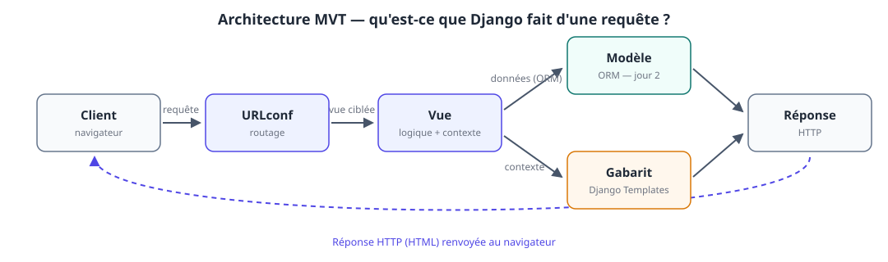
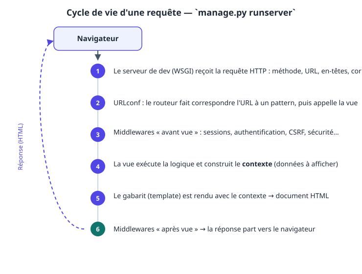
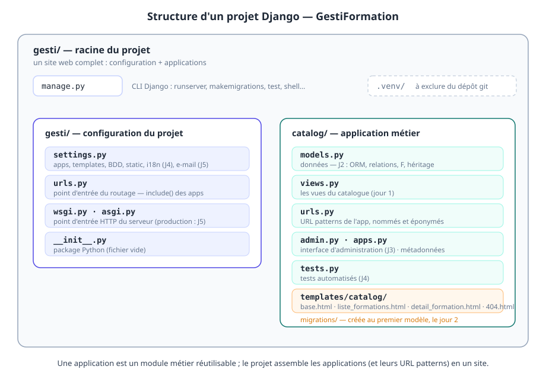

# Jour 1 — Découvrir Django et construire les premières pages de GestiFormation

> **Formation** : Django — initiation & approfondissement (5 jours)
> **Programme de référence** : [Dawan — Django : initiation / approfondissement](https://www.dawan.fr/formations/python/django/django-initiation-approfondissement)
> **Projet fil rouge** : GestiFormation — SaaS de gestion d'organisme de formation
> **Blocs couverts** : 1 (découvrir Django) · 2 (structure d'un site) · 3 (URLs & vues) · 4 (templates)

**Prérequis** : maîtrise de la programmation objet en Python.
**Durée** : 7 h (9h00 – 17h00, pauses comprises).

## Objectifs pédagogiques

À la fin de la journée, les participants sont capables de :

- installer et configurer un environnement de développement Django (venv, dépendances) ;
- décrire l'architecture MVT et le cycle de vie d'une requête HTTP ;
- structurer un projet Django (projet / applications) et comprendre `settings.py` ;
- déclarer des URL patterns (simples, convertisseurs, expressions régulières), nommés et inversables ;
- écrire des vues fonctionnelles qui produisent des réponses HTTP ;
- construire un jeu de pages avec Django Templates : héritage, filtres, balises, fichiers statiques.

### Livrable de la journée

Un site fonctionnel **GestiFormation** avec :

- une page d'accueil, un catalogue de formations et un détail de formation ;
- une page 404 personnalisée ;
- un thème CSS commun via un gabarit de base ;
- un serveur de développement actif avec rechargement automatique.

> 💡 **Choix pédagogique** : les données du catalogue sont des littéraux Python pour le jour 1 (bloc 3 Dawan : « renvoyer du contenu simple »). Le jour 2, les mêmes pages seront branchées sur l'ORM sans changer URL ni gabarits — c'est la meilleure démonstration du découplage MVT.

## Organisation de la journée

| Heure | Séquence | Blocs programme |
|---|---|---|
| 09h00 – 09h15 | Accueil, tour de table, vérification du matériel | — |
| 09h15 – 10h30 | **B1** — Découvrir Django, installation | Bloc 1 |
| 10h30 – 10h45 | Pause | |
| 10h45 – 11h30 | **B2** — Structure d'un site Django | Bloc 2 |
| 11h30 – 13h00 | **B3** — URLs & vues + atelier | Bloc 3 |
| 13h00 – 14h00 | Déjeuner | |
| 14h00 – 16h15 | **B4** — Templates + atelier | Bloc 4 |
| 16h15 – 16h30 | Pause | |
| 16h30 – 17h00 | Démonstrations, synthèse, preview du jour 2 | — |

---

## B1 — Découvrir Django (bloc 1) · 75 min

### 1.1. Qu'est-ce que Django ?

Django est un framework web **Python, open source, « batteries incluses »**, né en 2003 dans la rédaction de *LWN* (Adrian Holovaty, Simon Willison). Son credo : **convention over configuration** — Django choisit pour vous, et documente comment faire déchoixir.

Ce qui est fourni « out of the box » :

| Brique | Rôle | Jour de la formation |
|---|---|---|
| URL router | routage des URL vers les vues | J1 |
| Templates | rendu HTML côté serveur | J1 |
| ORM + migrations | accès aux données, évolution du schéma | J2 |
| Forms / ModelForms | formulaires, validation, anti-CSRF | J2–J3 |
| Admin | interface d'administration auto-générée | J3 |
| Auth | utilisateurs, groupes, permissions, sessions | J3 |
| i18n | traduction des interfaces | J4 |
| E-mails, signals, middlewares | mécanismes avancés | J5 |

**Versions.** Django suit un cycle de sorties annuelles avec une version **LTS** (Long Term Support, support ~4 ans) tous les deux ans.

> 💡 **Règle de formation** : on se forme sur une **LTS**. Ici, **Django 5.2 LTS**. Les stagiaires retrouveront la même logique sur les versions récentes ; la LTS est aussi ce qu'on déconseille en production pour des sites internes.

**Documentation.** `docs.djangoproject.com` est la référence — c'est même l'une des meilleures documentations du monde Python. Habitude à installer dès le jour 1 : **quand on doute, on lit la doc, pas Stack Overflow.**

### 1.2. L'écosystème des frameworks web Python

Le stagiaire développeur Python a déjà croisé Flask ou FastAPI. Situer Django évite le questionnement pendant toute la semaine :

| Framework | Positionnement | Point fort | Quand le choisir |
|---|---|---|---|
| **Django** | complet, prescriptif | ORM, admin, auth, sécurité | applications web complètes (admin, formulaires, comptes) |
| **Flask** | micro-framework, modulaire | légèreté, liberté | petites apps, API internes, protos |
| **FastAPI** | moderne, async, typé | performances, OpenAPI auto | API JSON, microservices, ML |
| **Pyramid** | flexible, indifférent aux briques | longévité, modularité | gros systèmes legacy |
| **Starlette** | micro async | asynchrone pur | bases de FastAPI, API temps réel |

> 💡 Argument à donner : **Django n'est pas « plus lent que Flask » en raison de ses briques — il fait plus de choses**. Pour une app d'administration métier (notre cas), Flask exigerait de réécrire l'admin, l'auth, les forms… c'est-à-dire de réinventer Django.

### 1.3. MVC, MVT : le schéma de fonctionnement

Les stagiaires connaissent MVC (Model-View-Controller). Django s'en inspire mais **renomme les briques** — source classique de confusion.



| MVC (classique) | Django | Contenu |
|---|---|---|
| Model | **Model** | classes Python décrivant les données + ORM |
| Controller | **View** (vue) | fonction/classe qui reçoit la requête, traite, répond |
| View (vue) | **Template** (gabarit) | le document HTML rendu |

Moyen mnémotechnique : **Django View = « le cerveau »**, Template = « la bouche », Model = « la mémoire ». (Et la « vue » du stagiaire, c'est le template — on s'y fait.)

Le cycle de vie détaillé d'une requête sous le serveur de développement :



Points à faire démontrer (pas seulement expliquer) :

- `runserver` est un vrai serveur WSGI minimaliste, **pas** un contournement : la chaîne est identique à la production, moins le serveur applicatif (Gunicorn/uvicorn — J5) ;
- les **middlewares** sont traversés en aller-retour ; on les verra agir concrètement le jour 3 (sessions, auth) et le jour 5 (CORS, compression) ;
- **une requête = une réponse**, aucune mémoire d'une page à l'autre (étatless) : l'état vit dans la session (cookie) et la base — idée centrale à faire absorber.

### 1.4. Installation et environnement

**Matériel type** : Linux/macOS ou Windows (WSL2 recommandé) ; VS Code ou PyCharm.

**Extensions VS Code utiles** (à installer au fil du besoin, pas tout d'un coup) : *Python*, *Pylance*, *Django* (surlignage des tags ``), *Ruff* (lint).

> ⚠️ Piège Windows : utiliser `python` (pas `py`) si un ancien Python 32 bits est dans le PATH ; vérifier `python --version` avant de créer le venv.

### 🛠️ Atelier 1 — Environnement de développement (30 min)

**Consignes** : créer un environnement de travail pour GestiFormation, sans encore créer le projet (ce sera l'atelier du bloc 2).

```bash
# 0. Vérifier Python (≥ 3.11 recommandé)
python --version

# 1. Répertoire de travail
mkdir -p ~/projets/gestiformation && cd ~/projets/gestiformation

# 2. Environnement virtuel
python -m venv .venv

# 3. L'activer
source .venv/bin/activate          # bash / zsh (Linux, macOS)
# .venv\Scripts\activate           # Windows (cmd)
# .venv\Scripts\Activate.ps1       # Windows (PowerShell)

# 4. Installer Django (LTS) et vérifier
pip install "Django>=5.2,<6.0"
django-admin --version             # → Django 5.2.x

# 5. Geler les dépendances (fichier à committer)
pip freeze > requirements.txt

# 6. Hygiène git minimale
git init
printf '.venv/\n__pycache__/\n*.pyc\n.env\n' > .gitignore
git add -A && git commit -m "Bootstrap environnement GestiFormation"
```

**Checklist de fin d'atelier**

- [ ] `django-admin --version` affiche Django 5.2.x **dans le venv actif** ;
- [ ] `requirements.txt` contient Django ;
- [ ] dépôt git initialisé avec `.gitignore` correct ;
- [ ] le stagiaire sait réactiver le venv dans un nouveau terminal.

> ⚠️ Si `django-admin` n'est pas trouvé après activation : le venv n'est pas activé (`which django-admin` doit pointer dans `.venv`).

**Le serveur de développement.** Première rencontre avec `runserver` (on créera le projet juste après) :

```bash
python manage.py runserver
```

À faire démontrer au tableau, **en direct** :

- l'autoreloader : modifier un fichier `.py` → le serveur se redémarre tout seul ;
- `DEBUG=True` : les erreurs s'affichent **dans le navigateur** avec trace complète — un luxe de développement, jamais en production ;
- `ALLOWED_HOSTS` : le serveur refuse les hôtes inconnus, même en dev (l'erreur est explicite, elle servira d'exemple) ;
- l'URL `http://127.0.0.1:8000/` : le serveur répond `DisallowedHost` ou une page vide selon le projet — normal, aucune URL n'est encore déclarée.

> 💡 **Réflexe pro à installer** : `Ctrl+C` arrête le serveur proprement. `runserver` n'est **jamais** un serveur de production (limité à un thread, `DEBUG` ouvert, pas de sécurité durcie). Nous en reparlerons le jour 5.

**Autres commandes à faire connaître** (la CLI `manage.py` est la porte d'entrée de Django) :

| Commande | Effet |
|---|---|
| `python manage.py check` | vérifie la cohérence du projet (à lancer **après chaque changement de settings**) |
| `python manage.py showurls` (via `django-extensions`) | liste les URL patterns actives |
| `python manage.py shell` | shell Python préchargé du projet (parfait pour expérimenter) |
| `python manage.py test` | lanceur de tests (jour 4) |
| `pip install django-extensions` | boîtes à outils très utile en dev (`show_urls`, `shell_plus`…) |
| `pip install django-debug-toolbar` | interface de debug dans le navigateur (barre latérale avec requêtes SQL, temps de réponse, etc.) |


> 💡 Optionnel mais apprécié : `pip install django-extensions` puis ajouter `"django_extensions"` dans `INSTALLED_APPS`. La commande `show_urls` (liste des URLs + vues) devient un réflexe de debug.

---

## B2 — Structure d'un site Django (bloc 2) · 45 min

### 2.1. Projet ≠ application

La distinction qui structure tout Django, et tout notre support :

- **un projet** = un site web complet : configuration (`settings.py`), racine du routage, point d'entrée WSGI/ASGI. C'est le *contenant*.
- **une application (app)** = un module métier **réutilisable** : modèles, vues, gabarits, admin, tests sur **un seul domaine**. C'est la *brique*.

> 💡 Exemple à donner : l'app `catalog` du GestiFormation pourrait, théoriquement, être branchée dans le site d'une autre boîte qui vend aussi des formations. C'est le test de réutilisabilité : **une app ne connaît pas le projet, le projet connaît les apps.**

Pour GestiFormation, prévoyons dès aujourd'hui **deux apps** (la seconde naîtra le jour 2) :

| App | Domaine | Jour |
|---|---|---|
| `catalog` | formations, sessions, compétences | J1–J2 |
| `inscriptions` | inscriptions, factures, documents | J2–J3 |

### 2.2. Anatomie du projet



**`manage.py`** — point d'entrée CLI du projet. Tout passe par `python manage.py <commande>`.

**`settings.py`** — le tableau de bord du site. Les éléments que nous toucherons pendant la semaine :

| Clé | Rôle | Jour |
|---|---|---|
| `SECRET_KEY` | signe cookies, sessions, tokens — **jamais** dans le git | J1 (notion) |
| `DEBUG` | mode développement (erreurs dans le navigateur) | J1 |
| `ALLOWED_HOSTS` | hôtes autorisés | J1 (notion), J5 (production) |
| `INSTALLED_APPS` | les apps du site (les nôtres **et** les apps Django) | J1 |
| `MIDDLEWARE` | la chaîne de middlewares | J1 (notion), J3–J5 (pratique) |
| `TEMPLATES` | moteur de gabarits, `APP_DIRS=True` = chercher dans `<app>/templates/` | J1 |
| `STATIC_URL` | préfixe des fichiers statiques | J1 |
| `DATABASES` | base (SQLite par défaut — parfait pour la semaine) | J2 |
| `DEFAULT_AUTO_FIELD` | type des PK auto-incrémentées | J2 |
| `LANGUAGE_CODE` / `USE_I18N` | langue, traduction | J4 |
| `EMAIL_BACKEND` / `EMAIL_HOST` | envoi de mails | J5 |
| `STATICFILES_STORAGE` | service des statics en prod | J5 |

**`urls.py` (du projet)** — racine du routage ; on y greffe les apps avec `include()`.
**`wsgi.py` / `asgi.py`** — le point d'entrée que le serveur applicatif (Gunicorn, uvicorn…) appelle en production. Le `runserver` fait la même chose en dev.

### 🛠️ Atelier 2 — Créer le projet et l'app `catalog` (20 min)

```bash
# dans ~/projets/gestiformation, venv activé
django-admin startproject gesti .     # package « gesti », racine du repo
python manage.py startapp catalog     # application métier
python manage.py check                # → System check identified no issues (0 silenced)
```

Puis, dans `gesti/settings.py`, déclarer l'app :

```python
INSTALLED_APPS = [
    'django.contrib.admin',
    'django.contrib.auth',
    'django.contrib.contenttypes',
    'django.contrib.sessions',
    'django.contrib.messages',
    'django.contrib.staticfiles',
    # --- nos applications métier (ordre peu important, lisibilité oui) ---
    'catalog.apps.CatalogConfig',
    # outils de développement
    'django_extensions',
    'debug_toolbar',
]
```

Vérifier, puis lancer le serveur et ouvrir `http://127.0.0.1:8000/` :

```bash
python manage.py check
python manage.py runserver
```

> ⚠️ **Piège classique n°1** : app oubliée dans `INSTALLED_APPS` → `ImproperlyConfigured` ou gabarits introuvables, sans message explicite. Réflexe : après tout ajout de configuration, `python manage.py check`.

> 💡 `startapp` crée un squelette (`apps.py`, `models.py`, `views.py`, `urls.py`, `tests.py`, `admin.py`). C'est **du code Python standard** — les stagiaires peuvent l'ouvrir, l'expliquer entre eux avant qu'on le fasse.

---

## B3 — URLs et vues (bloc 3) · 90 min

### 3.1. Le routeur : URL patterns

Une **URLconf** est une liste ordonnée de `(pattern, vue)` : Django parcourt la liste et **la première correspondance gagne**.

Trois styles de pattern, tous au programme Dawan (« simples et par expressions régulières ») :

```python
???
```

**Point clé — les convertisseurs :**

| Pattern | Accepte | Exemple qui passe |
|---|---|---|
| `<pk>` | toute chaîne (sauf `/`) | `42`, `abc`, `4a` |
| `<int:pk>` | entiers seulement | `42` |
| `<slug:pk>` | caractères alphanum. + `-` + `_` | `django-initiation` |
| `<uuid:pk>` | UUID canonique | `9f86d081-…` |
| `<str:pk>` | n'importe quoi, même `/` | ⚠️ rarement voulu |

> ⚠️ **Piège classique n°2** : l'ordre des patterns. `path('formations/<pk>/', …)` placé **avant** `path('formations/nouveautes/', …)` avalera l'URL « nouveautés » avec `pk='nouveautes'`. Règle : **du plus spécifique au plus générique**.

**Éponymie (namespace).** `app_name = 'catalog'` + `name='…'` sur chaque pattern → les URLs de l'app sont adressées partout comme `catalog:detail-formation`. Bénéfices immédiats :

- on peut renommer l'URL **sans casser le code** (les gabarits et vues utilisent le nom, jamais le chemin) ;
- deux apps peuvent avoir un pattern du même `name` sans collision ;
- `python manage.py show_urls` (via `django-extensions`) liste les patterns nommés — indispensable en debug.

### 3.2. Les URLs du projet (racine)

```python
????
```
> 💡 `include()` : permet d'inclure les patterns d'une app EXTERNE dans le routeur du projet.
> 💡 `include()` : on ne « monte » que la préfixe. Les patterns de `catalog/urls.py` vivent sous `''` ici — mais si on incluait sous `path('fr/', include('catalog.urls'))`, tout le catalogue basculerait sous `/fr/…` **sans toucher à une seule URL de l'app**. C'est l'une des plus belles propriétés du découpage apps/projets.

### 3.3. Les vues fonctionnelles

Une **vue** est une fonction Python `(request, *args, **kwargs) → réponse HTTP`.

```python
????
```

**L'objet `request`** — ce qu'on y trouve (le stagiaire peut l'inspecter dans le shell ou dans une vue de debug) :

| Attribut | Contenu |
|---|---|
| `request.method` | `'GET'`, `'POST'`, … |
| `request.path` | l'URL normalisée (sans la query string) |
| `request.GET` | dictionnaire-like de la query string |
| `request.POST` | dictionnaire-like du corps POST (formulaires — J2) |
| `request.headers` | en-têtes HTTP (`User-Agent`, `Referer`, …) |
| `request.META` | variables d'environnement du serveur (`REMOTE_ADDR`, …) |
| `request.user` | l'utilisateur courant (J3 — `AnonymousUser` tant que non connecté) |

**La réponse** — les trois types que nous croiserons cette semaine :

| Type | Usage |
|---|---|
| `HttpResponse(html, content_type=…, status=…)` | réponse brute |
| `JsonResponse(obj)` | réponse JSON (jour 5, API) |
| `render(request, template, context)` | **le** raccourci le plus utilisé : gabarit + contexte + request |

> ⚠️ Toujours passer `request` à `render()` — c'est ce qui permet aux middlewares (CSRF, messages) de fonctionner dans le gabarit.

**HTTP en 5 minutes** (à projeter pendant l'atelier, pas avant) :

| Élément | Valeurs utiles ici |
|---|---|
| Méthodes | `GET` (lecture), `POST` (création/mutation), `PUT` (remplacement), `DELETE` |
| Codes | `200` OK · `301/302` redirection · `404` introuvable · `400` requête invalide · `500` erreur serveur |
| En-têtes | `Content-Type`, `Location` (redirect), `Set-Cookie` (sessions) |

### 🛠️ Atelier 3 — Vues du catalogue (45 min)

**Consignes** : faire marcher les 3 vues avec les données littérales ci-dessus. On ne construit **pas encore** les gabarits (bloc 4) — pour vérifier, utiliser `HttpResponse` brut sur la liste :

```python
?????
```

**Progression attendue** :

1. `accueil` → `HttpResponse` brut → ouvrir `http://127.0.0.1:8000/` ;
2. ajouter `liste_formations` + son pattern → `http://127.0.0.1:8000/formations/` ;
3. ajouter `detail_formation` + son pattern avec `<int:pk>` → `http://127.0.0.1:8000/formations/2/` ;
4. taper `http://127.0.0.1:8000/formations/99/` → **la page 500 brute** de Django (pas la nôtre — c'est normal, les gabarits n'existent pas encore) ;
5. tester le pattern regex (`/formations/12345/` → 404, car `[0-9]{1,4}`).

**Checklist**

- [ ] `python manage.py check` → 0 issue ;
- [ ] `http://127.0.0.1:8000/` → page d'accueil ;
- [ ] `http://127.0.0.1:8000/formations/` → liste HTML brute ;
- [ ] `http://127.0.0.1:8000/formations/1/` et `/2/` → détail ;
- [ ] `http://127.0.0.1:8000/formations/99/` → 404 ;
- [ ] le stagiaire peut expliquer pourquoi `pk` arrive dans `detail_formation` (le pattern le capture, le routeur le passe en `**kwargs`).

> ⚠️ **Piège classique n°3** : `formations/<int:pk>/` sans barre finale → l'utilisateur tape `http://…/formations` (sans `/`) → **404 au lieu de redirection**. C'est le rôle de `APPEND_SLASH = True` (défaut Django) de corriger automatiquement ; comprendre le mécanisme évite 90 % des « pourquoi ça marche sur une URL mais pas sur l'autre ».

> 💡 **Vérification du découplage URL** : demander à un binôme de changer l'URL publique de `detail-formation` (ex. `path('formations/<int:pk>/', …)` → `path('catalogue/<int:pk>/', …)`) — **le code des vues ne change pas d'une ligne**. C'est l'effet de l'éponymie.

---

## B4 — Templates (bloc 4) · 135 min

### 4.1. Pourquoi des gabarits ?

Séparer la **logique** (les vues) du **préésentationnel** (le HTML). Concrètement :

- le designer peut toucher au HTML sans toucher au Python ;
- la vue peut évoluer (ORM, API, cache) sans toucher au HTML ;
- le HTML est **reusable** : un `<template>` de « carte formation » sert dans la liste, le détail, un e-mail (J5).

Le moteur Django (configuré dans `TEMPLATES`, `APP_DIRS=True`) cherche les gabarits **dans chaque app installée** sous `<app>/templates/<app>/`. C'est ce qui nous donne automatiquement `catalog/templates/catalog/*.html` sans configuration.

> 💡 **`DIRS` vs `APP_DIRS`** : `DIRS` = chemins absolus **du projet** (partageables entre apps) ; `APP_DIRS` = `templates/<app>/` **dans chaque app**. Pour GestiFormation, on n'utilise que `APP_DIRS` : chaque app est autonome.

> ⚠️ **Conséquence directe — comment on nomme les gabarits** : avec `APP_DIRS`, un gabarit est référencé **relativement au dossier `templates/` de l'app**, donc avec le préfixe du sous-dossier. Le fichier `catalog/templates/catalog/base.html` s'appelle `catalog/base.html` — dans `render()` **et** dans ``. Écrire `` provoque un `TemplateDoesNotExist` (Django cherche `catalog/templates/base.html`). C'est l'erreur n°1 des stagiaires en templates ; le règle d'or : **le nom du gabarit = son chemin après `templates/`**.

### 4.2. Le contexte et l'expression

`render(request, template, context)` passe un **dictionnaire** au gabarit. Dans le gabarit, on lit les clés avec `{{ nom_de_clé }}`.

La résolution du point (`.`) dans les expressions suit un ordre précis :

1. **clé de dictionnaire** : `{{ formation.code }}` si `formation` est un dict ;
2. **attribut** : `{{ formation.nom }}` si c'est une instance ;
3. **méthode sans argument** : `{{ now }}` → `now()` ;
4. **index de liste** : `{{ formations.0.nom }}` (astuce peu connue, très utile en debug).

> ⚠️ **Piège classique n°4** : `{{ ma_variable }}` n'affiche **rien** (ni `None`, ni `''`) si la variable n'existe pas dans le contexte. Django **ne lève jamais d'exception** sur un contexte manquant (sauf `string_if_invalid`). Réflexe debug : vérifier le `context` passé par la vue avant de suspecter le gabarit.

### 4.3. Filtres — les plus utiles de la semaine

Syntaxe : `{{ valeur|filtre }}`, chaînables `{{ v|f1|f2 }}`.

| Filtre | Effet | Exemple GestiFormation |
|---|---|---|
| `upper` / `lower` / `title` | casse | `{{ formation.code|upper }}` |
| `length` | longueur (str, liste, dict) | `{{ formations|length }} formations` |
| `first` / `last` | premier / dernier élément | `{{ competences|first }}` |
| `floatformat:2` | format décimal | `{{ formation.prix|floatformat:2 }} €` |
| `date:"d/m/Y"` | format date | `{{ session.debut|date:"d/m/Y" }}` |
| `time:"H:i"` | format heure | `{{ session.heure_debut|time:"H:i" }}` |
| `default:"txt"` | valeur par défaut | `{{ formation.public|default:"Tous publics" }}` |
| `join:", "` | jointure de liste | `{{ competences|join:", " }}` |
| `slice:":3"` | tranche de liste | `{{ formations|slice:":3" }}` (3 premières) |
| `get_item:"cle"` (Django 5+) | accès à une clé dans un dict | `{{ meta|get_item:"ville" }}` |
| `linebreaks` | texte → HTML (paragraphes) | `{{ formation.resume|linebreaks }}` |
| `safe` | **ne pas échapper** le HTML | `{{ html_brut|safe }}` ⚠️ danger XSS |
| `escape` | échapper (défaut implicite) | `{{ texte|escape }}` |

> ⚠️ **Sécurité par défaut** : Django **échappe automatiquement** tout ce qui passe dans `{{ }}` (protection XSS). `|safe` désactive cette protection — ne l'utiliser **que** sur du HTML qu'on a soi-même produit (pas du contenu utilisateur).

### 4.4. Balises — le jeu de construction

| Balise | Usage |
|---|---|
| ` /  /  / ` | conditions |
| ` …  … ` | boucles ; `` si séquence vide |
| `` | héritage (gabarit parent) |
| ` … ` | emplacement surchargeable |
| `` | inclure le contenu du block parent |
| `` | insérer un sous-gabarit (avec contexte courant) |
| `` | URL inversée (toujours, jamais de URL en dur) |
| `` puis `` | URL des fichiers statiques |
| `` | date du jour au rendu |
| `` | token anti-CSRF — **obligatoire** sur chaque `<form method="post">` (J2–J3) |
| `` | test d'authentification (J3) |

**`forloop`** — variables disponibles dans `` :

| Variable | Valeur |
|---|---|
| `forloop.counter` | index 1-based |
| `forloop.counter0` | index 0-based |
| `forloop.revcounter` | depuis la fin |
| `forloop.first` / `forloop.last` | booléen |
| `forloop.parentloop` | boucle parente (boucles imbriquées) |

### 4.5. Héritage de gabarits — le cœur du bloc 4

Le pattern : **un gabarit de base** (layout, nav, footer, CSS) + **des gabarits enfants** qui n'écrivent que leur contenu.

```
catalog/templates/catalog/
├── base.html              ← layout global (héritage)
├── liste_formations.html  ← 
├── detail_formation.html  ← 
├── 404.html               ← page d'erreur (hérite aussi de catalog/base.html)
└── 500.html               ← erreur interne (visible en prod seulement)
```

> 💡 **Conseil formateur** : faire écrire `base.html` **en dernier** (après liste + détail), pas en premier. Les stagiaires découvrent l'héritage quand ils ont **besoin** de dédupliquer, pas avant — l'abstraction arrive après la duplication, pas l'inverse.

### 4.6. Fichiers statiques

`STATIC_URL = 'static/'` (défaut). Les fichiers sont servis par `runserver` en dev (via `django.contrib.staticfiles`).

> ⚠️ **Piège classique n°5** : oublier `` dans le gabarit qui utilise `` → la balise est inconnue, l'URL est rendue littérale (`` affiché tel quel dans le HTML).

**Production (jour 5)** : `runserver` **ne sert pas** les statics quand `DEBUG=False`. On utilisera **WhiteNoise** (middleware, `STATICFILES_STORAGE`) ou un CDN — à préparer le jour 5.

### 🛠️ Atelier 4 — Construire l'interface (75 min)

**Consignes** : créer les gabarits et le CSS qui rendent les 3 pages + la 404.

---

#### 4.6.1 — `catalog/templates/catalog/base.html`

```html
<!DOCTYPE html>
<html lang="fr">
<head>
    <meta charset="utf-8">
    <meta name="viewport" content="width=device-width, initial-scale=1">
    <title>GestiFormation</title>
    <link rel="stylesheet" href="">
</head>
<body>
    <header class="entete">
        <nav class="nav">
            <a class="logo" href="">GestiFormation</a>
            <ul>
                <li><a href="">Catalogue</a></li>
                <li>???? — <a href="#">Déconnexion</a></li>
                <li><a href="#">Connexion</a></li>
            </ul>
        </nav>
    </header>

    <main class="contenu">
        
    </main>

    <footer class="pied">
        <p>??? — GestiFormation, site de démonstration</p>
    </footer>
</body>
</html>
```

> 💡 Le block `titre` est surchargé par chaque page — c'est l'exemple minimal d'héritage utile (au-delà de ``).

---

#### 4.6.2 — `catalog/templates/catalog/liste_formations.html`

```html
<section class="catalogue">
    <h1>Catalogue des formations</h1>
    <p class="chiffre">xxx formations au catalogue.</p>

    <table class="tableau">
        <thead>
            <tr>
                <th>#</th>
                <th>Code</th>
                <th>Intitulé</th>
                <th>Public</th>
                <th>Durée</th>
                <th class="prix-col">Tarif HT</th>
            </tr>
        </thead>
        <tbody>
            <tr>
                <td>n</td>
                <td><code></code></td>
                <td>
                    <a class="lien-nom"
                       href="">
                    </a>
                    <span class="badge badge-nouveau">Nouveau</span>
                </td>
                <td></td>
                <td>
                    x jours
                </td>
                <td class="prix-col"></td>
            </tr>
            <tr><td colspan="6" class="vide">Aucune formation publiée pour le moment.</td></tr>
        </tbody>
    </table>
</section>
```

> ⚠️ **Piège** : `forloop.counter0` (0-based) pour l'index dans l'URL, `forloop.counter` (1-based) pour l'affichage. Les mélanger décale toutes les URLs d'un cran.

> 💡 **Le ``** est la clause « liste vide » du `` — à utiliser systématiquement, c'est le reflet du `try/except` Python.

---

#### 4.6.3 — `catalog/templates/catalog/detail_formation.html`

```html
<article class="formation">
    <p class="retour"><a href="">&larr; Retour au catalogue</a></p>

    <header class="entete-formation">
        <h1>title</h1>
        <span class="badge badge-nouveau">Nouveau</span>
    </header>

    <dl class="fiche">
        <dt>Code</dt>       <dd><code>code</code></dd>
        <dt>Public</dt>      <dd>code</dd>
        <dt>Durée</dt>       <dd>n jours — 7 h/jour</dd>
        <dt>Tarif</dt>       <dd class="tarif">tarif € HT</dd>
    </dl>

    <section class="objectifs">
        <h2>Objectifs pédagogiques</h2>
        <ul>
            <li>Modéliser et développer une application web complète avec Django ;</li>
            <li>Maîtriser le cycle MVT, l'ORM, les formulaires et l'admin ;</li>
            <li>Préparer le déploiement d'une application en production.</li>
        </ul>
    </section>

    <section class="competences">
        <h2>Compétences visées</h2>
        <p>
                <span class="competence">competence</span>
        </p>
    </section>

    <footer class="action">
        <!-- J2 : formulaire d'inscription (ModelForm) -->
        <a class="btn" href="#">S'inscrire à cette formation</a>
    </footer>
</article>
```

> 💡 **À faire remarquer** : `formation.competences` n'existe pas encore dans les données littérales — Django affiche **rien** (pas d'erreur). Ajouter `'competences': ['ORM', 'MVT', 'Templates']` à l'une des formations pour voir la boucle fonctionner.

---

#### 4.6.4 — `catalog/templates/catalog/404.html`

```html
<div class="erreur">
    <h1>404 — page introuvable</h1>
    <p>La page demandée n'existe pas ou a été déplacée.</p>
    <a class="btn" href="">Retour à l'accueil</a>
</div>
```

> 💡 **À faire démontrer** : taper `http://127.0.0.1:8000/une-url-inexistante/` → **notre** page 404 (pas celle de Django), car `handler404` est déclaré dans `gesti/urls.py`.

---

#### 4.6.5 — `catalog/templates/catalog/500.html`

```html
<div class="erreur">
    <h1>500 — erreur interne</h1>
    <p>Une erreur est survenue côté serveur. L'équipe a été prévenue.</p>
    <a class="btn" href="">Retour à l'accueil</a>
</div>
```

> ⚠️ **Deux particularités à faire connaître** :
> 1. `handler500` impose une signature **`def interne(request):`** — sans `exception` (vérifié par `manage.py check`, erreur `urls.E007` si on s'y trompe) ;
> 2. la page 500 personnalisée n'est affichée qu'en **production** (`DEBUG=False`) : avec `DEBUG=True`, Django affiche sa page d'erreur détaillée. On peut donc la créer sans pouvoir la « voir » au bureau.

---

#### 4.6.6 — `catalog/static/css/base.css`

```css
:root {
    --fond: #f8fafc;
    --encre: #1f2937;
    --encre-douce: #6b7280;
    --primaire: #4f46e5;
    --primaire-fonce: #3730a3;
    --bordure: #e2e8f0;
    --blanc: #ffffff;
    --succes: #0f766e;
    --alerte: #d97706;
}

* { box-sizing: border-box; }

body {
    margin: 0;
    font-family: system-ui, -apple-system, "Segoe UI", sans-serif;
    color: var(--encre);
    background: var(--fond);
    line-height: 1.6;
}

/* ————— En-tête ————— */
.entete {
    background: var(--primaire);
    color: var(--blanc);
    padding: 0.75rem 1.5rem;
}
.nav {
    display: flex;
    align-items: center;
    justify-content: space-between;
    max-width: 1100px;
    margin: 0 auto;
}
.logo {
    font-weight: 700;
    font-size: 1.15rem;
    color: var(--blanc);
    text-decoration: none;
}
.nav ul {
    display: flex;
    gap: 1.25rem;
    list-style: none;
    margin: 0;
    padding: 0;
}
.nav a { color: var(--blanc); text-decoration: none; opacity: 0.9; }
.nav a:hover { opacity: 1; text-decoration: underline; }

/* ————— Contenu ————— */
.contenu {
    max-width: 1100px;
    margin: 2rem auto;
    padding: 0 1.5rem;
}
h1 { font-size: 1.75rem; margin-bottom: 0.5rem; }
h2 { font-size: 1.25rem; margin-top: 2rem; }
.chiffre { color: var(--encre-douce); margin-bottom: 1.5rem; }

/* ————— Tableau ————— */
.tableau {
    width: 100%;
    border-collapse: collapse;
    background: var(--blanc);
    border: 1px solid var(--bordure);
    border-radius: 8px;
    overflow: hidden;
}
.tableau th, .tableau td {
    padding: 0.65rem 0.9rem;
    text-align: left;
    border-bottom: 1px solid var(--bordure);
}
.tableau th {
    background: #eef2ff;
    font-weight: 600;
    font-size: 0.85rem;
    text-transform: uppercase;
    letter-spacing: 0.03em;
    color: var(--encre-douce);
}
.tableau tr:last-child td { border-bottom: none; }
.tableau tr:hover td { background: #f1f5f9; }
.prix-col { font-variant-numeric: tabular-nums; text-align: right; }
.vide { text-align: center; color: var(--encre-douce); padding: 2rem; }

/* ————— Liens & badges ————— */
.lien-nom { font-weight: 600; color: var(--primaire); text-decoration: none; }
.lien-nom:hover { text-decoration: underline; }
code {
    background: #eef2ff;
    padding: 0.1em 0.35em;
    border-radius: 4px;
    font-size: 0.9em;
}
.badge {
    display: inline-block;
    font-size: 0.7rem;
    font-weight: 700;
    padding: 0.15em 0.5em;
    border-radius: 999px;
    vertical-align: middle;
    margin-left: 0.4rem;
}
.badge-nouveau { background: #d1fae5; color: var(--succes); }

/* ————— Fiche détail ————— */
.retour { margin-bottom: 1rem; }
.retour a { color: var(--encre-douce); text-decoration: none; }
.retour a:hover { color: var(--primaire); }
.entete-formation { display: flex; align-items: center; gap: 0.75rem; flex-wrap: wrap; }
.fiche {
    display: grid;
    grid-template-columns: repeat(auto-fit, minmax(180px, 1fr));
    gap: 1rem;
    background: var(--blanc);
    border: 1px solid var(--bordure);
    border-radius: 8px;
    padding: 1.25rem;
    margin: 1.5rem 0;
}
.fiche dt {
    font-size: 0.75rem;
    font-weight: 600;
    text-transform: uppercase;
    letter-spacing: 0.05em;
    color: var(--encre-douce);
    margin-bottom: 0.2rem;
}
.fiche dd { margin: 0; font-size: 1rem; }
.tarif { font-size: 1.3rem; font-weight: 700; color: var(--primaire); }

/* ————— Compétences ————— */
.competence {
    display: inline-block;
    background: #eef2ff;
    color: var(--primaire-fonce);
    padding: 0.25em 0.7em;
    border-radius: 6px;
    font-size: 0.88rem;
    margin: 0.15rem 0.1rem;
}

/* ————— Bouton ————— */
.btn {
    display: inline-block;
    background: var(--primaire);
    color: var(--blanc);
    padding: 0.7rem 1.6rem;
    border-radius: 8px;
    text-decoration: none;
    font-weight: 600;
    transition: background 0.15s;
}
.btn:hover { background: var(--primaire-fonce); }

/* ————— Erreur 404 ————— */
.erreur { text-align: center; padding: 4rem 1rem; }
.erreur h1 { font-size: 3rem; color: var(--primaire); }
.erreur a { margin-top: 1.5rem; }

/* ————— Pied de page ————— */
.pied {
    text-align: center;
    color: var(--encre-douce);
    font-size: 0.85rem;
    padding: 1.5rem;
    border-top: 1px solid var(--bordure);
    margin-top: 3rem;
}
```

> ⚠️ **Piège** : le dossier s'appelle **`static`** (pas `css/` ou `assets/`) et est **à la racine de l'app** (`catalog/static/css/base.css`), pas dans `templates/`.

**Checklist de fin d'atelier**

- [ ] `http://127.0.0.1:8000/` → page d'accueil stylée (en-tête, pied, CSS chargés) ;
- [ ] `http://127.0.0.1:8000/formations/` → tableau avec badge « Nouveau » sur la formation 3 ;
- [ ] `http://127.0.0.1:8000/formations/3/` → fiche détaillée, lien retour fonctionnel ;
- [ ] `http://127.0.0.1:8000/inexistante/` → **notre** page 404 (pas celle de Django) ;
- [ ] le stagiaire peut expliquer : pourquoi `` et non une URL en dur ;
- [ ] le stagiaire peut identifier 3 filtres utilisés et leur effet ;
- [ ] `git add -A && git commit -m "J1 : site GestiFormation — 3 pages, thème, 404"` fait.

---

## Synthèse de fin de journée

### Ce qui est en place

```
~/projets/gestiformation/
├── .venv/                     # venv actif
├── .gitignore                 # .venv/, __pycache__/, .env
├── requirements.txt           # Django 5.2.x
├── manage.py
├── gesti/
│   ├── __init__.py
│   ├── settings.py            # INSTALLED_APPS += catalog
│   ├── urls.py                # /admin/, / → catalog, handler404/500
│   ├── asgi.py
│   └── wsgi.py
└── catalog/
    ├── __init__.py
    ├── apps.py
    ├── models.py              # vide — rempli le jour 2
    ├── views.py               # accueil, liste, detail, 404, 500
    ├── urls.py                # 5 patterns nommés (dont 1 regex)
    ├── admin.py               # vide — jour 3
    ├── tests.py               # vide — jour 4
    ├── static/css/base.css
    └── templates/catalog/
        ├── base.html
        ├── liste_formations.html
        ├── detail_formation.html
        ├── 404.html
        └── 500.html
```

### Les réflexes installés

| Réflexe | Pourquoi |
|---|---|
| `python manage.py check` après chaque changement de settings | détecte les incohérences sans lancer le serveur |
| `` et jamais d'URL en dur dans le HTML | renommer une URL ne casse rien |
| `python manage.py show_urls` (django-extensions) | debug routage en 2 secondes |
| `` dans tout gabarit qui utilise `` | évite l'URL littérale |
| `|floatformat:2` pour les montants, `|default:"…"`` pour les optionnels | affichage soigné sans `if` dans la vue |
| Commit git à chaque étape fonctionnelle | l'historique raconte l'avancement du projet |

### Pièges vus aujourd'hui (à récapituler oralement)

1. App oubliée dans `INSTALLED_APPS` → `ImproperlyConfigured` flou ;
2. Ordre des patterns : le plus spécifique **avant** le plus générique ;
3. `forloop.counter` (1-based) vs `forloop.counter0` (0-based) ;
4. `` oublié → URL littérale dans le HTML ;
5. `{{ variable }}` n'affiche rien si absente du contexte (pas d'exception) ;
6. `|safe` désactive l'échappement XSS — ne pas utiliser sur du contenu utilisateur ;
7. `` alors que le gabarit est dans `catalog/templates/catalog/` → `TemplateDoesNotExist` : le nom = le chemin après `templates/` (`catalog/base.html`) ;
8. page 404 « qui ne marche pas » : avec `DEBUG=True`, Django affiche sa page de debug et **ignore `handler404`** — à vérifier avec `DEBUG=False`.

### Preview du jour 2 — blocs 5 & 6

Le jour 2, les données littérales de `catalog/views.py` disparaissent au profit de l'ORM :

- définition des modèles `Formation`, `Session`, `Client` (relations `ForeignKey`, `ManyToMany`) ;
- `makemigrations` / `migrate` — la base SQLite est créée et peuplée ;
- remplacement des listes Python par des requêtes ORM (`select_related`, `prefetch_related`) ;
- introduction de **F objects** (trier les sessions par capacité restante) et **héritage de modèle** (Document → Contrat) ;
- premiers **forms** (validation côté serveur) en amont des ModelForms du jour 3.

> 💡 **Message de clôture** : « Les 3 pages que vous voyez ne changeront **ni d'URL, ni de gabarit** quand on branchera l'ORM. C'est exactement le découplage que Django promettait. »

---

## Annexe — Commandes du jour (cheat-sheet)

```bash
# Environnement
python -m venv .venv && source .venv/bin/activate
pip install "Django>=5.2,<6.0" django-extensions
pip freeze > requirements.txt

# Projet & app
django-admin startproject gesti .
python manage.py startapp catalog

# Serveur & debug
python manage.py check
python manage.py runserver
python manage.py runserver 0.0.0.0:8000   # accessible depuis le réseau local
python manage.py shell                     # shell préchargé du projet

# Git
git init && git add -A && git commit -m "Bootstrap"
git add -A && git commit -m "J1 : site GestiFormation"
```
