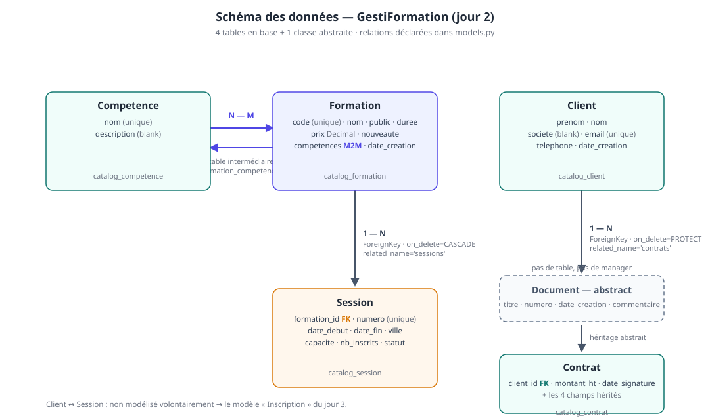
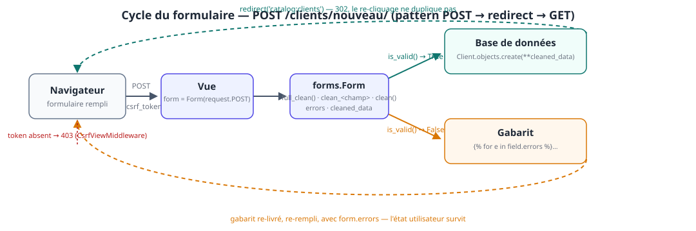

# Jour 2 — De la donnée en mémoire à la donnée en base : ORM, migrations, formulaires

> **Formation** : Django — initiation & approfondissement (5 jours)
> **Programme de référence** : [Dawan — Django : initiation / approfondissement](https://www.dawan.fr/formations/python/django/django-initiation-approfondissement)
> **Projet fil rouge** : GestiFormation — SaaS de gestion d'organisme de formation
> **Blocs couverts** : 5 (ORM : modèles, relations, F objects, héritage) · 6 (formulaires : validation côté serveur)

**Prérequis** : jour 1 validé (projet `gesti`, app `catalog`, 3 pages, serveur de dev).
**Durée** : 7 h (9h00 – 17h00, pauses comprises).

## Objectifs pédagogiques

À la fin de la journée, les participants sont capables de :

- définir des modèles Django : champs, types, contraintes, relations (`ForeignKey`, `ManyToManyField`) ;
- générer, lire et appliquer des **migrations** (`makemigrations`, `migrate`, `sqlmigrate`) ;
- écrire des requêtes **ORM** : filtrage, tri, agrégats, **F objects** ;
- identifier et corriger un **N+1** avec `select_related` / `prefetch_related` ;
- comprendre l'**héritage de modèle** abstrait (Document → Contrat) ;
- refactoriser les vues du jour 1 — **mêmes URLs, mêmes gabarits** — au profit de l'ORM ;
- écrire un formulaire `forms.Form` **validé côté serveur** : `is_valid()`, `errors`, `cleaned_data`, `clean_<champ>`, CSRF.

### Livrable de la journée

- 5 modèles : `Competence`, `Formation`, `Session`, `Client`, `Contrat` (héritage) ;
- migrations appliquées + base SQLite peuplée via un script de seed ;
- pages catalogue et détail branchées sur l'ORM (la fiche détail gagne ses **sessions à venir**) ;
- formulaire « Nouveau client » validé côté serveur + page liste des clients avec recherche ;
- les 3 pages du jour 1 toujours accessibles, avec **les mêmes URLs**.

> 💡 **Fil conducteur** : le découplage MVT du jour 1 paie aujourd'hui. Les vues changent de « moteur » (littéraux Python → ORM) ; les URLs et l'essentiel des gabarits ne bougent pas. On ne « réécrit » pas le site, on le **rebranche**.

## Organisation de la journée

| Heure | Séquence | Blocs programme |
|---|---|---|
| 09h00 – 09h15 | Reprise du J1, `check` + serveur + commit | — |
| 09h15 – 10h45 | **B5·a** — Modèles & migrations | Bloc 5 |
| 10h45 – 11h00 | Pause | |
| 11h00 – 12h45 | **B5·b** — ORM : requêtes, relations, F objects, optimisation | Bloc 5 |
| 12h45 – 13h45 | Déjeuner | |
| 13h45 – 14h15 | **B5·c** — Héritage de modèle (Document → Contrat) | Bloc 5 |
| 14h15 – 16h15 | **B6** — Formulaires + atelier « Nouveau client » | Bloc 6 |
| 16h15 – 16h30 | Pause | |
| 16h30 – 17h00 | Démonstrations, synthèse, preview du jour 3 | — |

---

## B5 — ORM : de la table à l'objet (bloc 5)

### 5.1. Du littéral à la base de données

Au jour 1, `catalog/views.py` contenait :

```python
FORMATIONS = [
    {'code': 'PY-101', 'nom': 'Django : initiation', 'prix': 1890.0, …},
    …
]
```

Trois limites, toutes rédhibitoires dès qu'il y a un deuxième utilisateur :

| Limite du littéral | Ce que la base apporte |
|---|---|
| tout est **perdu au redémarrage** du serveur | persistance (fichier `db.sqlite3`) |
| une seule « source de vérité » en mémoire, impossible d'ajouter sans code | écriture par un admin, un import, un autre service |
| aucune **intégrité** (rien n'empêche deux `code` identiques) | contraintes (`unique`, `NOT NULL`, clés étrangères) |

L'**ORM** (Object-Relational Mapping) de Django traduit des expressions Python en requêtes SQL, sans qu'on écrive de SQL :

| En SQL (mental) | En Python (Django) |
|---|---|
| `SELECT * FROM formation WHERE nouveaute = 1` | `Formation.objects.filter(nouveaute=True)` |
| `ORDER BY date_debut` | `.order_by('date_debut')` |
| `WHERE capacite - nb_inscrits > 0` | `.annotate(places=F('capacite') - F('nb_inscrits')).filter(places__gt=0)` |
| `JOIN` / `GROUP BY` | `select_related`, `prefetch_related`, `Count`, `Sum` |

> 💡 **Idée clé** : `models.py` est la **source de vérité unique** sur le schéma. La base, les migrations, l'admin (jour 3), les formulaires (aujourd'hui), les tests (jour 4) en découlent. Si le schéma doit changer, on change le **modèle** — jamais la base à la main.

### 5.2. Schéma du modèle de données — GestiFormation



Le vocabulaire des relations, tel qu'on le verra écrit dans `models.py` :

| Relation | Entre | Déclarée par | Suppression de la source |
|---|---|---|---|
| **1 — N** | `Formation` → `Session` | `ForeignKey` dans `Session` | `CASCADE` : les sessions suivent la formation |
| **1 — N** | `Client` → `Contrat` | `ForeignKey` dans `Contrat` | `PROTECT` : on ne supprime pas un client qui a des contrats |
| **N — M** | `Formation` ↔ `Competence` | `ManyToManyField` dans `Formation` | table intermédiaire `formation_competences` |
| **héritage** | `Document` (abstrait) → `Contrat` | `Meta: abstract = True` | aucune table pour `Document` |

À noter : la relation **Client ↔ Session** n'est **pas** encore modélisée. On la laissera volontairement en blanc : le jour 3, elle deviendra le modèle `Inscription` (avec date, statut, montant) — c'est la démonstration que **ajouter une entité métier, c'est ajouter un modèle**, pas refaire le site.

> 💡 **Choix pédagogique** : `Session.nb_inscrits` est un **compteur stocké** (et non le `COUNT` d'une table d'inscriptions) car celle-ci n'existe pas encore. C'est exactement le bon support pour les **F objects** : `F('capacite') - F('nb_inscrits')`. Le jour 3, le compteur sera maintenu par les vues d'inscription.

### 5.3. `catalog/models.py` — le code de référence

```python
?????
```

> ⚠️ **Piège n°9 — `blank` ≠ `null`** : `blank=True` concerne la **validation** (le champ peut être vide dans un formulaire) ; `null=True` concerne la **base** (colonne `NULL`). Pour un `CharField`, la règle Django est `blank=True` **sans** `null=True` (stocker `NULL` *et* `''` dans la même colonne, c'est deux façons de dire « vide »). `null=True` a son sens sur les champs optionnels « structuré » : `DateField`, `IntegerField`, `DecimalField`, `ForeignKey` — voir `Contrat.date_signature`.

> ⚠️ **Piège n°10 — choisir `on_delete` est une décision métier** :

| `on_delete` | Signification | Usage dans GestiFormation |
|---|---|---|
| `CASCADE` | supprime les objets liés | `Session.formation` : pas de formation → pas de session |
| `PROTECT` | **empêche** la suppression | `Contrat.client` : un client qui a signé un contrat ne se supprime pas |
| `RESTRICT` | idem, mais via la contrainte SQL | variante de `PROTECT` |
| `SET_NULL` | met la FK à `NULL` (exige `null=True`) | ex. `Session.formateur` quand le formateur part |

Oublier `on_delete` sur une `ForeignKey` : erreur — depuis Django 2.0 c'est **obligatoire** (avant, défaut silencieux `CASCADE`). C'est le genre de choix qu'on explique en meeting, pas dans un ticket.

### 5.3.1 — Ce que chaque mot-clé fait dans une classe

| Élément | Effet | Où on le revoit |
|---|---|---|
| `models.CharField('libellé', …)` | 1ʳᵉ arg = **libellé** (admin, forms) — en français | jour 3 (admin), J3 (ModelForm) |
| `max_length` | obligatoire sur `CharField` (taille SQL) | — |
| `unique=True` | contrainte SQL + index | `code`, `email`, `numero` |
| `blank=True` | champ optionnel en validation | §5.3, piège n°9 |
| `default=…` | valeur par défaut **à l'insertion** | `default='Paris'` |
| `auto_now_add=True` | horodaté à la création, non éditable | `date_creation` |
| `choices=STATUTS` | liste fermée + `get_<champ>_display()` | admin J3, gabarits |
| `related_name='sessions'` | navigation inverse : `formation.sessions.all()` | §5.6 |
| `Meta.ordering` | tri par défaut de **tout** QuerySet sans `order_by` | `Formation.objects.all()` déjà trié par `code` |
| `__str__` | affichage de l'objet (admin, `repr`) | partout |

> 💡 **`Meta.ordering` et le gabarit du jour 1** : la page liste fait `{{ formations|length }}` puis une boucle. Au J1, l'ordre venait de la liste Python. Ici, il vient de `Meta.ordering = ['code']` — **et aucune vue n'a à y penser**. C'est l'illustration que la « logique d'affichage de base » vit dans le modèle, pas dans la vue.

### 🛠️ Atelier 5·a — Écrire les modèles, migrer, peupler (45 min)

1. Coller `catalog/models.py` **section par section** (un modèle, un `check` — on apprend à lire les erreurs) ;
2. `python manage.py makemigrations` → lire le fichier `catalog/migrations/0001_initial.py` **avec le binôme** (qui a créé quoi ?) ;
3. `python manage.py migrate` ;
4. `python manage.py sqlmigrate catalog 0001` → **lire le vrai SQL généré** (colonne `varchar(12)`, `UNIQUE`, `DECIMAL(10,2)`, FK…) ;
5. Coller `catalog/seed.py`, l'exécuter ;
6. `python manage.py shell` → `list(Formation.objects)`, `Session.objects.first().formation` ;
7. `git add -A && git commit -m "J2 : modèles Formation/Session/Client/Competence/Contrat + seed"`.

**`catalog/seed.py` — peupler la base de démonstration** :

```python
# 2 — Les 3 formations du jour 1, cette fois **en base**
FORMATIONS = [
    # code    nom                        public          dur   prix     nouv.  compétences
    ('PY-101', 'Django : initiation',        'Développeurs', 3, 1890.00, False, ['Django', 'Templates']),
    ('PY-102', 'Django : approfondissement', 'Développeurs', 2, 2490.00, False, ['Django', 'ORM']),
    ('DA-201', 'Data analysis with Python',  'Analystes',    5, 2190.00, True,  ['ORM']),
]

# 3 — Sessions (la relation 1—N)
SESS = [
    ('PY-101-2612', 'PY-101', date(2026, 12, 1), date(2026, 12, 3), 'Paris',  12, 7,  'A'),
    ('PY-102-2601', 'PY-102', date(2027, 1, 12), date(2027, 1, 13), 'Lyon',   8, 8,  'A'),  # COMPLET
    ('DA-201-2611', 'DA-201', date(2026, 11, 9), date(2026, 11, 13), 'Paris', 10, 3,  'E'),
]

```

> 💡 **`get_or_create` / `update_or_create`** : le trio d'« upsert » de l'ORM — `get_or_create` (créer si absent), `update_or_create` (créer **et** mettre à jour), `bulk_create` (insérer une liste sans `SELECT` préalable). Les scripts de seed, de démo et de tests (J4) en vivent.

> ⚠️ **Piège n°11 — le M2M n'a pas de `default`** : on ne peut pas écrire `formation.competences = ['Django', 'ORM']` dans `update_or_create` — la table intermédiaire est une **autre table**. On passe par `.set(…)` après, comme dans le seed. C'est la première fois que la structure des tables « perce » dans le code, et c'est la bonne occasion de le voir.

---

### 5.4. Les migrations — le schéma a un historique

**Définition** : une *migration* est un **script versionné qui transforme le schéma** (créer une table, ajouter une colonne, poser une contrainte). Le dossier `catalog/migrations/` est la **mémoire de ce que la base a subi**, dans l'ordre.

Le cycle, à réciter :

```
modèle (models.py)  ──makemigrations──▶  fichier 000X_….py  ──migrate──▶  base de données
        ▲                                        │
        └────────── on change le modèle ◀────────┘   (git commit des deux)
```

| Commande | Ce qu'elle fait | Elle écrit… |
|---|---|---|
| `makemigrations` | **diff** entre `models.py` et les migrations existantes → génère le script | `catalog/migrations/0001_initial.py` |
| `migrate` | **joue** les scripts non encore appliqués, dans l'ordre | `db.sqlite3` + table `django_migrations` |
| `showmigrations` | liste l'historique par app (`[X]` = appliquée) | — |
| `sqlmigrate catalog 0001` | **affiche le SQL réel** d'une migration sans l'appliquer | — (lecture) |
| `migrate catalog zero` | dé-apply les migrations de `catalog` (⚠️ **supprime les tables**) | — (destructif) |

**Exemple de `0001_initial.py`** (extrait, lisible tel quel) :

```python
class Migration(migrations.Migration):
    initial = True
    dependencies = []
    operations = [
        migrations.CreateModel(
            name='Formation',
            fields=[
                ('id', models.BigAutoField(auto_primary_key=True, …)),
                ('code', models.CharField(max_length=12, unique=True)),
                ('nom', models.CharField(max_length=120)),
                ('prix', models.DecimalField(decimal_places=2, max_digits=10)),
                …
            ],
            options={'verbose_name': 'formation', 'ordering': ['code']},
        ),
        migrations.CreateModel(
            name='Session',
            fields=[
                …
                ('formation', models.ForeignKey(on_delete=models.CASCADE,
                 to='catalog.formation', …)),
            ],
        ),
        migrations.AddField(
            model_name='formation',
            name='competences',
            field=models.ManyToManyField(blank=True, to='catalog.competence'),
        ),
    ]
```

Trois choses à faire remarquer :

1. **l'ordre compte** : `CreateModel(Session)` après `CreateModel(Formation)` — Django a résolu la dépendance FK ;
2. **le M2M est un `AddField`** posé *après* les deux tables (il a besoin de la table intermédiaire) ;
3. `verbose_name` et `ordering` sont **dans la migration** (`options=…`) — ce n'est pas du décor.

> 💡 **`models.py` ≠ migration, c'est un contrat à deux temps** : `models.py` dit *ce que le schéma doit être*, la migration dit *comment on y est arrivé*. En production, on ne « met à jour la base », on **applique l'historique** — c'est pour ça que les fichiers de migration sont commités et que `db.sqlite3` (ou les dumps) sont dans `.gitignore`.

> ⚠️ **Piège n°12 — jamais modifier une migration déjà appliquée** : la « solution » de débutant consiste à éditer `0001_initial.py` pour coller le nouveau champ. Localement, ça « marche » ; en équipe, la base de A n'a plus le schéma de B. La bonne marche : **nouvelle migration** (`makemigrations` génère `0002_formation_nouveau_champ.py`). Seule exception courante : une migration `0001` avec des données de seed → `RunPython` (jour 4).

> ⚠️ **Piège n°13 — `makemigrations` sans rien changer** : on change un `default` « en apparence » ou un libellé, on relance `makemigrations` → « No changes detected ». Ce n'est pas un bug : le diff est **structurel** (colonne, contrainte, FK), pas sémantique. Si le changement est comportemental (recalculer des valeurs), c'est un `RunPython`, pas une migration de schéma.

> 💡 **`--fake` (à mentionner, pas pratiquer)** : `migrate --fake` marque une migration comme appliquée **sans exécuter le SQL**. Cas d'usage légitime : la base a déjà le schéma (import, reprise d'un projet) et on veut resynchroniser l'historique. À manipuler seulement en ayant compris `django_migrations` — sinon on finit avec un historique qui ne correspond à rien.

---

### 5.5. Le QuerySet — la colonne vertébrale de l'ORM

Tout part de `Modèle.objects` — un **manager** qui fabrique des **QuerySets**. Deux propriétés à ancrer d'abord, car elles changent toute la façon de lire le code :

1. **un QuerySet est paresseux** : `Formation.objects.filter(nouveaute=True)` **n'exécute aucune requête**. La SQL part quand on *force* l'évaluation — `list(…)`, `for … in`, `len(…)`, `print(…)`, `qs[0]`… ;
2. **un QuerySet est immuable** : chaque méthode renvoie **un nouveau QuerySet** ; `qs.filter(…)` ne modifie pas `qs`.

```python
>>> qs = Formation.objects.all()              # rien part en base
>>> qs = qs.filter(nouveaute=True)            # un *autre* QuerySet
>>> qs = qs.order_by('-prix')                 # un *autre* QuerySet
>>> print(len(qs))                            # ICI, la SQL part (une seule, composée)
```

**Le vocabulaire des lookups** (`__…`) — l'équivalent Python des `WHERE` :

| Lookup | SQL | Exemple |
|---|---|---|
| `__exact` | `=` (défaut) | `filter(code='PY-101')` |
| `__iexact` | `= '…'` insensible à la casse | `filter(code__iexact='py-101')` |
| `__icontains` | `LIKE '%…%'` (insensible) | `filter(nom__icontains='django')` |
| `__in` | `IN (…)` | `filter(code__in=['PY-101', 'DA-201'])` |
| `__gt / __gte / __lt / __lte` | `> >= < <=` | `filter(prix__gte=2000)` |
| `__range` | `BETWEEN` | `filter(date_debut__range=['2026-11-01', '2026-12-31'])` |
| `__isnull` | `IS NULL` | `filter(date_signature__isnull=True)` |

**Les méthodes qu'on utilisera tous les jours** :

```python
Formation.objects.count()                                  # COUNT(*) — ne charge pas les objets
Formation.objects.filter(nouveaute=True).exists()          # EXISTS — arrêt dès le 1ᵉʳ résultat
Formation.objects.order_by('duree').first()                # 1er élément ou None (jamais d'exception)
Formation.objects.get(code='PY-101')                        # exactement un — sinon :
#   → DoesNotExist (0 résultat)  ou  MultipleObjectsReturned (>1)

Session.objects.filter(statut='A').update(ville='Bordeaux')  # UPDATE en masse — PAS d'instance en mémoire
Session.objects.filter(statut='C').delete()                  # DELETE en masse
```

> ⚠️ **Piège n°14 — `.first()` vs `.get()`** : `.first()` renvoie `None` (pas d'exception) quand c'est vide ; `.get()` **lève**. Pour « trouver un client par son e-mail » dans une vue, on choisit `.get()` + gestion `DoesNotExist` — ou `get_object_or_404` (cf. §5.5.1), pas `if obj is None`. L'exception, c'est la contracte du code.

> ⚠️ **Piège n°15 — `values()` / `values_list()`** : ils renverraient des **dicts / tuples**, pas des instances. C'est le bon outil pour une API JSON légère ou un agrégat — mais dans un gabarit, `{{ formation.nom }}` casserait, car il n'y a plus d'objet. En J2, on les réserve aux besoins explicites.

> 💡 **`exclude()` = `NOT`** : `Session.objects.exclude(statut='C')` ≡ `filter(statut__in=['A', 'E'])`. Préférer `exclude` quand la liste blanche est longue ou instable.

### 5.5.1 — Revoir les pages du jour 1 avec l'ORM

C'est le moment de **rebrancher** les vues. Comparer à gauche (J1) / à droite (J2) — le delta est volontairement minuscule :

```python
# catalog/views.py — extrait J2
???
```

```python
# J1 — pour mémoire
def detail_formation(request, pk):
    try:
        formation = FORMATIONS[int(pk) - 1]
    except (ValueError, IndexError):
        raise Http404(f"Formation inconnue (#{pk}).")
    return render(request, 'catalog/detail_formation.html', {'formation': formation})
```

`get_object_or_404(Formation, pk=pk)` remplace le `try/except` + `Http404` manuel : c'est le **raccourci Django** pour « trouver ou 404 ». Le jour 3, on verra ses cousins (`get_list_or_404`) et le jour 4, pourquoi on les préfère à un `if not formation`.

**Le gabarit, lui, change d'une seule ligne** — celle qui couplait l'affichage à l'index de la liste Python :

```diff
- href=""
???
```

C'est **la** ligne pédagogique de la journée : au J1, on n'avait pas d'identifiant stable (une liste en mémoire) ; on a « triché » avec l'index de boucle. Avec l'ORM, chaque formation a un `pk` — l'URL pointe sur **l'objet**, pas sur sa position. Tout le reste du gabarit (blocs, filtres, boucle ``) est **inchangé**.

> 💡 **`request` est toujours passé à `render()`** (règle J1) — et c'est exactement ce qui permet, demain, aux formulaires de lire `request.POST`. On ne change rien, on a déjà payé la facturer.

---

### 5.6. Traverser les relations — et le N+1 qui vient avec

Une fois les objets créés, l'ORM les **navigue** : les relations déclarées dans `models.py` deviennent des attributs Python.

| Navigation | Code | SQL cachée |
|---|---|---|
| côté N → côté 1 (via la FK) | `session.formation` | lecture de la colonne `formation_id` + accès à l'objet |
| côté 1 → côté N (`related_name`) | `formation.sessions.all()` | `SELECT … WHERE formation_id = 3` |
| `ManyToManyField` | `formation.competences.all()` | `JOIN formation_competences` |
| inverse du M2M | `competence.formations.all()` | idem, l'autre côté |
| **filtrer à travers** | `Session.objects.filter(formation__code='PY-101')` | `JOIN catalog_formation ON …` |

**Le double-tilde `__` = « à travers la relation ».** Il enchaîne : `Client.objects.filter(contrats__montant_ht__gte=2000)` lit *« les clients qui ont au moins un contrat de ≥ 2 000 € »* — une phrase métier en une expression.

**La fiche détail gagne ses « sessions à venir »** (livrable du jour) — le contexte change, le gabarit s'étend d'un bloc :

```python
# catalog/views.py — extrait J2
???
```

```html
{# catalog/detail_formation.html — section ajoutée avant le footer d'action #}
<section class="sessions">
    <h2>Sessions à venir</h2>
    
        <p>
            <code>{{ session.numero }}</code> —
            du {{ session.date_debut|date:"d/m/Y" }} au {{ session.date_fin|date:"d/m/Y" }}
            à {{ session.ville }}
            ({{ session.capacite }} places)
        </p>
    
        <p class="vide">Aucune session planifiée pour cette formation.</p>
    
</section>
```

> 💡 **`date_debut` est un `date` du stdlib** — le filtre `|date:"d/m/Y"` du jour 1 s'applique tel quel. Les types Python des champs (`DateField` → `datetime.date`, `DecimalField` → `decimal.Decimal`) sont ceux qui s'affichent dans le gabarit : `{{ session.prix|floatformat:2 }}` continue de marcher.

**Le N+1 — le premier vrai coût de la base.** Ce bloc d'un gabarit « sessions d'une formation » :

```python
for session in formation.sessions.all():   # 1 requête
    print(session.ville)                    # 0 requête supplémentaire
```

Par contre, si le gabarit fait `{{ session.formation.nom }}` **dans la boucle** :

```python
for session in Session.objects.all():      # 1 requête : les sessions
    print(session.formation.nom)           # + 1 requête par itération !
```

N sessions → **1 + N requêtes**. Le navigateur ne voit rien, mais chaque itération fait un aller-retour base. C'est le défaut n°1 des applications Django qui « ralentissent sans raison ».

**Les deux correctifs** :

| | `select_related` | `prefetch_related` |
|---|---|---|
| Pour | `ForeignKey` (côté N → 1) | `related_name` (1 → N), `ManyToManyField` |
| Mécanisme | **1** SQL avec `JOIN` | **2** SQL, assemblage en Python (en mémoire) |
| Exemple GestiFormation | `Session.objects.select_related('formation')` | `Formation.objects.prefetch_related('competences', 'sessions')` |
| Limite | une seule table à la fois (enchaînable : `select_related('formation', …)`) | aucun JOIN — c'est pour ça que ça marche sur le M2M |

> ⚠️ **Piège n°16 — confondre les deux** : `select_related('competences')` sur une `Formation` ne marche pas — le M2M n'a **pas** de colonne à joindre, c'est la table intermédiaire. Symétriquement, `prefetch_related('formation')` sur `Session` « passe » mais génère 2 requêtes là où 1 suffirait. La règle à retenir : **`select_related` = FK, `prefetch_related` = la liste (inverse ou M2M)**.

> 💡 **Mesurer avant d'optimiser.** En dev, le bas de la page de debug de Django affiche les requêtes exécutées — c'est là qu'on « voit » le N+1 (30 lignes de `SELECT * FROM catalog_session …` identiques). En shell : `from django.db import connection; print(len(connection.queries))` avant / après le bloc suspect.

---

### 5.7. F objects et `annotate` — la logique calculée **dans** la base

`Session.places_dispo` est calculé en Python. Correct, mais : la valeur est recalculée **N fois côté Python, après le chargement des lignes**, et on ne peut **ni filtrer, ni trier** dessus. Le **F object** (`django.db.models.F`) est une **promesse de valeur** : *« utilise la valeur de cette colonne au moment où la SQL est construite »*.

| Situation | Sans F | Avec F |
|---|---|---|
| comparer **deux colonnes** de la même ligne | impossible sans charger l'objet | `filter(capacite__gt=F('nb_inscrits'))` |
| un champ **calculé** (filtrable, triable) | propriété Python, hors SQL | `.annotate(places=F('capacite') - F('nb_inscrits'))` |
| **incrémenter** sans race condition | `update(nb_inscrits=s.nb_inscrits + 1)` — lit puis écrit, deux instants | `update(nb_inscrits=F('nb_inscrits') + 1)` — **atome SQL** |

**L'exemple de la journée** — « sessions ouvertes, les plus pleines d'abord » :

```python
from django.db.models import F

???
```

Ce que la base reçoit, en une passe :

```sql
SELECT …, (capacite - nb_inscrits) AS places
FROM catalog_session
JOIN catalog_formation ON (catalog_session.formation_id = catalog_formation.id)
WHERE statut = 'A' AND (capacite - nb_inscrits) > 0
ORDER BY places;
```

L'attribut annoté existe **sur les instances de ce QuerySet** : `session.places` s'affiche dans le gabarit, et `session.filter(…)` / `.order_by('places')` restent possibles — car `places` est une **vraie colonne calculée**, pas un `@property`.

Le F traverse aussi les relations (`F('formation__code')`) et s'écrit dans `values()`, `extra()`, les agrégats. Les agrégats eux-mêmes (`Count`, `Sum`, `Avg`, `Max`) arrivent le jour 4 avec les tests — le jour 3, la ligne d'inscription fera exactement :

```python
Session.objects.filter(pk=session.pk).update(nb_inscrits=F('nb_inscrits') + 1)
```

> 💡 **Pourquoi cette ligne plutôt que `session.nb_inscrits += 1 ; session.save()`** : la seconde version **lit** la valeur (en mémoire), **l'incrémente en Python**, **réécrit**. Deux stagiaires (ou deux nœuds) qui inscrivent en même temps écrasent l'un l'autre — c'est une *race condition*. La version F est **une seule instruction SQL**, que la base exécute de façon atomique. C'est le premier « réflexe pro » du cours : **toute mise à jour dérivée d'une valeur lue passe par F**.

> ⚠️ **Piège n°17 — l'attribut annoté n'existe que sur le QuerySet qui l'a ajouté** : `Session.objects.filter(places__gt=0)` **sans** l'`annotate` → `FieldError: Cannot resolve keyword 'places'` ; et `Session.objects.first().places` → `AttributeError`. L'annotation est une propriété du **QuerySet**, pas de la table.

> ⚠️ **Piège n°18 — les `@property` ne vont pas dans la SQL** : `filter(places_dispo__gt=0)` échoue — l'ORM ne connaît que des **champs** et des **annotations**, jamais du code Python. Si un calcul doit être filtrable/triable, il devient une annotation (ou une colonne, si c'est permanent).

### 🛠️ Atelier 5·b — Requêtes, relations, F objects (45 min)

**Consignes** : dans `python manage.py shell`, répondre aux 8 questions **avant de recharger la page** (le binaire doit pouvoir les reformuler).

```python
from datetime import date
from django.db.models import F

# Q1 — Les 3 formations, tri par code (Meta.ordering fait le travail)
????

# Q2 — La formation PY-101 et ses sessions à venir (relation directe)
f = Formation.objects.get(code='PY-101')
????

# Q3 — Les sessions de la session PY-102 (inverse + lookup)
????

# Q4 — Clients qui ont un contrat de ≥ 2000 € (traversée)
????

# Q5 — Sessions ouvertes, les plus pleines d'abord (F + annotate)
????

# Q6 — « COMPLET » en SQL (comparaison de deux colonnes — impossible sans F)
????

# Q7 — Le N+1 : combien de requêtes pour les villes, avec et sans select_related ?
????

# Q8 — L'incrément atomique (à relire demain pour les inscriptions)
????
```

**Checklist de fin d'atelier**

- [ ] les 8 questions répondues, le binôme capable de les **reformuler** sans regard ;
- [ ] `select_related` sur `Session` → **1** requête en base (vérifiée avec `connection.queries`) ;
- [ ] la vue `detail_formation` passe sur l'ORM **sans changer l'URL** ;
- [ ] le bloc « Sessions à venir » est affiché sur `http://127.0.0.1:8000/formations/1/` ;
- [ ] le stagiaire sait dire pourquoi `.filter(places__gt=0)` exige l'`annotate` ;
- [ ] `git add -A && git commit -m "J2 : vues ORM + sessions à venir + F objects"` fait.

---

### 5.8. Héritage de modèle — `Document` → `Contrat`

`Contrat(Document)` était déjà dans `models.py` ; voici ce que fait concrètement `abstract = True`.

**Définition** : une classe abstraite est un **squelette partagé** — ses champs et ses méthodes sont **recopiés dans chaque classe enfant**, mais **aucune table `catalog_document` n'est créée**.

| | `Document` (abstrait) | `Contrat` (enfant) |
|---|---|---|
| Table en base | **aucune** | `catalog_contrat` (toutes les colonnes, héritées + propres) |
| `Document.objects` | ❌ n'existe pas (pas de manager) | `Contrat.objects` ✅ |
| Migration | aucune propre | sa table apparaît dans `0001_initial.py` |
| Méthodes / `__str__` / `Meta.ordering` | hérités | hérités |

```
            Document  (abstrait — pas de table)
           /    titre, numero, date_creation, commentaire
          ▼
       Contrat
       + client (FK → Client, PROTECT)
       + montant_ht, date_signature
```

Le `sqlmigrate` du bloc 5·a montrait déjà la conséquence :

```sql
CREATE TABLE catalog_contrat (
    id                integer PRIMARY KEY,
    titre             varchar(160) NOT NULL,
    numero            varchar(32) UNIQUE NOT NULL,
    date_creation     datetime NOT NULL,
    commentaire       text NOT NULL,
    client_id         integer NOT NULL REFERENCES catalog_client (id),
    montant_ht        decimal(12, 2) NOT NULL,
    date_signature    date DEFAULT NULL
);
```

**Lecture à faire faire** : les 4 colonnes héritées (`titre`, `numero`, `date_creation`, `commentaire`) sont **dans la table `Contrat`** — l'abstraction est une affaire de **Python**, la base ne connaît que des tables plates. C'est l'exact opposé d'un héritage « base de données » (table parente + `parent_id`) ; Django propose aussi un héritage **concret** (multi-table inheritance, une table par classe + pointeur) — on ne l'enseigne pas ici, mais il existe et se discute en réunion d'archi.

**Pourquoi c'est le bon outil dans GestiFormation** : le jour 5, l'organisme émet des **factures**. Le jour 5, la ligne sera :

```python
class Facture(Document):
    client = models.ForeignKey(Client, on_delete=models.PROTECT, related_name='factures')
    numero_facture = ...   # (déjà portés par `numero` de Document, en l'état)
    montant_ht = models.DecimalField(max_digits=12, decimal_places=2)
    date_echeance = models.DateField(null=True, blank=True)
```

— **une migration de 3 colonnes**, un admin (J3) qui se génère comme le précédent, et **zéro changement** sur `Contrat`. L'héritage abstrait, c'est *« un nouveau type de document métier, sans toucher aux anciens »*.

> ⚠️ **Piège n°19 — `abstract` oublié** : sans `abstract = True`, Django crée bien la table `catalog_document`, un manager `Document.objects`, et une migration en plus. Le code « marche » — c'est le genre de défaut qui se découvre à la revue de `sqlmigrate`. À l'inverse, `Document.objects` sur une classe **bien** abstraite → `AttributeError` : c'est l'erreur attendue, pas un bug.

> 💡 **Ce qui est hérité, précisément** : champs, méthodes (y compris `__str__`), `Meta` (sauf `db_table`, que l'enfant peut surcharger), les contraintes déclarées. Ce qui ne l'est **pas** : les relations inverses (chaque enfant gène les siennes), le manager (re-déclaré par enfant). En cas de doute : « l'abstraction est recopiée dans l'enfant à l'écriture du modèle » — tout le reste se pense par enfant.

### 🛠️ Atelier 5·c — L'héritage, en 20 lignes (30 min)

**Consignes** : vérifier, puis démontrer — l'héritage abstrait doit être **visible** (SQL) et **invisible** (Python).

```python
# 1 — La table hérite les colonnes (lecture SQL)
#    $ python manage.py sqlmigrate catalog 0001 | grep -A 10 catalog_contrat

# 2 — Document n'a ni table ni manager
>>> from catalog.models import Document
>>> Document.objects
AttributeError: Manager isn't available...  # ou « abstract model »

# 3 — Mais un Contrat EST un document : les 4 champs hérités sont écrits
>>> from catalog.models import Contrat
>>> c = Contrat.objects.get(numero='CT-2026-011')
>>> (c.titre, c.numero, c.client.nom, c.montant_ht)
('Contrat PY-102 — Acme', 'CT-2026-011', 'Dupont', Decimal('2490.00'))

# 4 — Créer un nouveau document sans migration : la classe suffit
>>> Contrat.objects.create(
...     titre='Contrat DA-201 — Acme', numero='CT-2026-012',
...     client=c.client, montant_ht=2190.00)
```

**Checklist de fin d'atelier**

- [ ] `sqlmigrate` montre `titre`, `numero`, `date_creation`, `commentaire` **dans** `catalog_contrat` ;
- [ ] `Document.objects` lève `AttributeError` — et le binôme sait **pourquoi** ;
- [ ] un 2ᵉ contrat créé sans aucune migration supplémentaire ;
- [ ] le stagiaire sait citer ce qui est hérité (champs, `Meta`, `__str__`) et ce qui ne l'est pas (table, manager, relations inverses) ;
- [ ] `python manage.py check` passe, commit `J2 : héritage Document → Contrat` fait.

---

## B6 — Formulaires : le serveur ne croit personne (bloc 6) · 120 min

### 6.1. Pourquoi la validation côté serveur

Le navigateur peut tout faire : JS coupé, requête retouchée dans les devtools, `curl` à la place du formulaire. Les règles de validité **doivent** donc vivre dans **un seul endroit, côté serveur** :

| Côté client (HTML5/JS) | Côté serveur (`forms.Form`) |
|---|---|
| confort d'usage (feedback immédiat) | **autorité** — seule décision qui compte |
| évite l'aller-retour inutile | rejoue les règles pour **chaque** requête, même les malveillantes |
| contournable par construction | `is_valid()` ou rien n'est écrit |

Le formulaire de la journée, « **Nouveau client** », est l'occasion d'énoncer le principe qui gouvernera les jours 3–5 :

> **On n'écrira dans la base qu'après `form.is_valid()` — et uniquement avec `form.cleaned_data`.**

### 6.2. `forms.Form` et les champs — un champ = une règle + une boîte

Un **champ** de formulaire déclare trois choses à la fois : le **type** attendu (et sa conversion), la **contrainte** (longueur, format, requis) et le **widget** (la `<input>` qui l'affichera).

| Champ `forms.` | Widget HTML par défaut | À retenir |
|---|---|---|
| `CharField` | `<input type="text">` | `max_length` = contrainte **Python** (pas de taille SQL ici — `forms.Form` ne connaît pas la base) |
| `EmailField` | `<input type="email">` | valide le format (`a@b.c`) — **pas** l'existence du compte |
| `IntegerField` | `<input type="number">` | convertit `'42'` → `42` ; lève si non numérique |
| `DecimalField` | `<input type="text">` | `max_digits` / `decimal_places` |
| `DateField` | `<input type="text">` | `input_formats` pour l'attendre au format voulu |
| `ChoiceField` | `<select>` | `choices=` liste fermée — comme `models.Choices` |
| `BooleanField` | `<input type="checkbox">` | ⚠️ non coché ≠ `False`, c'est **absent** |
| `TextField` | `<textarea>` | multi-lignes, sans `max_length` imposé |

Le **libellé est toujours le 1ᵉʳ argument positionnel** — la même règle que dans `models.py`, et pour la même raison : admin, gabarits, messages d'erreur.

**`catalog/forms.py` — le formulaire de référence** :

```python
????
```

Trois niveaux de validation, à nommer l'un après l'autre :

1. **`clean_<champ>()`** — après la conversion et la validation générique du champ, **avant** `cleaned_data` du champ suivant ; lever `ValidationError` avec un message ;
2. **`clean()`** — quand **tous** les champs individuels sont passés ; `self.add_error('champ', msg)` pour pointer un champ, `self.add_error(None, msg)` pour une erreur **de formulaire** (`non_field_errors`) ;
3. **`non_field_errors`** — les erreurs « globales » s'affichent en tête de formulaire, pas à côté d'un champ.

> 💡 **`clean_email` interroge la base** : c'est normal, c'est le moment de la **validation croisée** (unicité, existence d'une FK). Le jour 3, les **ModelForms** feront cette vérification **automatiquement** pour `unique=True` — le jour 2, on la code en main pour **voir ce qu'ils font**.

### 6.3. Le cycle de vie — `is_valid()` fait tout



```
GET  /clients/nouveau/            POST /clients/nouveau/
────────────────────────          ────────────────────────────
form = NouveauClientForm()        form = NouveauClientForm(request.POST)
(gabarit vierge)                  form.is_valid()
     │                                │
     ▼                                ├─ False → le formulaire est rendu **re-rempli**
form_client.html                   │            avec form.errors
     │                              └─ True  →  Client.objects.create(**form.cleaned_data)
     ▼                                        → redirect('catalog:clients')  (302)
navigateur
```

| Méthode / attribut | État | Valeur |
|---|---|---|
| `form.data` | toujours | **les valeurs brutes** (`'  MARIE  '`, `'ab@'`, `''`) — dicts de strings |
| `form.is_valid()` | — | `True` / `False` — **une fois** ; le 2ᵉ appel renvoie le même résultat |
| `form.errors` | après `is_valid()` | `{champ: [messages]}` — vide si valide |
| `form.non_field_errors` | après `is_valid()` | les erreurs de `clean()` sans champ |
| `form.cleaned_data` | **uniquement si valide** | les valeurs **converties + validées** (`'42'`→`42`, e-mail normalisé) |

```python
def nouveau_client(request):
    if request.method == 'POST':
        form = NouveauClientForm(request.POST)
        if form.is_valid():
            Client.objects.create(**form.cleaned_data)
            return redirect('catalog:clients')
    else:
        form = NouveauClientForm()          # formulaire vierge
    return render(request, 'catalog/form_client.html', {'form': form})
```

Trois choses à pointer du doigt dans ces 10 lignes :

1. **`request.method` d'abord** — la même URL répond au `GET` (afficher) et au `POST` (valider + créer). C'est le **pattern de la journée**, qui sera le squelette de toutes les vues d'écriture de la semaine ;
2. **`create(**form.cleaned_data)`** — les 5 champs du formulaire sont exactement les 5 colonnes du modèle `Client` : c'est **la** ligne qui justifiera, le jour 3, d'automatiser ce couplage avec un **ModelForm** ;
3. **`return redirect(…)`** — on ne **ré-affiche pas** un `POST` réussi (re-cliquer sur « Envoyer » ne doit pas créer un doublon) ; on renvoie un **302** vers la liste : le *pattern POST/redirect/GET*.

**CSRF — le token à ne jamais oublier.** Un formulaire `method="post"` **doit** contenir `` ; le middleware `CsrfViewMiddleware` vérifie que la requête vient **d'une page que le navigateur a lui-même reçue** (le token est signé + lié à la session). Sans token → **`403 Forbidden`**, pas d'erreur Python.

> ⚠️ **Piège n°20 — le formulaire POST sans ``** : la page s'affiche (le `GET` passe), l'envoi **échoue en 403** sans traceback. Message à ancrer : « 403 sur un formulaire = le token manque » (ou le domaine hors `ALLOWED_HOSTS`, cas plus rare). À l'inverse, un formulaire **`GET`** (recherche) n'en a **pas besoin** — il ne modifie rien.

### 6.4. Brancher : URLs, gabarit, page de liste

**Les URLs** (dans `catalog/urls.py`, **après** `formations/…` et **avant** rien de plus générique) :

```python
path('clients/',              views.liste_clients,   name='clients'),
path('clients/nouveau/',      views.nouveau_client,  name='nouveau-client'),
```

> ⚠️ Rappel J1 (piège n°2) : `clients/<int:pk>/` placé **avant** `clients/nouveau/` avalerait « nouveau » comme pk — le plus spécifique d'abord.

**`catalog/templates/catalog/form_client.html`** — le formulaire est **rendu par Django** : on ne réécrit pas les `<input>` :

```html
<section class="formulaire">
    <p class="retour"><a href="">&larr; Retour aux clients</a></p>
    <h1>Nouveau client</h1>

    <form method="post" class="form">
        <ul class="erreurs"><li>error</li></ul>

        <div class="champ  champ-erreur">
            <small class="aide"></small>
            <span class="erreur">error</span>
        </div>

        <button type="submit" class="btn">Enregistrer le client</button>
    </form>
</section>
```

Rendu dans le navigateur (extraits) — c'est **ce que Django génère** à partir de la classe :

```html
<div class="champ email">
    <label for="id_email">E-mail</label>
    <input type="email" name="email" required id="id_email">
</div>
<div class="champ societe">
    <label for="id_societe">Société</label>
    <input type="text" name="societe" maxlength="100" id="id_societe">
</div>
```

— notez : **`required`** sur les champs obligatoires, **absent** sur `societe` (`required=False`) ; l'`id` préfixé `id_` pour ne jamais entrer en collision ; le `maxlength` porté depuis la contrainte du champ. C'est l'argument, en image, pour ne **jamais** écrire les `<input>` à la main.

**La page liste — une recherche en `GET`, pas en `POST`** :

```python
# catalog/views.py — extrait J2
from django.db import models as db_models

????
```

Deux nouveautés à faire nommer :

- **`request.GET`** — la recherche arrive **dans l'URL** (`/clients/?q=dupont`) : c'est lisible, partageable, ré-éxécutables sans re-soumission — donc un `GET` ; la création est un `POST` car elle **modifie** l'état. Règle simple : *lire = GET, écrire = POST* ;
- **`Q` et `|`** — les conditions se combinent **en Python** : `Q(...) | Q(...)` est un `OR` SQL, `Q(...) & Q(...)` un `AND` SQL. Sans `Q`, un `filter(a=1, b=2)` est un `AND` implicite — le `OR` est l'exception, il se déclare.

```html
{# catalog/templates/catalog/liste_clients.html #}


Clients — GestiFormation


<section class="clients">
    <h1>Clients</h1>

    <form method="get" class="recherche">
        <input type="search" name="q" value="{{ q }}" placeholder="Nom, société, e-mail…">
        <button type="submit" class="btn">Rechercher</button>
    </form>
    {# ⚠️ pas de  : c'est un GET #}

    <table class="tableau">
        <thead><tr><th>Nom</th><th>Société</th><th>E-mail</th><th>Tél.</th></tr></thead>
        <tbody>
        
            <tr>
                <td>{{ c.nom }} {{ c.prenom }}</td>
                <td>{{ c.societe|default:"—" }}</td>
                <td>{{ c.email }}</td>
                <td>{{ c.telephone|default:"—" }}</td>
            </tr>
        
            <tr><td colspan="4" class="vide">
                Aucun client pour « {{ q }}».Aucun client — créez le premier.
            </td></tr>
        
        </tbody>
    </table>

    <p><a class="btn" href="">+ Nouveau client</a></p>
</section>

```

> 💡 **`value="{{ q }}"`** — le champ recherche se re-remplit avec la valeur en cours, ce qui est l'équivalent « GET » de re-livrer un formulaire POST valide avec ses erreurs. C'est le même réflexe : **l'état utilisateur survit à la re-requête**.

> ⚠️ **Piège n°21 — `cleaned_data` sans `is_valid()`** : `form.cleaned_data` **avant** (ou si) `is_valid()` est `False` → `AttributeError`, ou des données **non validées** silencieusement. L'ordre est une contracte : `is_valid()` d'abord, **ensuite** `cleaned_data` ou `errors`.

### 🛠️ Atelier 6 — Le formulaire « Nouveau client » (60 min)

**Consignes** : créer `forms.py`, les 2 vues, les 2 URLs et les 2 gabarits, puis **tester chaque cas de la checklist dans le navigateur** (pas dans le shell — l'interface est le livrable).

| # | Action | Résultat attendu |
|---|---|---|
| 1 | ouvrir `/clients/` | tableau avec Marie Dupont (seed), champ recherche vide |
| 2 | chercher `q=dup` | 1 ligne ; `q=zzz` → « Aucun client pour « zzz » » |
| 3 | `/clients/nouveau/` — tout envoyer vide | 4 erreurs de champ, **pas** de crash, formulaire re-rempli |
| 4 | e-mail `m.dupont@acme.fr` | « Un client existe déjà avec cette adresse » (la `clean_email`) |
| 5 | téléphone `abc` | « Format invalide » (la `clean_telephone`) |
| 6 | `prenom=Marie`, `nom=Dupont`, société vide | erreur **de champ** `societe` (le `clean()`) |
| 7 | un client complet | **redirection** `/clients/` — le nouveau client est en tête |
| 8 | **re-cliquer sur « Retour arrière » puis « Envoyer »** | **pas** de doublon (le 302 fait son travail) |
| 9 | ouvrir le réseau (F12) : la requête `POST` porte un `csrfmiddlewaretoken` | le token est dans le corps, pas seulement dans l'URL |

**Checklist de fin d'atelier**

- [ ] les 9 cas de la table passés, le binôme capable de dire **pourquoi** le cas 8 ne duplique pas ;
- [ ] `catalog/forms.py` contient **au moins** un `clean_<champ>` et un `clean()` ;
- [ ] le gabarit n'écrira **aucun** `<input>` à la main (rendu par ``) ;
- [ ] la recherche est un **`GET`** (token CSRF absent du formulaire) et la création un **`POST`** (token présent) ;
- [ ] les 3 pages du jour 1 toujours accessibles, **mêmes URLs** — le site n'est pas cassé ;
- [ ] `git add -A && git commit -m "J2 : formulaire Nouveau client + liste/recherche clients"` fait.

> 💡 **Critère de réussite de la journée** (à énoncer devant le binôme) : « Je sais dire, pour la requête POST du formulaire, **où** chaque validation a eu lieu (champ, `clean_telephone`, `clean_email`, `clean()`), **quand** (avant/après `is_valid()`), et **pourquoi** rien n'a été écrit dans la base sur le cas 5. »

---

## Synthèse de fin de journée

### Ce qui est en place

```
~/projets/gestiformation/
├── .venv/                      # venv actif
├── db.sqlite3                  # ← NOUVEAU — dans .gitignore
├── manage.py
├── gesti/
│   ├── settings.py
│   └── urls.py                 # inchangé depuis J1
└── catalog/
    ├── models.py               # ← NOUVEAU : 5 classes (4 tables + Document abstrait)
    ├── forms.py                # ← NOUVEAU : NouveauClientForm (3 niveaux de validation)
    ├── seed.py                 # ← NOUVEAU : python manage.py shell < catalog/seed.py
    ├── migrations/
    │   ├── __init__.py
    │   └── 0001_initial.py     # ← NOUVEAU — commité, c'est la mémoire du schéma
    ├── views.py                # ORM : liste, détail (+ sessions à venir), clients, nouveau_client
    ├── urls.py                 # + /clients/, /clients/nouveau/
    ├── admin.py                # vide — demain
    ├── static/css/base.css     # + .formulaire, .champ-erreur, .recherche
    └── templates/catalog/
        ├── base.html           # nav + lien « Clients »
        ├── liste_formations.html   # 1 ligne changée : forloop.counter0 → formation.pk
        ├── detail_formation.html   # + bloc « Sessions à venir »
        ├── form_client.html    # ← NOUVEAU
        ├── liste_clients.html  # ← NOUVEAU
        ├── 404.html            # inchangés
        └── 500.html
```

### Les réflexes installés

| Réflexe | Pourquoi |
|---|---|
| changer le **modèle**, jamais la base à la main | la migration est l'historique ; le modèle, le contrat |
| `python manage.py sqlmigrate <app> 0001` après chaque `makemigrations` | lire le SQL réel — la base n'est pas une boîte noire |
| `filter()` / `exclude()` / `get_object_or_404` avant `first()` + `if` | les exceptions sont la contracte du code |
| `select_related` pour une FK, `prefetch_related` pour une liste | tuer le N+1 avant qu'il ne coûte |
| toute écriture dérivée d'une valeur lue → **`F`** | `update(nb_inscrits=F('nb_inscrits') + 1)` est atomique |
| `is_valid()` **avant** `cleaned_data` ; `create(**cleaned_data)` | seule la donnée validée entre en base |
| `` sur **chaque** `POST` ; jamais sur un `GET` | 403 silencieux sinon |
| POST réussi → `redirect(…)` (302), jamais de re-rendu | le re-cliquage ne duplique rien |

### Pièges vus aujourd'hui (à récapituler oralement)

9. `blank=True` ≠ `null=True` — validation vs base ;
10. `on_delete` est une décision **métier**, pas un réglage ;
11. le `ManyToManyField` n'a pas de `default` — c'est une **autre table** (`.set(…)` après) ;
12. **jamais** éditer une migration appliquée → nouvelle migration ;
13. `makemigrations` « No changes detected » sur un simple `default` — le diff est structurel ;
14. `.first()` (→ `None`) vs `.get()` (→ exception) — choisir, pas laisser passer ;
15. `values()` / `values_list()` = dicts/tuples, **pas** des instances de modèle ;
16. `select_related` ≠ `prefetch_related` — FK vs liste, JOIN vs 2 requêtes ;
17. l'annotation n'existe que sur le QuerySet qui l'a ajoutée ;
18. un `@property` ne peut être ni filtré, ni trié, ni incrémenté — c'est du Python ;
19. `abstract` oublié → table `catalog_document` + migration inutile ;
20. formulaire `POST` sans `` → 403 sans traceback ;
21. `cleaned_data` sans `is_valid()` → `AttributeError` ou donnée non validée.

### Preview du jour 3 — blocs 7, 8 & 9

Demain, le formulaire « Nouveau client » devient un **ModelForm** (les `clean_*` d'aujourd'hui, automatisés), l'**admin** s'écrit sur les 5 modèles (avec `PROTECT` qui se voit enfin), et **l'authentification** arrive : `Inscription` — le modèle manquant du schéma d'hier — s'alimente par login, et les permissions séparent *stagiaire* / *formateur* / *admin*.

> 💡 **Message de clôture** : « Le site du jour 1 est **le même site** : mêmes URLs, mêmes gabarits — mais ses données vivent désormais dans une base que l'on versionne, que l'on peut interroger, et que l'on écrit **uniquement** par des formulaires validés. C'est là que Django commence à payer. »

---

## Annexe — Commandes du jour (cheat-sheet)

```bash
# Migrations (dans l'ordre, tous les jours)
python manage.py makemigrations        # diff models.py → 000X_….py
python manage.py sqlmigrate catalog 0001   # lire le SQL réel, sans appliquer
python manage.py migrate               # appliquer l'historique
python manage.py showmigrations        # [X] = appliquée
python manage.py migrate catalog zero  # ⚠️ SUPPRIME les tables de catalog

# Seed & shell
python manage.py shell < catalog/seed.py
python manage.py shell                 # puis : Formation.objects.all()

# Requêtes en shell (à réciter)
python manage.py shell -c "from catalog.models import S; print(S.objects.filter(statut='A').count())"

# Git
git add -A && git commit -m "J2 : modèles + migrations + seed"
git add -A && git commit -m "J2 : vues ORM + sessions à venir"
git add -A && git commit -m "J2 : formulaire Nouveau client + liste/recherche"
```
