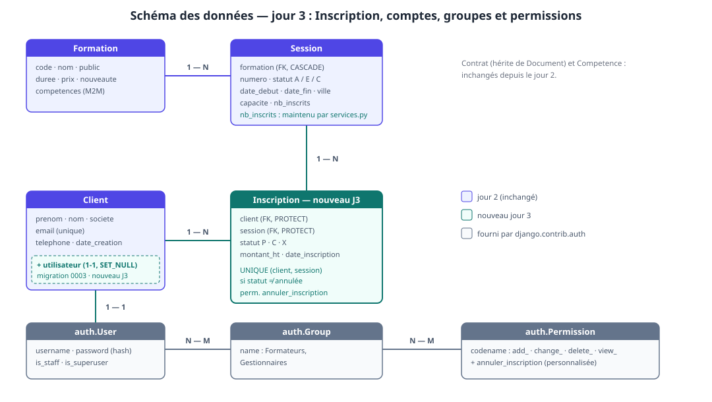
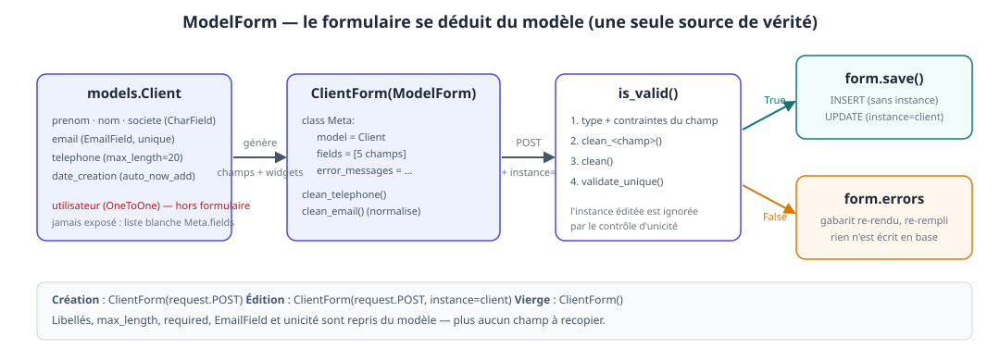
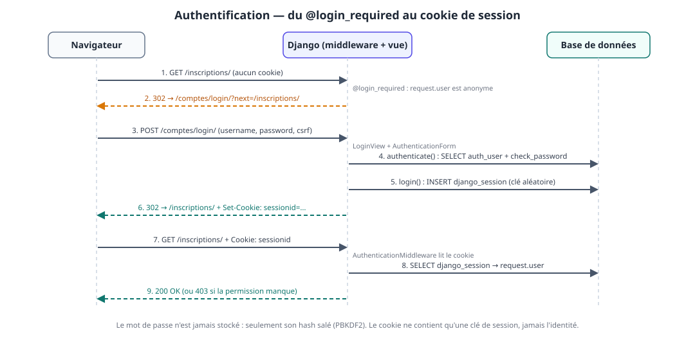
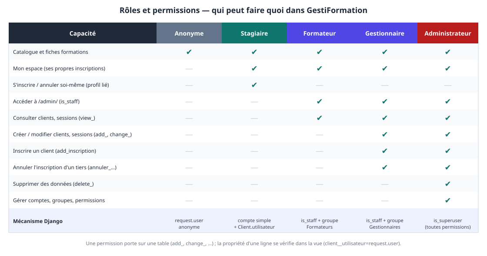

# Jour 3 — Écrire proprement, administrer, protéger : ModelForms, admin, authentification

> **Formation** : Django — initiation & approfondissement (5 jours)
> **Programme de référence** : [Dawan — Django : initiation / approfondissement](https://www.dawan.fr/formations/python/django/django-initiation-approfondissement)
> **Projet fil rouge** : GestiFormation — SaaS de gestion d'organisme de formation
> **Blocs couverts** : 7 (ModelForms : création, édition, suppression, inscriptions) · 8 (administration) · 9 (authentification, groupes, permissions)

**Prérequis** : jour 2 validé (5 modèles, migrations appliquées, seed, formulaire « Nouveau client », pages catalogue/détail sur l'ORM).
**Durée** : 7 h (9h00 – 17h00, pauses comprises).

## Objectifs pédagogiques

À la fin de la journée, les participants sont capables de :

- remplacer un `forms.Form` écrit à la main par un **`ModelForm`** : `Meta.model`, `Meta.fields`, `instance=`, `save()`, `save(commit=False)` ;
- écrire un **CRUD complet** (créer, modifier, supprimer) avec le pattern POST/redirect/GET et le framework de **messages** ;
- introduire un nouveau modèle métier (`Inscription`) et en protéger les règles (capacité, doublon) dans une **couche de services** transactionnelle ;
- configurer l'**administration** : `ModelAdmin`, `list_display`, filtres, recherche, **inlines**, **actions**, champs en lecture seule ;
- expliquer ce que l'admin **contourne** (vues, formulaires) et comment garder les règles métier à un seul endroit ;
- mettre en place l'**authentification** : connexion, déconnexion, création de compte, interventions, mots de passe hachés ;
- protéger les vues (`@login_required`, `@permission_required`) et les gabarits (`user`, `perms`) ;
- distinguer **permission** (portée sur une table) et **propriété** (portée sur une ligne) et empêcher l'accès aux données d'autrui ;
- construire des **groupes** (Formateurs, Gestionnaires) et une permission personnalisée.

### Livrable de la journée

- `Inscription` (modèle + migration + service) et formulaire d'inscription d'un client à une intervention ;
- CRUD des clients par `ModelForm`, avec messages de confirmation et suppression protégée ;
- administration complète des 6 modèles (inlines, actions, filtres, recherche) ;
- comptes : connexion, déconnexion, création de compte, page **Mon espace** ;
- 3 rôles + administrateur : stagiaire, formateur, gestionnaire ; permission `annuler_inscription` ;
- les pages publiques du jour 1 (accueil, catalogue, détail) toujours accessibles à tous, **mêmes URLs**.

> 💡 **Fil conducteur** : au jour 2, on a rendu le site *persistant* ; aujourd'hui on le rend *exploitable* (on écrit sans recopier), *administrable* (un back-office sans le coder) et *sûr* (chaque page sait qui la demande). Chaque bloc **protège** le précédent : le B9 protège ce que le B7 a écrit et ce que le B8 expose.

## Organisation de la journée

| Heure | Séquence | Blocs programme |
|---|---|---|
| 09h00 – 09h15 | Reprise du J2 : `check`, `migrate`, seed, serveur, commit | — |
| 09h15 – 11h00 | **B7** — ModelForms, CRUD clients, modèle `Inscription` | Bloc 7 |
| 11h00 – 11h15 | Pause | |
| 11h15 – 12h45 | **B8** — L'administration Django | Bloc 8 |
| 12h45 – 13h45 | Déjeuner | |
| 13h45 – 16h15 | **B9** — Authentification, groupes, permissions + atelier « Mon espace » | Bloc 9 |
| 16h15 – 16h30 | Pause | |
| 16h30 – 17h00 | Démonstrations, synthèse, preview du jour 4 | — |

### Le schéma de la journée



Trois ajouts au schéma du jour 2 : le modèle **`Inscription`** (la relation Client ↔ Intervention volontairement laissée en blanc hier), le lien **`Client.utilisateur`** (un compte peut être rattaché à un client) et les tables **`auth`** fournies par Django (`User`, `Group`, `Permission`).

---

## B7 — ModelForms : le formulaire se déduit du modèle (bloc 7) · 105 min

### 7.1. Le problème qu'on a créé hier

Le formulaire du jour 2 recopiait le modèle :

```python
# J2 — forms.py : 5 champs recopiés de models.Client
prenom    = forms.CharField(label='Prénom',  max_length=60)
email     = forms.EmailField(label='E-mail')
...
# J2 — views.py : le couplage « formulaire = colonnes »
Client.objects.create(**form.cleaned_data)
```

Trois dettes, qui grossissent à chaque nouveau champ :

| Dette | Conséquence |
|---|---|
| libellé, `max_length`, `required` écrits **deux fois** | `models.py` et `forms.py` divergent au premier changement |
| unicité de l'e-mail recodée à la main (`clean_email`) | un oubli = un doublon en base ou un `IntegrityError` |
| pas de **modification** : `create()` ne sait que créer | il faudrait un second formulaire, ou un `update` écrit à la main |

Le **ModelForm** supprime les trois : il **génère** les champs depuis le modèle, valide l'unicité, et sait **créer ou modifier** selon qu'on lui donne une instance.



| | `forms.Form` (J2) | `forms.ModelForm` (J3) |
|---|---|---|
| Champs | déclarés un par un | déduits de `Meta.model` + `Meta.fields` |
| Libellés / `max_length` / `required` | à redéclarer | repris du modèle |
| Unicité (`unique=True`) | `clean_<champ>` à la main | **automatique** (`validate_unique`) |
| Enregistrement | `Client.objects.create(**cleaned_data)` | `form.save()` |
| Modification | à écrire | `instance=client` — `save()` fait un `UPDATE` |
| Quand l'utiliser | formulaire **sans** modèle (recherche, contact) | formulaire **qui écrit** un modèle |

> 💡 **Règle de la semaine** : si le formulaire écrit dans une table, c'est un `ModelForm`. `forms.Form` reste pour les saisies qui ne sont pas des lignes de table (recherche, filtre, contact).

### 7.2. `ClientForm` — le formulaire de référence

```python
# catalog/forms.py
class ClientForm(forms.ModelForm):
    """
    remplace NouveauClientForm et aussi la MAJ
    """

    class Meta:
        model = Client
        # champs à afficher (liste blanche)
        fields = ['prenom', 'nom', 'societe', 'email', 'telephone']
        widgets = {
            'prenom': forms.TextInput(attrs={'placeholder': 'Entrez votre prénom ici...'}) 
        }
        error_messages = {
            'email': {'unique': 'Un client existe déjà avec cet e-mail.'}
        }

    def clean_email(self):
        """
        le check a été au niveau du modèle Mais on peut normaliser !
        """
        return self.cleaned_data.get('email', '').lower()

    def clean_telephone(self):
        valeur = self.cleaned_data.get('telephone', '')
        if valeur and not re.fullmatch(r"[\d\s+]{8,20}", valeur):
            raise ValidationError("Format invalide - chiffres, espace et + attendu.")
        return valeur
```

Ce qui a **disparu** par rapport à J2 : les 5 déclarations de champs, `clean_email` qui interrogeait la base, le `clean()` de démonstration. Ce qui **reste** : les règles qui n'existent pas dans le modèle (`clean_telephone`) — un `ModelForm` s'enrichit, il ne se limite pas à ce que le modèle sait dire.

L'ordre de validation d'un `ModelForm` est à connaître, car il explique `clean_email` :

1. chaque champ : conversion + contraintes issues du modèle (`max_length`, `required`, format e-mail) ;
2. chaque `clean_<champ>()` ;
3. `clean()` du formulaire ;
4. **`validate_unique()`** du modèle — **après** les `clean_*`. C'est pourquoi `clean_email` met l'adresse en minuscules : l'unicité est vérifiée sur la valeur **normalisée**.

> ⚠️ **Piège n°22 — `fields = '__all__'` (ou `exclude`)** : pratique, et dangereux. Le jour où `Client` gagne un champ sensible — dès B9 : `utilisateur` — il devient **modifiable par n'importe quel visiteur** qui forge un `POST` avec ce nom de champ (*mass assignment*, OWASP A01). On écrit **toujours** la liste blanche explicite `fields = [...]`.

### 7.3. Le CRUD des clients

Trois vues, un gabarit. On garde la structure du J2 (`GET` affiche, `POST` valide, `redirect` après succès) ; seul `instance=` distingue création et modification.

```python
# catalog/views.py — extrait J3 (les gardes d'accès arrivent en B9)
def nouveau_client(request):
    if request.method == 'POST':
        form = ClientForm(request.POST)
        if form.is_valid():
            # ici forme CONTIENT un objet Modèle !!! qui peut utiliser save() --> create et/ ou  update
            client = form.save()
            return redirect('catalog:clients')
    else:
        form = ClientForm()

    # à partir de deux vues qui pourraient utiliser le template GENERIQUE form.html 
    # on a besoin de variabiliser d'autres éléments
    return render(request, 'catalog/form.html', {
        'form': form,
        'titre': 'Nouveau client',
        'retour': 'catalog:clients'
    })

def modifier_client(request, pk):
    client = get_object_or_404(Client, pk=pk)
    if request.method == 'POST':
        form = ClientForm(request.POST, instance=client)       # ← la seule différence
        if form.is_valid():
            form.save()
            messages.success(request, f'Client « {client} » modifié.')
            return redirect('catalog:clients')
    else:
        form = ClientForm(instance=client)                     # pré-rempli
    return render(request, 'catalog/form.html', {
        'form': form, 'titre': f'Modifier {client}', 'retour': 'catalog:clients',
    })

def supprimer_client(request, pk: int):
    client = get_object_or_404(Client, pk=pk)
    if request.method == 'POST':
        # si le modèle utilise une relation avec contrainte RESTRICT ou PROTECTED en python
        try:
            client.delete()
        except ProtectedError:
            messages.error(request, 'Suppression impossible : ce client a des contrats ou des inscriptions.')
        # else adossé à try/except garantit que le try s'est exécuté jusqu'ou bout ==> pas d'erreur
        else:
            messages.success(request, f'Client « {client} » supprimé.')
        return redirect('catalog:clients')
    return render(request, 'catalog/confirmer_suppression.html', {
        'objet': client, 'retour': 'catalog:clients',
    })
```

`liste_clients` (J2) est inchangée. Les URLs, **le plus spécifique d'abord** (rappel piège n°2) :

```python
# catalog/urls.py — ajouts J3
path('clients/', views.liste_clients, name="clients"),
path('clients/nouveau/', views.nouveau_client, name="nouveau-client"),
path('clients/<int:pk>/modifier/',     views.modifier_client,   name='modifier-client'),
path('clients/<int:pk>/supprimer', views.supprimer_client, name="supprimer-client")
```

Trois points à faire nommer :

1. **`instance=client`** : sans lui, `ClientForm(request.POST)` **crée** un second client — ou échoue sur l'unicité de l'e-mail. Avec lui, `save()` exécute un `UPDATE` et le contrôle d'unicité **ignore la ligne en cours d'édition** ;
2. **la suppression passe par un `POST`** (page de confirmation, puis formulaire). Un `GET` qui supprime serait déclenchable par une simple balise `` sur un autre site — voir le CSRF du jour 2 ;
3. **`ProtectedError`** : `Contrat.client` est `PROTECT` (jour 2, piège n°10). Sans le `try/except`, le visiteur reçoit une 500 ; avec, un message clair. C'est **la** démonstration que `on_delete` est une décision métier.

> ⚠️ **Piège n°23 — oublier `instance=` côté `POST`** : l'affichage est pré-rempli (`ClientForm(instance=client)`), l'envoi crée un doublon (`ClientForm(request.POST)`). Les deux branches du `if` doivent recevoir l'instance.

**Les messages** — le pont entre la vue qui redirige et la page qui s'affiche ensuite. `django.contrib.messages` est déjà installé (middleware + context processor du `settings.py` généré au jour 1). Les messages vivent **dans la intervention** jusqu'à leur affichage.

```html
{# catalog/base.html — ajout, juste avant  #}
{# messages continer des messages flash quand ils ont été déclenchés #}

<ul class="messages">
    
        <li class="{{ message.tags }}">{{ message }}</li>
    
</ul>

```

**Le gabarit de formulaire devient générique.** C'est le troisième formulaire de l'application : on factorise (`form_client.html` du jour 2 est remplacé).

```html
{# catalog/templates/catalog/_champs.html — le rendu des champs, partagé #}

    <ul class="erreurs"><li>{{ e }}</li></ul>


    <div class="champ {{ field.name }} champ-erreur">
        {{ field.label_tag }}
        {{ field }}
        <small class="aide">{{ field.help_text }}</small>
        <span class="erreur">{{ e }}</span>
    </div>

```

```html
{# catalog/templates/catalog/form.html #}


{{ titre }} — GestiFormation


<section class="formulaire">
    <p class="retour"><a href="">&larr; Retour</a></p>
    <h1>{{ titre }}</h1>
    <form method="post" class="form">
        
        ????
        <button type="submit" class="btn">Enregistrer</button>
    </form>
</section>

```

```html
{# catalog/templates/catalog/confirmer_suppression.html #}


Confirmer la suppression — GestiFormation


<section class="formulaire">
    <h1>Supprimer « {{ objet }} » ?</h1>
    <p>Cette action est définitive.</p>
    <form method="post">
        
        <button type="submit" class="btn btn-danger">Oui, supprimer</button>
        <a class="btn" href="">Annuler</a>
    </form>
</section>

```

Dans `liste_clients.html`, une colonne d'actions par ligne :

```html
<td>
    <a href="">Modifier</a> ·
    <a href="">Supprimer</a>
</td>
```

Quelques lignes de CSS pour les messages, à ajouter à `static/css/base.css` :

```css
.messages { list-style: none; padding: 0; margin: 1rem 0; }
.messages li { padding: .6rem 1rem; border-radius: 6px; margin-bottom: .5rem; }
.messages .success { background: #ecfdf5; color: #065f46; }
.messages .error   { background: #fef2f2; color: #991b1b; }
.btn-danger { background: #b91c1c; }
form.inline { display: inline; }
.lien { background: none; border: 0; padding: 0; font: inherit; color: inherit; text-decoration: underline; cursor: pointer; }
```

### 7.4. `save(commit=False)` — compléter avant d'écrire

`form.save()` fait deux choses : construire l'objet **et** l'écrire. `save(commit=False)` ne fait que la première — on récupère l'instance, on la complète avec ce que le formulaire ne porte pas, puis on écrit.

```python
objet = form.save(commit=False)        # instance construite, rien en base
objet.cree_par = request.user          # ce qu'aucun champ du formulaire ne fournit
objet.save()
form.save_m2m()                        # ⚠️ obligatoire si le formulaire a des ManyToMany
```

> ⚠️ **Piège n°24 — `commit=False` et les `ManyToMany`** : sans `form.save_m2m()`, les relations M2M saisies sont **perdues silencieusement** (la ligne principale est écrite, pas la table intermédiaire). On le retrouvera avec `Formation.competences` si on écrit un `FormationForm`.

On l'utilisera en B9 (création de compte). En B7, pour les inscriptions, la règle métier est plus riche qu'un champ à compléter — elle a besoin d'une couche à part.

### 7.5. Aperçu : les vues génériques

Le triptyque « afficher / valider / enregistrer / rediriger » est si courant que Django le fournit sous forme de **vues basées sur des classes** (`CreateView`, `UpdateView`, `DeleteView`). `modifier_client` s'écrit alors :

```python
from django.urls import reverse_lazy
from django.views.generic import UpdateView

????
```

```python
path('clients/<int:pk>/modifier/', ???, name='modifier-client'),
```

| Vue fonctionnelle (référence du cours) | Vue générique |
|---|---|
| `nouveau_client` | `CreateView` |
| `modifier_client` | `UpdateView` |
| `supprimer_client` | `DeleteView` |
| `liste_clients` | `ListView` |
| `detail_formation` | `DetailView` |

> 💡 **Pourquoi on reste en fonctions** : la vue fonctionnelle **montre** chaque étape (méthode HTTP, validation, redirection) ; la générique la **cache**. On apprend avec la première, on gagne du temps avec la seconde — le jour où l'on a compris ce qu'elle cache. Les contraintes d'accès de B9 ont leur équivalent en classes (`LoginRequiredMixin`, `PermissionRequiredMixin`).

### 🛠️ Atelier 7·a — Le CRUD clients en ModelForm (45 min)

1. remplacer `NouveauClientForm` par `ClientForm` dans `catalog/forms.py` ;
2. écrire les 3 vues, les 2 URLs ajoutées, `form.html`, `_champs.html`, `confirmer_suppression.html` ; supprimer `form_client.html` ;
3. brancher le bloc `messages` dans `base.html`, la colonne « Actions » dans `liste_clients.html` ;
4. dérouler la table de contrôle :

| # | Action | Résultat attendu |
|---|---|---|
| 1 | créer un client avec l'e-mail `M.Dupont@ACME.fr` | erreur « Un client existe déjà… » (**normalisé** en minuscules avant l'unicité) |
| 2 | créer un client valide | redirection `/clients/` + message vert |
| 3 | modifier ce client **sans** changer l'e-mail | enregistré — l'unicité ignore la ligne éditée |
| 4 | modifier ce client avec l'e-mail d'un **autre** | erreur d'unicité |
| 5 | ouvrir `/clients/<pk>/modifier/` | formulaire **pré-rempli** |
| 6 | supprimer le client créé à l'étape 2 | supprimé, message vert |
| 7 | supprimer Marie Dupont (seed, a un contrat) | message rouge, **pas** de 500 |
| 8 | ouvrir `/clients/<pk>/supprimer/` en `GET` | page de confirmation, **rien** de supprimé |

**Checklist** :

- [ ] les 8 cas passés, le binôme capable d'expliquer le cas 3 (pourquoi pas d'erreur d'unicité) ;
- [ ] `forms.py` ne contient plus aucune déclaration de champ pour `Client` ;
- [ ] `git add -A && git commit -m "J3 : CRUD clients en ModelForm + messages"` fait.

---

### 7.6. `Inscription` — le modèle manquant

Le jour 2 avait laissé **Client ↔ Intervention** en blanc, avec un compteur stocké `Intervention.nb_inscrits`. Voici la relation, enfin modélisée.

```python
# catalog/models.py — ajout J3
from django.db.models import Q

class Inscription(models.Model):
    """Un client inscrit à une intervention — la table de liaison porte ses propres données."""
    STATUTS = [
        ('P', 'En attente'),
        ('C', 'Confirmée'),
        ('X', 'Annulée'),
    ]
    
    statut = models.CharField('statut', max_length=1, default="P", choices=STATUTS)
    montant_ht = models.DecimalField('montant HT (€)', max_digits=10, decimal_places=2)
    date_inscription = models.DateTimeField('inscrit le', auto_now_add=True)

    client = models.ForeignKey(
        Client, on_delete=models.PROTECT, related_name='inscriptions', verbose_name='client'
    )

    intervention = models.ForeignKey(
        Intervention, on_delete=models.PROTECT, related_name='inscriptions', verbose_name='intervention',
    )

    class Meta:
        verbose_name = 'inscription'
        # ---------> - : décroissant
        ordering = ['-date_inscription']
        ## contraintes composites impossible d'exprimer dans un champs
        constraints = [
            models.UniqueConstraint(
                fields=["client", "intervention"],
                # la contrainte est assurée si l'inscription n'est pas annulée (non statut X)
                # métier: un client peut annuler et ensuite se réinscrire !!!!
                condition=~Q(statut='X'),
                name='inscription_unique_client_intervention_active',
            )
        ]

    def __str__(self):
        return f"{self.client} --> {self.intervention}"   
```

Quatre choix à justifier :

| Choix | Pourquoi |
|---|---|
| table de liaison **explicite** plutôt qu'un `ManyToManyField` | l'inscription a ses propres données (statut, montant, date) |
| `on_delete=PROTECT` des deux côtés | on ne perd pas l'historique ; supprimer une `Formation` qui a des inscriptions est **bloqué en cascade** (`Formation → Intervention → Inscription`) |
| `montant_ht` **copié** depuis la formation | le prix d'aujourd'hui ne doit pas réécrire la facture d'hier |
| `UniqueConstraint` **conditionnelle** | un client peut se réinscrire après une annulation, jamais deux inscriptions actives |

`Meta.permissions` déclare une permission **personnalisée** en plus des quatre créées d'office (`add_`, `change_`, `delete_`, `view_`) — elle servira en B8 et B9.

```bash
python manage.py makemigrations          # → 0002_inscription.py
python manage.py sqlmigrate catalog 0002 # lire : CREATE UNIQUE INDEX … WHERE NOT (statut = 'X')
python manage.py migrate
```

> 💡 **Lire l'index partiel** : `sqlmigrate` montre un `CREATE UNIQUE INDEX … WHERE …` : la contrainte vit **dans la base**, pas seulement dans Python. Même un script qui contourne l'application ne créera pas de doublon actif.

**La règle métier — `catalog/services.py`.** L'inscription n'est pas un simple `create()` : il faut vérifier la place, incrémenter le compteur, refuser le doublon, **de façon atomique**. Cette logique a **deux appelants** (le formulaire du back-office, et en B9 le bouton « S'inscrire » du stagiaire) ; elle vit donc dans un module à part, pas dans une vue.

```python
# catalog/services.py
from django.db import transaction
from django.db.models import F, Q

from .models import Inscription, Intervention, Client

class DejaInscrit(Exception):
    def __init__(self, cl, inter):
        self.cl = cl
        self.inter = inter

    def __str__(self):
        return f"client: {self.cl} est déjà été inscrit à l'intervention: {self.inter}"

class InterventionComplete(Exception):
    def __init__(self, inter):
        self.inter = inter

    def __str__(self):
        return f"plus de places sur l'intervention: {self.inter} !!"

@transaction.atomic
def inscrire(client: Client, intervention: Intervention):
    """
    on inscrit si
        - le client n'est pas déjà inscrit !!!
        - s'il ya des places dispo !!!
          dans ce cas on met à jour les nb_inscrits de l'intervention
    dans ce cas on créé une inscription 
    """
    # if Inscription.objects.filter(
    #     Q(client=client) & 
    #     Q(intervention=intervention) &
    #     ~Q(statut='X')
    # ).exists():
    # exclude (NAND) != filter (AND)
    if Inscription.objects.filter(
        client=client, intervention=intervention
    ).exclude(statut='X'):
        raise DejaInscrit(client, intervention)

    # 1. retourne l'intervention s'il ya des places dispo OU QuerySet vide
    # 2. s'il ya intervention : on incrémente les places dispo
    places_prises = Intervention.objects.filter(
        pk=intervention.pk, statut='A', nb_inscrits__lt=F('capacite')
    ).update(nb_inscrits=F('nb_inscrits') +  1)
    if not places_prises:
        raise InterventionComplete(intervention)

    return Inscription.objects.create(
        client=client, 
        intervention=intervention,
        montant_ht=intervention.formation.prix
    )

def annuler(inscription: Inscription) -> bool:
    """
    libère la place et change le statut à X et retourne True si le changement est fait 
    """
    # si on veut utiliser plusieurs transactions dans la même procédure
    with transaction.atomic():
       change = Inscription.object.filter(
           pk=inscription.pk
        ).exclude(statut='X').update('X')
       # change est le nb éléments modifiés: 1 => True, 0 => False
       if change:
           Intervention.objects.filter(
               pk=inscription.intervention_id
            ).update(nb_inscrits=F('nb_inscrits') - 1)
    return bool(change)

    
```

C'est le **`F` du jour 2** (§5.7) dans son rôle final. Le filtre `nb_inscrits__lt=F('capacite')` **dans l'`UPDATE`** est la clé : deux requêtes simultanées sur la dernière place s'exécutent l'une après l'autre dans la base ; la seconde trouve `nb_inscrits == capacite`, met à jour **0 ligne**, et lève `InterventionComplete`. Avec `if intervention.places_dispo > 0: …; intervention.save()`, les deux passeraient.

`@transaction.atomic` garantit le *tout ou rien* : si `Inscription.objects.create` échoue (la contrainte d'unicité, par exemple), l'incrément du compteur est **annulé** avec lui.

> ⚠️ **Piège n°25 — le compteur et la ligne doivent bouger ensemble** : sans transaction, un plantage entre l'`UPDATE` du compteur et le `create` laisse une place « perdue ». Toute opération qui écrit **deux tables** liées passe sous `atomic`.

**Le formulaire d'inscription du back-office** :

```python
# catalog/forms.py — ajout J3
from django.db.models import F

class InscriptionForm(forms.ModelForm):
    """
    formulaire d'inscription:
      - 1 champs et widget complexe multi champs: dropdown qui présente des listes d'inscription liés
        + le numéro de l'intervention - nom de la formation (ville, dates début -- places dispo calculées à la voléé )
    """
    # champs de formulaire composite
    intervention = InterventionChoiceField(
        # alimenter le dropdown directement à partir d'un queryset
        queryset=(Intervention.objects.filter(statut='A')
                    .annotate(places=F('capacite') - F('nb_inscrits'))
                    .filter(places__gt=0)
                    .select_related('formation')
        ),
        # queryset=Intervention.objects.none(),
        label="Intervention"
    )

    class Meta:
        model = Inscription
        fields = ['client', 'intervention']

    def __init__(self, *args, **kwargs):
        super().__init__(*args, **kwargs)
        # alimenter à l'instanciation
        # self.fields['intervention'].queryset = (
        #     Intervention.objects.filter(statut='A')
        #     .annotate(places=F('capacite') - F('nb_inscrits'))
        #     .filter(places__gt=0)
        #     .select_related('formation')
        # )
```

Deux idées : le **`queryset` d'un champ de choix se restreint dans `__init__`** (seules les interventions ouvertes et non complètes sont proposées — l'annotation `places` du jour 2, réutilisée) ; et **`label_from_instance`** contrôle le texte de chaque option (sans lui, `<select>` affiche `str(intervention)` = le numéro seul).

> 💡 **Le formulaire filtre, le service garantit.** La liste déroulante a été construite il y a 30 secondes ; entre-temps la intervention a pu se remplir. Le formulaire est un **confort** ; la vraie décision se prend dans `inscrire()`, au moment de l'écriture.

```python
# catalog/views.py — ajout J3
def liste_inscriptions(request):
    # ------------------------------------------------> 2 joins client et intervention avec leur propre relation formation
    inscriptions = Inscription.objects.select_related('client', 'intervention__formation')
    return render(request, 'catalog/liste_inscriptions.html', {'inscriptions': inscriptions})

def nouvelle_inscription(request):
    if request.method == 'POST':
        form = InscriptionForm(request.POST)
        if form.is_valid():
            try:
                inscrire(form.cleaned_data['client'], form.cleaned_data['intervention'])
            except (DejaInscrit, InterventionComplete) as erreur:
                form.add_error(None, str(erreur))          # erreur « de formulaire »
            else:
                messages.success(request, 'Inscription enregistrée.')
                return redirect('catalog:inscriptions')
    else:
        form = InscriptionForm()
    return render(request, 'catalog/form.html', {
        'form': form, 'titre': 'Nouvelle inscription', 'retour': 'catalog:inscriptions',
    })
```

```python
# catalog/urls.py — ajouts
path('inscriptions/', views.liste_inscriptions, name='inscriptions'),
path('inscriptions/nouvelle/', views.nouvelle_inscription, name='nouvelle-inscription'),
```

```html
{# catalog/templates/catalog/liste_inscriptions.html #}


Inscriptions — GestiFormation


<section class="inscriptions">
    <h1>Inscriptions</h1>
    <table class="tableau">
        <thead><tr><th>Client</th><th>Formation</th><th>Intervention</th><th>Statut</th><th>Montant HT</th></tr></thead>
        <tbody>
        
            <tr>
                <td>{{ i.client }}</td>
                <td>{{ i.intervention.formation.nom }}</td>
                <td>{{ i.intervention.numero }} — {{ i.intervention.date_debut|date:"d/m/Y" }}</td>
                <td>{{ i.get_statut_display }}</td>
                <td>{{ i.montant_ht|floatformat:2 }} €</td>
            </tr>
        
            <tr><td colspan="5" class="vide">Aucune inscription.</td></tr>
        
        </tbody>
    </table>
    <p><a class="btn" href="">+ Nouvelle inscription</a></p>
</section>

```

> 💡 `select_related('client', 'intervention__formation')` : la double-soulignement traverse **deux** FK dans le même `JOIN` (jour 2, §5.6). Sans lui, la boucle de ce gabarit ferait 3 requêtes par ligne.

### 🛠️ Atelier 7·b — Inscrire un client (40 min)

1. ajouter `Inscription` à `models.py`, `makemigrations`, **lire** `0002_inscription.py` et le SQL, `migrate` ;
2. écrire `services.py`, `InscriptionForm`, les 2 vues, les 2 URLs, le gabarit ;
3. dérouler :

| # | Action | Résultat attendu |
|---|---|---|
| 1 | `/inscriptions/nouvelle/` | la liste ne propose **pas** la intervention complète `PY-102-2601` |
| 2 | inscrire Marie Dupont à `PY-101-2612` (7/12) | inscription créée, intervention à **8/12** (vérifier en shell) |
| 3 | recommencer la même inscription | erreur « déjà inscrit », compteur **inchangé** |
| 4 | en shell_plus : `inscrire(client, Intervention.objects.get(numero='PY-102-2601'))` | `InterventionComplete` — la intervention est pleine |
| 5 | en shell_plus : `annuler(inscription)` puis réinscrire | compteur 8 → 7 → 8, réinscription **autorisée** |

```python
# shell_plus — cas 2 et 4
>>> from catalog.services import inscrire
>>> c = Client.objects.get(email='m.dupont@acme.fr')
>>> i= Intervention.objects.get(numero='PY-101-2612')
>>> i..nb_inscrits
7
>>> inscrire(c, i)
<Inscription: Marie Dupont → PY-101-2612>
>>> i.nb_inscrits
7
>>> i.refresh_from_db() # resynchronise l'objet python et l'enregistrement en BDD !!!!
>>> i.nb_inscrits
8
```

**Checklist** :

- [ ] `sqlmigrate catalog 0002` lu : le binôme sait dire ce que fait le `WHERE NOT (statut = 'X')` ;
- [ ] le compteur reste cohérent sur les 5 cas ;
- [ ] **le seed ne doit plus écraser un compteur vivant** — appliquer le correctif ci-dessous ;
- [ ] `git add -A && git commit -m "J3 : Inscription + services.inscrire"` fait.

**Correctif du seed** : `update_or_create` réécrivait `nb_inscrits` à chaque relance, donc effaçait les inscriptions prises depuis. Django 5.0 apporte `create_defaults` : valeurs utilisées **uniquement à la création**.

```python
# catalog/seed.py — seed_interventions() corrigée
def seed_interventions():
    for numero, code, d_debut, d_fin, ville, capacite, inscrits, statut in INTERVENTIONS:
        commun = {
            'formation': Formation.objects.get(code=code),
            'date_debut': d_debut, 'date_fin': d_fin, 'ville': ville,
            'capacite': capacite, 'statut': statut,
        }
        Intervention.objects.update_or_create(
            numero=numero,
            defaults=commun,                                     # mises à jour à chaque relance
            create_defaults={**commun, 'nb_inscrits': inscrits}, # le compteur, une seule fois
        )
```

---

## B8 — L'administration : un back-office sans le coder (bloc 8) · 90 min

### 8.1. Ce que c'est — et ce que ce n'est pas

`django.contrib.admin` **génère un site de gestion à partir des modèles**. Il est dans `INSTALLED_APPS` et `gesti/urls.py` le sert sur `/admin/` depuis le jour 1 ; il n'attendait que des modèles à gérer — et un compte pour s'y connecter.

```bash
python manage.py createsuperuser        # nom, e-mail (facultatif), mot de passe
python manage.py runserver              # → http://127.0.0.1:8000/admin/
```

Le premier enregistrement tient en une ligne : `admin.site.register(Formation)`. L'admin est alors utilisable — liste, création, modification, suppression, historique — avec les libellés `verbose_name` du jour 2 (c'est leur raison d'être).

| L'admin est | L'admin n'est pas |
|---|---|
| un outil **interne** : équipe, support, démos | l'interface des clients ou des stagiaires |
| généré à partir de `models.py` — **un modèle = une page** | un site à la charte graphique de l'organisme |
| doté de permissions par modèle (B9) | un workflow métier (« inscrire = vérifier la capacité ») |

### 8.2. `ModelAdmin` — décrire l'affichage, pas le coder

Une classe `ModelAdmin` associée à un modèle par `@admin.register(...)`. Les options à connaître :

| Option | Effet | Exemple GestiFormation |
|---|---|---|
| `list_display` | colonnes de la liste (champs, méthodes, `__str__`) | code, nom, prix, nouveauté |
| `list_filter` | filtres latéraux | `statut`, `nouveaute` |
| `search_fields` | barre de recherche (`icontains` sur chaque champ) | `code`, `nom`, `client__email` |
| `ordering` | tri par défaut | — (`Meta.ordering` suffit) |
| `list_editable` | édition **directe** dans la liste | `nouveaute` |
| `date_hierarchy` | navigation par date | `date_debut` |
| `list_select_related` | `select_related` de la liste (anti N+1) | `('formation',)` |
| `readonly_fields` | champs affichés, non modifiables | `nb_inscrits` |
| `fieldsets` | regroupement des champs du formulaire | « Offre », « Compétences » |
| `filter_horizontal` | widget à deux colonnes pour un M2M | `competences` |
| `autocomplete_fields` | liste de choix interrogeable (FK) | `client`, `formation` |
| `inlines` | modèles liés édités **dans la page parent** | interventions d'une formation |
| `actions` | traitements sur la sélection de la liste | « Clôturer », « Confirmer » |

### 8.3. `catalog/admin.py` — le code de référence

```python
from django.contrib import admin, messages
from django.db.models import Count, F

from .models import Client, Competence, Contrat, Formation, Inscription, Intervention
from .services import annuler

admin.site.site_header = 'GestiFormation — administration'
admin.site.site_title = 'GestiFormation'
admin.site.index_title = "Pilotage de l'organisme"


# ---------- inlines : les objets liés, dans la page du parent ----------

class InterventionInline(admin.TabularInline):
    model = Intervention
    extra = 0
    fields = ('numero', 'date_debut', 'date_fin', 'ville', 'capacite', 'statut')
    show_change_link = True


class ContratInline(admin.TabularInline):
    model = Contrat
    extra = 0
    fields = ('numero', 'titre', 'montant_ht', 'date_signature')
    show_change_link = True


# ---------- catalogue ----------

@admin.register(Competence)
class CompetenceAdmin(admin.ModelAdmin):
    list_display = ('nom', 'nb_formations')
    search_fields = ('nom',)

    def get_queryset(self, request):
        return super().get_queryset(request).annotate(_nb_formations=Count('formations'))

    @admin.display(description='formations', ordering='_nb_formations')
    def nb_formations(self, obj):
        return obj._nb_formations


@admin.register(Formation)
class FormationAdmin(admin.ModelAdmin):
    list_display = ('code', 'nom', 'duree', 'prix', 'nouveaute', 'nb_interventions')
    list_editable = ('nouveaute',)
    list_filter = ('nouveaute', 'duree', 'competences')
    search_fields = ('code', 'nom')            # requis par autocomplete_fields ailleurs
    filter_horizontal = ('competences',)
    inlines = [InterventionInline]
    actions = ['marquer_nouveaute']
    fieldsets = (
        (None, {'fields': ('code', 'nom', 'public')}),
        ('Offre', {'fields': ('duree', 'prix', 'nouveaute')}),
        ('Compétences visées', {'fields': ('competences',), 'classes': ('collapse',)}),
    )

    def get_queryset(self, request):
        # distinct=True : le filtre « competences » ajoute un JOIN qui dupliquerait le comptage
        return super().get_queryset(request).annotate(_nb_interventions=Count('interventions', distinct=True))

    @admin.display(description='interventions', ordering='_nb_interventions')
    def nb_interventions(self, obj):
        return obj._nb_interventions

    @admin.action(description='Marquer comme nouveauté', permissions=['change'])
    def marquer_nouveaute(self, request, queryset):
        n = queryset.update(nouveaute=True)
        self.message_user(request, f'{n} formation(s) marquée(s) comme nouveauté.', messages.SUCCESS)


@admin.register(Intervention)
class InterventionAdmin(admin.ModelAdmin):
    list_display = ('numero', 'formation', 'date_debut', 'ville', 'statut',
                    'nb_inscrits', 'capacite', 'places')
    list_filter = ('statut', 'ville')
    search_fields = ('numero', 'formation__code', 'formation__nom')
    date_hierarchy = 'date_debut'
    list_select_related = ('formation',)
    autocomplete_fields = ('formation',)
    readonly_fields = ('nb_inscrits',)         # tenu par services.inscrire / annuler
    actions = ['cloturer']

    def get_queryset(self, request):
        return super().get_queryset(request).annotate(_places=F('capacite') - F('nb_inscrits'))

    @admin.display(description='places libres', ordering='_places')
    def places(self, obj):
        return obj._places

    @admin.action(description='Clôturer les interventions sélectionnées', permissions=['change'])
    def cloturer(self, request, queryset):
        n = queryset.update(statut='C')
        self.message_user(request, f'{n} intervention(s) clôturée(s).', messages.SUCCESS)


# ---------- clients, contrats, inscriptions ----------

# @admin.register(Client)
# class ClientAdmin(admin.ModelAdmin):
#     list_display = ('nom', 'prenom', 'societe', 'email', 'utilisateur', 'date_creation')
#     list_select_related = ('utilisateur',)
#     search_fields = ('nom', 'prenom', 'societe', 'email')
#     autocomplete_fields = ('utilisateur',)
#     inlines = [ContratInline]


# @admin.register(Contrat)
# class ContratAdmin(admin.ModelAdmin):
#     list_display = ('numero', 'titre', 'client', 'montant_ht', 'date_signature')
#     list_select_related = ('client',)
#     list_filter = ('date_signature',)
#     search_fields = ('numero', 'titre', 'client__nom', 'client__email')
#     autocomplete_fields = ('client',)
#     date_hierarchy = 'date_signature'


@admin.register(Inscription)
class InscriptionAdmin(admin.ModelAdmin):
    list_display = ('client', 'intervention', 'statut', 'montant_ht', 'date_inscription')
    list_filter = ('statut', 'intervention__formation')
    list_select_related = ('client', 'intervention')
    search_fields = ('client__nom', 'client__email', 'intervention__numero')
    # tout est en lecture seule : l'état ne change que par les actions, qui respectent les règles
    readonly_fields = ('client', 'intervention', 'statut', 'montant_ht', 'date_inscription')
    actions = ['confirmer', 'annuler_selection']

    def has_add_permission(self, request):
        return False                            # une inscription se crée par services.inscrire

    def has_delete_permission(self, request, obj=None):
        return False                            # on annule, on ne supprime pas

    def has_annuler_permission(self, request):  # appelée par permissions=['annuler']
        return request.user.has_perm('catalog.annuler_inscription')

    @admin.action(description='Confirmer les inscriptions sélectionnées', permissions=['change'])
    def confirmer(self, request, queryset):
        n = queryset.filter(statut='P').update(statut='C')
        self.message_user(request, f'{n} inscription(s) confirmée(s).', messages.SUCCESS)

    @admin.action(description='Annuler les inscriptions sélectionnées', permissions=['annuler'])
    def annuler_selection(self, request, queryset):
        n = sum(annuler(inscription) for inscription in queryset)
        self.message_user(request, f'{n} inscription(s) annulée(s), places libérées.', messages.SUCCESS)
```

Ce qu'il faut **lire en détail** avec les stagiaires :

1. **`get_queryset` + `annotate`** : `places` et `nb_interventions` sont calculées **par la base** (F, `Count` — jour 2), donc triables dans la liste via `ordering=` ; un appel `obj.interventions.count()` par ligne ferait un N+1 ;
2. **`list_select_related`** : sans lui, afficher `intervention.formation` dans la liste coûte une requête par ligne (jour 2, §5.6) ;
3. **`Count('interventions', distinct=True)`** : on filtre la liste sur `competences` (un `JOIN` M2M) ; sans `distinct`, une formation à 3 compétences compterait ses interventions 3 fois ;
4. **les `@admin.action(permissions=[...])`** : l'action n'apparaît que si l'utilisateur a la permission (`change` → `has_change_permission`, `annuler` → notre `has_annuler_permission`, branchée sur la permission personnalisée du modèle) ;
5. **`autocomplete_fields`** : exige que le modèle cible ait un `ModelAdmin` avec `search_fields` — c'est pourquoi `FormationAdmin` et `ClientAdmin` en déclarent.

### 8.4. Pourquoi `InscriptionAdmin` est presque en lecture seule

C'est le point le plus important du bloc.

> ⚠️ **Piège n°26 — l'admin contourne vos vues, vos formulaires et vos services.** Un `ModelAdmin` écrit **directement** le modèle. Une `Inscription` créée dans l'admin n'incrémente pas `Intervention.nb_inscrits` ; un statut passé à « Annulée » dans le formulaire ne libère pas la place ; une suppression laisse le compteur faux. Toute la discipline de B7·b serait contournée en trois clics.

Trois réponses possibles, de la plus simple à la plus lourde :

| Réponse | Mise en œuvre | Choix ici |
|---|---|---|
| **fermer l'écriture directe** | `has_add_permission`, `has_delete_permission`, champs en `readonly_fields` ; les transitions passent par des **actions** qui appellent `services.annuler` | ✅ |
| faire appeler le service par l'admin | surcharger `save_model` pour router vers `inscrire` | possible, plus fragile |
| faire respecter la règle par le modèle | `save()` surchargé ou signaux | à discuter en réunion d'architecture |

L'admin sert au **suivi** (filtrer, rechercher, confirmer, annuler) ; la **création** d'une inscription reste l'affaire de `/inscriptions/nouvelle/` (et, en B9, du bouton « S'inscrire »). Même logique pour `Intervention.nb_inscrits` : `readonly_fields`, car il appartient aux services.

> 💡 **Principe à retenir** : les règles métier vivent **à un seul endroit** (`services.py`) ; vues, admin, scripts et tests (jour 4) **l'appellent**. Une règle écrite dans une vue n'existe pas pour l'admin.

> ⚠️ **Piège n°27 — les `@property` et méthodes dans `list_display`** : `list_display = ('nom', 'places_dispo')` « marche » mais exécute le calcul **par ligne**, sans tri possible. Dès qu'une colonne dérive d'une relation ou d'un calcul, on **annote** dans `get_queryset` (comme `places`).

L'**intégrité** se voit aussi dans l'admin : supprimer une `Formation` qui a des interventions avec inscriptions affiche la page « *suppression impossible : objets protégés* » — le `PROTECT` du jour 2, sans une ligne de code.

### 🛠️ Atelier 8 — Administrer GestiFormation (60 min)

**Consignes** : écrire `admin.py` section par section (un `@admin.register`, un rechargement de `/admin/`) puis dérouler :

| # | Action | Résultat attendu |
|---|---|---|
| 1 | `createsuperuser`, ouvrir `/admin/` | le tableau de bord liste les modèles du catalogue (6 + comptes/groupes), libellés en français |
| 2 | ouvrir une `Formation` | ses **interventions** sont éditables dans la même page (inline) |
| 3 | liste des `Intervention` : filtrer `statut = À venir`, trier par « places libres » | tri géré **par la base** |
| 4 | sélectionner 2 formations → action « Marquer comme nouveauté » | message vert, case `nouveaute` cochée |
| 5 | `Client` Marie Dupont → inline `Contrat` | le contrat du seed est visible |
| 6 | tenter de supprimer Marie Dupont | page « objets protégés » |
| 7 | `Inscription` : bouton « Ajouter » | **absent** |
| 8 | sélectionner l'inscription créée en 7·b → « Annuler » | statut `X`, `nb_inscrits` décrémenté (vérifier dans `Intervention`) |
| 9 | relancer l'action sur la même ligne | « 0 inscription(s) annulée(s) » — pas de double décrément |

**Checklist** :

- [ ] les 9 cas passés ; le binôme sait expliquer pourquoi `readonly_fields` ne suffit pas à protéger le compteur (réponse : il ne protège que ce formulaire — l'ORM, un script ou un autre `ModelAdmin` peuvent toujours écrire, d'où les services) ;
- [ ] aucun `@property` dans un `list_display` ;
- [ ] `git add -A && git commit -m "J3 : administration complète"` fait.

---

## B9 — Authentification, groupes et permissions (bloc 9) · 150 min

### 9.1. Qui es-tu ? Qu'as-tu le droit de faire ?

Deux questions distinctes, deux mécanismes distincts :

| | **Authentification** | **Autorisation** |
|---|---|---|
| Question | *« Qui est-ce ? »* | *« A-t-il le droit de faire ça ? »* |
| Mécanisme Django | `authenticate()`, `login()`, sessions, `request.user` | permissions, groupes, `has_perm`, décorateurs |
| Échec | redirection vers la page de connexion (302) | **403 Forbidden** |
| Dans GestiFormation | se connecter, créer son compte | qui voit les clients, qui annule une inscription |

Aujourd'hui, **toutes les pages d'écriture sont publiques** : n'importe quel visiteur peut créer, modifier ou supprimer un client. C'est la faille de conception que ce bloc corrige.

### 9.2. Comment Django reconnaît un utilisateur



À retenir de ce schéma, dans l'ordre :

1. **`SessionMiddleware`** + **`AuthenticationMiddleware`** (déjà dans `MIDDLEWARE`, jour 1) lisent le cookie `sessionid` et placent **`request.user`** sur **chaque** requête — un objet `User` réel, ou `AnonymousUser` ;
2. le **cookie** ne contient qu'une **clé aléatoire** ; l'identité est dans la table `django_session` (lisible depuis `python manage.py shell` avec `Session` de `django.contrib.sessions.models`) ;
3. **`authenticate()`** vérifie identifiant + mot de passe, **`login()`** crée la session ;
4. le mot de passe n'est **jamais stocké** : seulement son *hash* salé (PBKDF2 par défaut).

```python
>>> from django.contrib.auth import get_user_model
>>> User = get_user_model()
>>> u = User.objects.create_user('test', 'test@example.org', 'secret-123')
>>> u.password
'pbkdf2_sha256$1000000$gH7…$Zr0…'        # algorithme $ itérations $ sel $ hash
>>> u.check_password('secret-123')
True
```

> ⚠️ **Piège n°28 — créer un utilisateur avec `User.objects.create(password='…')`** : le mot de passe est enregistré **en clair** et la connexion échoue (Django attend un hash). On passe **toujours** par `create_user(...)` ou `set_password(...)`.

| Attribut de `User` | Sens |
|---|---|
| `is_active` | `False` = compte désactivé, connexion refusée |
| `is_staff` | autorise l'accès à `/admin/` — **rien d'autre** |
| `is_superuser` | **toutes** les permissions, sans exception |
| `groups`, `user_permissions` | autorisations (§9.6) |

> 💡 **Modèle d'utilisateur personnalisé** : si le projet doit ajouter des champs à l'utilisateur (téléphone, société…), Django recommande de déclarer `AUTH_USER_MODEL` **avant la toute première migration**. Le changer après est un chantier. Ici on n'en a pas besoin : les données propres au client vivent dans `Client`, rattaché au `User` par une relation `1-1`.

### 9.3. Connexion et déconnexion — les vues fournies

Django fournit les vues d'authentification (`LoginView`, `LogoutView`, changement et réinitialisation de mot de passe). On les branche en une ligne et on ne fournit que le gabarit.

```python
# gesti/urls.py — ajouts J3
from django.contrib.auth.views import LoginView

urlpatterns = [
    path('admin/',   admin.site.urls),
    path('comptes/login/', LoginView.as_view(template_name='catalog/login.html'), name='login'), # page de connexion
    path('comptes/', include('django.contrib.auth.urls')),   # login, logout, password_change…
    path('',         include('catalog.urls')),
]

handler403 = 'catalog.views.acces_refuse'
```

Les URLs obtenues portent des noms **sans espace de noms** : `login`, `logout`, `password_change`, `password_reset`…

```python
# gesti/settings.py — ajouts J3
LOGIN_URL = 'login'                          # où renvoyer un anonyme (nom d'URL)
LOGIN_REDIRECT_URL = 'catalog:mon-espace'    # après connexion, sans ?next=
LOGOUT_REDIRECT_URL = 'catalog:accueil'
```

```html
{# catalog/templates/registration/login.html — Django cherche ce chemin exact #}


Connexion — GestiFormation


<section class="formulaire">
    <h1>Connexion</h1>
    <form method="post" class="form">
        
        
        <input type="hidden" name="next" value="{{ next }}">
        <button type="submit" class="btn">Se connecter</button>
    </form>
    <p>Pas encore de compte ? <a href="">Créer un compte</a></p>
</section>

```

Le paramètre **`next`** fait revenir l'utilisateur sur la page qu'il demandait avant d'être redirigé vers le login (étapes 2 et 6 du schéma). `LoginView` vérifie que l'adresse reste **sur le site** (protection contre la *redirection ouverte*) : ne jamais recoder cette redirection à la main avec un paramètre non contrôlé.

**La barre de navigation** devient sensible à l'utilisateur et à ses permissions :

```html
{# catalog/base.html — le <ul> de la navigation #}
<ul>
    <li><a href="">Catalogue</a></li>
    
        <li><a href="">Mon espace</a></li>
        <li><a href="">Clients</a></li>
        <li><a href="">Inscriptions</a></li>
        <li><a href="">Admin</a></li>
        <li>
            {{ user.get_username }} —
            <form method="post" action="" class="inline">
                <button type="submit" class="lien">Déconnexion</button>
            </form>
        </li>
    
        <li><a href="">Connexion</a></li>
        <li><a href="">Créer un compte</a></li>
    
</ul>
```

`user` et `perms` sont fournis par `django.contrib.auth.context_processors.auth` (déjà dans `TEMPLATES`, jour 1) : **aucune vue n'a à les passer**.

> ⚠️ **Piège n°29 — la déconnexion en `GET`** : depuis Django 5.0, `LogoutView` n'accepte que le **`POST`**. Un lien `<a href="/comptes/logout/">` répond `405 Method Not Allowed`. C'est voulu : un `GET` qui déconnecte pourrait être déclenché depuis un autre site. D'où le petit formulaire avec `` ci-dessus.

> 💡 Les gabarits masquent des liens ; ils **ne protègent rien**. Un lien caché reste accessible en tapant l'URL : la sécurité est dans la **vue** (§9.5), le gabarit n'est que de l'ergonomie.

### 9.4. Créer un compte — un `ModelForm` fourni

`UserCreationForm` est un **ModelForm** sur `User` : il valide la politique de mot de passe (`AUTH_PASSWORD_VALIDATORS`), demande la confirmation et **hache** le mot de passe. On l'étend avec l'e-mail et le nom.

```python
# catalog/forms.py — ajout J3
from django.contrib.auth import get_user_model
from django.contrib.auth.forms import UserCreationForm


?????
```

**Le lien compte ↔ client** : un `Client` peut être rattaché à un compte.

```python
# catalog/models.py — ajout dans Client (J3)
from django.conf import settings

?????
```

```bash
python manage.py makemigrations   # → 0003_client_utilisateur.py (dépend de AUTH_USER_MODEL)
python manage.py migrate
```

> 💡 **Ajouter une colonne à une table qui contient déjà des lignes** : `null=True` rend l'ajout trivial (les clients existants reçoivent `NULL`). Une colonne **obligatoire** sans `default` fait demander à `makemigrations` quelle valeur donner aux lignes existantes. C'est la suite du piège n°12 (le schéma a un historique).

```python
# catalog/views.py — ajout J3
?????
```

> ⚠️ **Piège n°30 — rattacher un compte à un client par e-mail non vérifié** : ici, saisir l'adresse d'un client existant suffit à **hériter de son profil et de ses inscriptions**. C'est acceptable pour une démonstration ; en production, on **envoie un lien de confirmation** avant de rattacher (jour 5, e-mails). À dire à voix haute : une fonctionnalité pratique peut être une faille.

### 9.5. Protéger les vues

**Décorateurs** pour les vues fonctionnelles :

| Outil | Rôle | Si la condition n'est pas remplie |
|---|---|---|
| `@login_required` | l'utilisateur est connecté | **302** vers `LOGIN_URL?next=…` |
| `@permission_required('catalog.add_client', raise_exception=True)` | il possède la permission `<app>.<codename>` | **403** |
| `@require_POST` | la méthode HTTP est `POST` | **405** |

Les permissions de modèle sont créées **automatiquement** pour chaque modèle (`add_`, `change_`, `delete_`, `view_`). Leur nom complet : `catalog.view_client`.

```python
# catalog/views.py — les gardes d'accès (J3)
from django.contrib.auth.decorators import login_required, permission_required


????
```

**L'ordre des décorateurs compte.** `@login_required` est **au-dessus** : il tranche d'abord *connecté ou non* (redirection), puis `@permission_required` tranche *autorisé ou non* (403).

> ⚠️ **Piège n°31 — `@permission_required` seul** : sans `raise_exception=True`, un utilisateur **connecté** mais sans la permission est renvoyé… vers la page de **connexion** — il se reconnecte, revient, est renvoyé : une boucle déroutante. Avec `raise_exception=True`, il reçoit un **403** explicite ; et on empile `@login_required` au-dessus pour que l'anonyme, lui, soit invité à se connecter.

| Vue | Gardes |
|---|---|
| `liste_clients` | `login_required` + `catalog.view_client` |
| `nouveau_client` | `login_required` + `catalog.add_client` |
| `modifier_client` | `login_required` + `catalog.change_client` |
| `supprimer_client` | `login_required` + `catalog.delete_client` |
| `liste_inscriptions` | `login_required` + `catalog.view_inscription` |
| `nouvelle_inscription` | `login_required` + `catalog.add_inscription` |
| `mon_espace`, `sinscrire`, `annuler_ma_inscription` | `login_required` (+ propriété, §9.7) |
| `accueil`, `liste_formations`, `detail_formation`, `creer_compte` | **publiques** |

```html
{# catalog/templates/catalog/403.html #}

Accès refusé — GestiFormation

<section class="erreur-page">
    <h1>403 — Accès refusé</h1>
    <p>Votre compte n'a pas les droits nécessaires pour cette page.</p>
    <p><a class="btn" href="">Retour à l'accueil</a></p>
</section>

```

Dans les gabarits, les colonnes d'action de `liste_clients.html` se conditionnent aux mêmes permissions :

```html
<td>
    ????<a href="">Modifier</a>
    ????<a href="">Supprimer</a>
</td>
```

**Équivalent pour les vues en classes** : `LoginRequiredMixin` et `PermissionRequiredMixin` (`permission_required = 'catalog.change_client'`), placés **avant** la vue générique dans les bases : `class ClientUpdateView(LoginRequiredMixin, PermissionRequiredMixin, UpdateView)`.

### 9.6. Groupes et rôles

Attribuer des permissions **une à une** à chaque utilisateur est ingérable. Un **groupe** est un ensemble nommé de permissions ; on place les utilisateurs dans des groupes.



| Rôle | Mécanisme | Ce qu'il fait |
|---|---|---|
| Anonyme | aucun | consulte le catalogue |
| Stagiaire | compte simple + `Client.utilisateur` | s'inscrit, voit **ses** inscriptions |
| Formateur | `is_staff` + groupe **Formateurs** | consulte (admin et pages), ne modifie rien |
| Gestionnaire | `is_staff` + groupe **Gestionnaires** | crée, modifie, inscrit, **annule** |
| Administrateur | `is_superuser` | tout, dont suppression et gestion des comptes |

Deux choses à noter. Le **stagiaire n'a aucune permission de modèle** : il n'a pas besoin de `view_inscription` pour voir *ses* inscriptions — c'est la **propriété** (§9.7), pas une permission. Et le `is_staff` seul **n'ouvre aucune page dans l'admin** : il donne le droit d'y entrer, les permissions disent ce qu'on y voit.

> ⚠️ **Piège n°32 — confondre `is_staff`, permissions et `is_superuser`** : un compte `is_staff` sans groupe se connecte à `/admin/` et ne voit **rien** ; un compte `is_superuser` **ignore toutes les vérifications** (`has_perm` renvoie toujours `True`) — on n'en distribue pas « pour que ça marche ».

**Le seed des rôles** — à ajouter à `catalog/seed.py` (les groupes sont des **données de configuration**, comme le catalogue). Les permissions de modèle sont créées par `migrate` : le seed doit donc passer **après** `migrate`.

```python
# catalog/seed.py — ajouts J3
from django.contrib.auth import get_user_model
from django.contrib.auth.models import Group, Permission

GROUPES = {
    'Formateurs': [
        'view_formation', 'view_intervention', 'view_client', 'view_inscription',
    ],
    'Gestionnaires': [
        'view_formation', 'add_formation', 'change_formation',
        'view_intervention', 'add_intervention', 'change_intervention',
        'view_client', 'add_client', 'change_client',
        'view_contrat', 'add_contrat', 'change_contrat',
        'view_inscription', 'add_inscription', 'change_inscription',
        'annuler_inscription',
    ],
}

MOT_DE_PASSE_DEMO = 'demo-2026'      # ⚠️ démonstration uniquement

# identifiant, prénom, nom, e-mail, groupe, is_staff
COMPTES = [
    ('alice',    'Alice',    'Martin',  'alice@example.org',    None,            False),
    ('francois', 'François', 'Lemaire', 'francois@example.org', 'Formateurs',    True),
    ('gaelle',   'Gaëlle',   'Roux',    'gaelle@example.org',   'Gestionnaires', True),
]


def seed_groupes():
    for nom, codenames in GROUPES.items():
        groupe, _ = Group.objects.get_or_create(name=nom)
        groupe.permissions.set(
            Permission.objects.filter(content_type__app_label='catalog', codename__in=codenames)
        )


def seed_comptes():
    User = get_user_model()
    for username, prenom, nom, email, groupe, staff in COMPTES:
        user, cree = User.objects.get_or_create(
            username=username,
            defaults={'first_name': prenom, 'last_name': nom, 'email': email, 'is_staff': staff},
        )
        if cree:
            user.set_password(MOT_DE_PASSE_DEMO)
            user.save()
        if groupe:
            user.groups.add(Group.objects.get(name=groupe))

    # le compte « alice » est aussi un client
    alice = User.objects.get(username='alice')
    Client.objects.update_or_create(
        email='alice@example.org',
        defaults={'prenom': 'Alice', 'nom': 'Martin', 'utilisateur': alice},
    )


# dans run() :  seed_groupes(); seed_comptes()   (après seed_clients_contrats())
```

> 💡 **`groupe.permissions.set(...)` est idempotent** : relancer le seed remet les permissions **exactement** à la liste du code. C'est le comportement voulu pour une configuration — la source de vérité des droits est ce dictionnaire, versionné, pas les clics dans l'admin.

```bash
python manage.py migrate        # crée les permissions (post_migrate)
python -m catalog.seed          # groupes + comptes de démonstration
```

### 9.7. Permission ≠ propriété — « Mon espace »

Une permission de modèle répond à *« peut-il lire **les** inscriptions ? »*, pas à *« peut-il lire **cette** inscription ? »*. Pour les données d'un stagiaire, la vérification se fait **ligne par ligne**, dans la vue, avec la requête.

```python
# catalog/views.py — ajouts J3
from django.views.decorators.http import require_POST
from .services import annuler


@login_required
def mon_espace(request):
    client = Client.objects.filter(utilisateur=request.user).first()
    inscriptions = (
        Inscription.objects
        .filter(client__utilisateur=request.user)        # ← la propriété est dans la requête
        .select_related('intervention__formation')
    )
    return render(request, 'catalog/mon_espace.html', {
        'client': client, 'inscriptions': inscriptions,
    })


@login_required
@require_POST
def sinscrire(request, pk):
    intervention = get_object_or_404(Intervention.objects.select_related('formation'), pk=pk, statut='A')
    client = Client.objects.filter(utilisateur=request.user).first()
    if client is None:
        messages.error(request, "Aucun profil client n'est associé à votre compte.")
    else:
        try:
            inscrire(client, intervention)
        except (DejaInscrit, InterventionComplete) as erreur:
            messages.error(request, str(erreur))
        else:
            messages.success(request, f'Inscription à {intervention.formation.nom} enregistrée.')
    return redirect('catalog:detail-formation', pk=intervention.formation_id)


@login_required
@require_POST
def annuler_ma_inscription(request, pk):
    # filtrer par propriétaire : l'inscription d'un autre → 404, pas 403
    inscription = get_object_or_404(Inscription, pk=pk, client__utilisateur=request.user)
    if annuler(inscription):
        messages.success(request, 'Inscription annulée.')
    return redirect('catalog:mon-espace')
```

```python
# catalog/urls.py — ajouts
path('creer-compte/',                     views.creer_compte,            name='creer-compte'),
path('mon-espace/',                       views.mon_espace,              name='mon-espace'),
path('interventions/<int:pk>/s-inscrire/',     views.sinscrire,               name='sinscrire'),
path('mon-espace/inscriptions/<int:pk>/annuler/',
                                          views.annuler_ma_inscription,  name='annuler-ma-inscription'),
```

> ⚠️ **Piège n°33 — l'accès aux objets d'autrui par simple changement d'identifiant (IDOR)** : `get_object_or_404(Inscription, pk=pk)` + `@login_required` laisse **n'importe quel connecté** annuler l'inscription n° 7 en changeant le nombre dans l'URL. La permission existe, la propriété n'est pas vérifiée. On filtre **toujours** par propriétaire (`client__utilisateur=request.user`) : l'objet d'autrui **n'existe pas** (404) — et l'on ne révèle même pas qu'il existe.

Les deux gabarits :

```html
{# catalog/templates/catalog/mon_espace.html #}


Mon espace — GestiFormation


<section class="espace">
    <h1>Bonjour {{ user.first_name|default:user.get_username }}</h1>
    
        <p class="vide">Aucun profil client n'est associé à ce compte.</p>
    

    <h2>Mes inscriptions</h2>
    <table class="tableau">
        <thead><tr><th>Formation</th><th>Intervention</th><th>Début</th><th>Statut</th><th></th></tr></thead>
        <tbody>
        
            <tr>
                <td>{{ i.intervention.formation.nom }}</td>
                <td>{{ i.intervention.numero }}</td>
                <td>{{ i.intervention.date_debut|date:"d/m/Y" }}</td>
                <td>{{ i.get_statut_display }}</td>
                <td>
                    
                    <form method="post" action="" class="inline">
                        <button type="submit" class="lien">Annuler</button>
                    </form>
                    
                </td>
            </tr>
        
            <tr><td colspan="5" class="vide">Aucune inscription.</td></tr>
        
        </tbody>
    </table>
</section>

```

Le bouton « S'inscrire » s'ajoute à la fiche détail, dans la boucle des interventions (J2, §5.6) :

```html
{# catalog/templates/catalog/detail_formation.html — dans  #}

    <form method="post" action="" class="inline">
        
        <button type="submit" class="btn" disabled>S'inscrire</button>
    </form>

    <a href="?next={{ request.path|urlencode }}">Se connecter pour s'inscrire</a>

```

> 💡 **`disabled` est du confort, pas de la sécurité** : un `POST` forgé sur une intervention complète est refusé par `inscrire()` (`InterventionComplete`). L'interface masque, **le service décide** — le même principe qu'en B7·b.

### 🛠️ Atelier 9 — Qui a le droit de quoi ? (90 min)

**Consignes** : ajouter les réglages, les URLs, les vues, les gabarits, `Client.utilisateur` (migration 0003), le seed des rôles ; poser les gardes de §9.5 ; **tester chaque rôle dans son propre navigateur** (ou une fenêtre privée) — jamais en changeant de compte dans la même intervention.

| # | Rôle / action | Résultat attendu |
|---|---|---|
| 1 | anonyme : `/clients/` | **302** vers `/comptes/login/?next=/clients/` |
| 2 | se connecter | retour sur `/clients/` (le `next`) — puis 403 si le compte n'a pas `view_client` |
| 3 | `alice` : `/clients/` | **403** avec la page personnalisée |
| 4 | `alice` : fiche d'une formation | bouton « S'inscrire » visible ; inscription à `PY-101-2612` : message vert, **Mon espace** la liste |
| 5 | `alice` : se réinscrire à la même intervention | message rouge « déjà inscrit », compteur **inchangé** |
| 6 | `alice` : intervention `PY-102-2601` (complète) | bouton `disabled` ; `POST` forgé (`curl`, devtools) → message « complète » |
| 7 | `alice` : annuler son inscription | statut « Annulée », compteur décrémenté |
| 8 | `alice` : `POST` sur l'annulation d'une inscription **d'un autre** | **404** |
| 9 | `alice` : déconnexion par un lien (`GET /comptes/logout/`) | **405** — le bouton POST fonctionne |
| 10 | `francois` (formateur) : `/admin/` | voit Formations, Interventions, Clients, Inscriptions ; **aucun** bouton Ajouter / Supprimer |
| 11 | `francois` : `/clients/nouveau/` | **403** |
| 12 | `gaelle` (gestionnaire) : `/clients/nouveau/` puis l'action « Annuler » de l'admin | autorisés ; **pas** de suppression de client |
| 13 | superutilisateur | tout, dont la suppression et la gestion des groupes |
| 14 | créer un compte `bob` avec un mot de passe `12345678` | refusé par `AUTH_PASSWORD_VALIDATORS` |
| 15 | `python manage.py shell` : `User.objects.get(username='alice').password` | un **hash** `pbkdf2_sha256$…`, jamais `demo-2026` |

**Checklist de fin d'atelier**

- [ ] les 15 cas passés, chaque rôle testé séparément ;
- [ ] le binôme sait dire pourquoi le cas 8 renvoie **404** et non 403 ;
- [ ] aucune vue d'écriture n'est restée publique : `grep -n "^def " catalog/views.py` puis relire chaque garde ;
- [ ] `python manage.py check` passe ;
- [ ] `git add -A && git commit -m "J3 : authentification, rôles, mon espace"` fait.

> 💡 **Critère de réussite de la journée** (à énoncer devant le binôme) : « Je sais dire, pour une requête `POST /interventions/3/s-inscrire/`, **qui** est l'utilisateur (middleware), **ce qui est vérifié** (connexion, méthode, propriété, capacité), **où** (décorateur, requête, service) et **ce qui se passe en base** si la intervention est pleine — rien. »

---

## Synthèse de fin de journée

### Ce qui est en place

```
gestiformation/
├── db.sqlite3
├── manage.py
├── gesti/
│   ├── settings.py              # + LOGIN_URL, LOGIN_REDIRECT_URL, LOGOUT_REDIRECT_URL
│   └── urls.py                  # + comptes/ (auth.urls), handler403
└── catalog/
    ├── models.py                # + Inscription ; Client.utilisateur (1-1)
    ├── forms.py                 # ClientForm, InscriptionForm, CompteForm (3 ModelForms)
    ├── services.py              # ← NOUVEAU : inscrire(), annuler()
    ├── admin.py                 # ← NOUVEAU : 6 ModelAdmin, inlines, actions
    ├── seed.py                  # + groupes, comptes de démonstration, create_defaults
    ├── migrations/
    │   ├── 0001_initial.py
    │   ├── 0002_inscription.py          # ← NOUVEAU
    │   └── 0003_client_utilisateur.py   # ← NOUVEAU
    ├── views.py                 # + CRUD clients, inscriptions, comptes, mon espace, 403
    ├── urls.py
    ├── static/css/base.css      # + .messages, .btn-danger, form.inline, .lien
    └── templates/
        ├── registration/
        │   └── login.html       # ← NOUVEAU
        └── catalog/
            ├── base.html        # navigation selon user / perms, messages
            ├── form.html        # ← NOUVEAU : remplace form_client.html
            ├── _champs.html     # ← NOUVEAU
            ├── confirmer_suppression.html    # ← NOUVEAU
            ├── liste_inscriptions.html       # ← NOUVEAU
            ├── mon_espace.html               # ← NOUVEAU
            ├── 403.html                      # ← NOUVEAU
            └── …                # liste_formations, detail_formation (+ S'inscrire), liste_clients
```

### Les réflexes installés

| Réflexe | Pourquoi |
|---|---|
| un formulaire qui écrit une table est un **`ModelForm`** à `fields` **explicites** | zéro recopie, jamais de champ exposé par accident |
| `instance=` sur **les deux** branches (GET et POST) d'une modification | sinon un doublon, ou une erreur d'unicité |
| une règle métier = **une fonction de service**, appelée par la vue, l'admin, les tests | l'admin et les scripts contournent les formulaires |
| écrire deux tables liées → **`transaction.atomic`** ; décider dans l'`UPDATE` (`F` + filtre) | pas d'état intermédiaire, pas de course sur la dernière place |
| admin : **annoter** dans `get_queryset`, `list_select_related`, `readonly_fields` | pas de N+1, pas de compteur modifié à la main |
| `create_user` / `set_password`, jamais `create(password=…)` | le mot de passe est un hash |
| `@login_required` **puis** `@permission_required(..., raise_exception=True)` | 302 pour l'anonyme, 403 pour le connecté non autorisé |
| déconnexion et suppression en **`POST`** | un `GET` ne doit rien changer |
| toute donnée d'un utilisateur se filtre **par propriétaire** | permission ≠ propriété |
| l'interface masque, **le serveur décide** | `disabled`, liens cachés : confort, pas sécurité |

### Pièges vus aujourd'hui (à récapituler oralement)

22. `fields = '__all__'` / `exclude` : un futur champ sensible devient modifiable ;
23. `instance=` oublié côté `POST` : doublon ou erreur d'unicité ;
24. `save(commit=False)` sans `save_m2m()` : relations M2M perdues ;
25. compteur et ligne écrits hors transaction : place « perdue » ;
26. l'admin contourne vues, formulaires et services ;
27. `@property` dans `list_display` : un calcul par ligne — annoter ;
28. `User.objects.create(password=…)` : mot de passe en clair ;
29. déconnexion en `GET` : `405` depuis Django 5.0 ;
30. rattachement compte ↔ client par e-mail non vérifié ;
31. `@permission_required` sans `raise_exception` : boucle de connexion ;
32. `is_staff`, permissions et `is_superuser` ne sont pas la même chose ;
33. IDOR : `get_object_or_404(..., pk=pk)` sans filtrer par propriétaire.

### Preview du jour 4 — blocs 10 & 11

Demain, on **traduit** le catalogue (`gettext`, fichiers `.po`, `LocaleMiddleware`, `/fr/` et `/en/`) — c'est le moment de transformer les messages écrits en français ce matin en chaînes traduisibles — puis on **teste** : la logique de capacité de `inscrire()` (y compris le scénario « dernière place »), les gardes d'accès de chaque rôle, la validation de `ClientForm`. Tout ce qu'on a protégé aujourd'hui se verra enfin **démontré par un test qui échoue quand on casse la règle**.

> 💡 **Message de clôture** : « Le site du jour 2 écrivait dans une base ; celui d'aujourd'hui écrit **sans recopier**, s'administre **sans coder** et sait **à qui il parle**. La règle d'or de la journée : l'interface n'est jamais la barrière — la barrière est dans le serveur. »

---

## Annexe — Commandes du jour (cheat-sheet)

```bash
# Migrations (B7 puis B9)
python manage.py makemigrations                 # → 0002_inscription.py
python manage.py sqlmigrate catalog 0002        # lire l'index partiel
python manage.py migrate
python manage.py makemigrations                 # → 0003_client_utilisateur.py
python manage.py migrate

# Comptes et rôles
python manage.py createsuperuser
python -m catalog.seed                          # groupes + alice / francois / gaelle (mdp : demo-2026)

# Vérifier
python manage.py check
python manage.py showmigrations catalog

# Shell : permissions d'un utilisateur
python manage.py shell
>>> from django.contrib.auth import get_user_model
>>> u = get_user_model().objects.get(username='gaelle')
>>> u.has_perm('catalog.annuler_inscription')   # True
>>> sorted(u.get_all_permissions())             # toutes les permissions effectives

# Git
git add -A && git commit -m "J3 : CRUD clients en ModelForm + messages"
git add -A && git commit -m "J3 : Inscription + services.inscrire"
git add -A && git commit -m "J3 : administration complète"
git add -A && git commit -m "J3 : authentification, rôles, mon espace"
```
