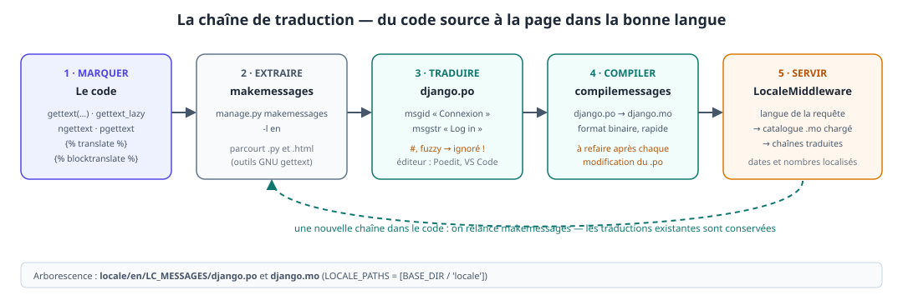
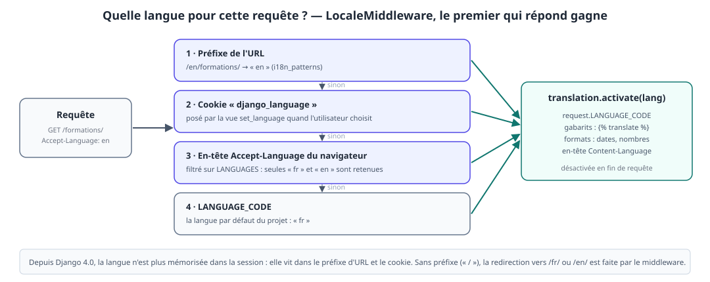
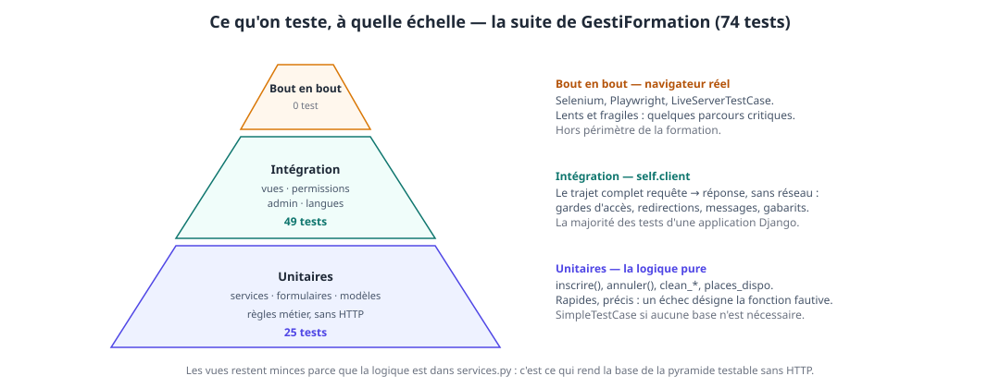
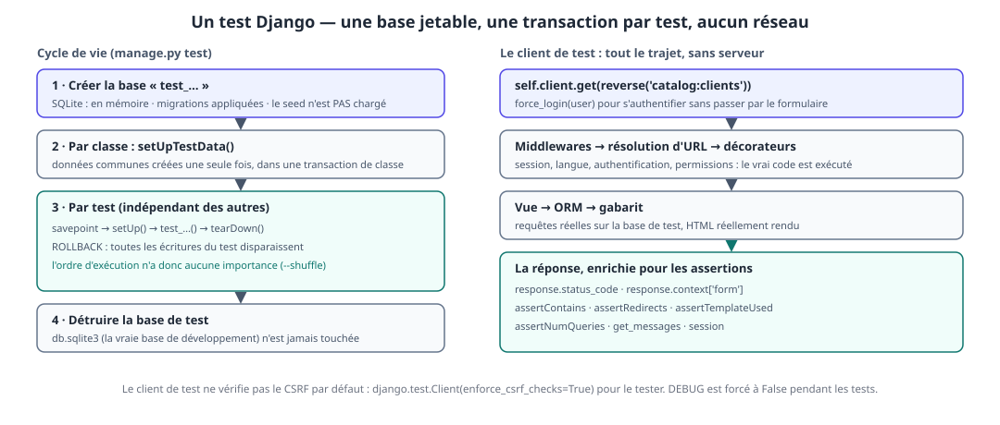

# Jour 4 — Parler plusieurs langues, prouver que ça marche : internationalisation et tests

> **Formation** : Django — initiation & approfondissement (5 jours)
> **Programme de référence** : [Dawan — Django : initiation / approfondissement](https://www.dawan.fr/formations/python/django/django-initiation-approfondissement)
> **Projet fil rouge** : GestiFormation — SaaS de gestion d'organisme de formation
> **Blocs couverts** : 10 (internationalisation et localisation) · 11 (tests automatisés)

**Prérequis** : jour 3 validé (`Inscription`, `services.py`, admin, authentification, rôles, « Mon espace »).
**Durée** : 7 h (9h00 – 17h00, pauses comprises).

> 💡 **Vocabulaire du dépôt** : dans le dépôt de référence, l'entité planifiée que les supports J2–J3 appellent `Session` s'appelle **`Intervention`** (`Inscription.intervention`, `InterventionComplete`, `Intervention.places_dispo`…). Les extraits du jour 4 suivent le dépôt.

## Objectifs pédagogiques

À la fin de la journée, les participants sont capables de :

- distinguer **internationalisation** (préparer le code), **traduction** et **localisation** (formats de dates, de nombres) ;
- marquer les chaînes : `gettext`, `gettext_lazy`, `ngettext`, `pgettext`, ``, `` — et choisir la bonne fonction selon **le moment d'exécution** ;
- produire et compiler un catalogue : `makemessages`, fichier `.po`, `compilemessages`, fichier `.mo` ;
- servir le site en `/fr/` et `/en/` : `LocaleMiddleware`, `i18n_patterns`, sélecteur de langue, formats localisés ;
- écrire des tests avec `django.test` : `SimpleTestCase`, `TestCase`, client de test, `RequestFactory`, `mock.patch` ;
- construire des **fabriques** de données de test, sans fixtures ni seed ;
- tester **services**, **formulaires**, **vues**, **gardes d'accès**, **admin** et **langues** ;
- appliquer un cycle **rouge → vert** (TDD) sur une règle métier ;
- mesurer la **couverture**, en tirer des constats, et vérifier qu'un test **échoue vraiment** quand on casse la règle.

### Livrable de la journée

- catalogue **français / anglais** : navigation, messages, formulaires, statuts, libellés de modèles, admin ;
- URLs préfixées `/fr/…` et `/en/…`, sélecteur de langue, dates et nombres localisés ;
- une suite de **74 tests** (`catalog/tests/`), exécutable en une commande, en ordre aléatoire ;
- un constat de couverture et la correction du code mort qu'il révèle ;
- les pages et les URLs des jours précédents toujours fonctionnelles, désormais préfixées par la langue.

> 💡 **Fil conducteur** : hier, on a *protégé* le site ; aujourd'hui, on le rend **lisible par d'autres** (B10) et **vérifiable** (B11). Les deux blocs sont liés : un test de langue vérifie une traduction, un test d'accès vérifie un décorateur. Chaque règle de la semaine devient une phrase qu'un ordinateur sait contrôler.

## Organisation de la journée

| Heure | Séquence | Blocs programme |
|---|---|---|
| 09h00 – 09h15 | Reprise du J3 : `check`, `migrate`, seed, serveur, commit | — |
| 09h15 – 11h00 | **B10·a** — Marquer le code, extraire, traduire, compiler | Bloc 10 |
| 11h00 – 11h15 | Pause | |
| 11h15 – 12h45 | **B10·b** — Langue dans l'URL, formats localisés, atelier | Bloc 10 |
| 12h45 – 13h45 | Déjeuner | |
| 13h45 – 16h15 | **B11** — Tests : services, formulaires, vues, accès, langues, couverture | Bloc 11 |
| 16h15 – 16h30 | Pause | |
| 16h30 – 17h00 | Démonstrations, synthèse, preview du jour 5 | — |

---

## B10 — Internationalisation et localisation (bloc 10) · 195 min

### 10.1. Trois mots, trois chantiers

| Terme | Sens | Dans GestiFormation |
|---|---|---|
| **Internationalisation** (i18n) | préparer le code pour qu'il *puisse* être traduit | marquer les chaînes avec `gettext` / `` |
| **Traduction** | fournir le texte dans une langue | `locale/en/LC_MESSAGES/django.po` |
| **Localisation** (l10n) | adapter les **formats** à une région | `1 890,50 €` en français, `1,890.50` en anglais ; `1 décembre 2026` / `Dec. 1, 2026` |

Une **locale** est un code de langue (`fr`, `en`), éventuellement régional (`fr-ca`, `en-gb`). On ne traduit pas « un site » mais des **chaînes marquées** ; tout ce qui n'est pas marqué reste tel quel.

| Django traduit tout seul | Il faut le marquer soi-même | Il ne sait pas traduire |
|---|---|---|
| l'admin, les messages d'erreur des formulaires (`required`, `invalid`), les formulaires de connexion et de mot de passe | nos gabarits, nos messages, nos libellés de modèles, nos exceptions | **les contenus saisis en base** (noms de formations, compétences) — voir §10.9 |

> 💡 **Effet immédiat à montrer** : passer `LANGUAGE_CODE` à `'fr'` met l'admin, le login et les erreurs de formulaire en français — **sans écrire une ligne de traduction**. Django embarque ses propres catalogues ; on n'a qu'à traduire *nos* chaînes.

### 10.2. La chaîne de traduction



Cinq étapes, toujours dans cet ordre : **marquer** (code), **extraire** (`makemessages`), **traduire** (le `.po`), **compiler** (`compilemessages`), **servir** (le middleware choisit la langue, Django lit le `.mo`). Quand le code évolue, on **ré-extrait** : les traductions existantes sont conservées.

### 10.3. Les réglages

```python
# gesti/settings.py — modifications J4
LANGUAGE_CODE = 'fr'                          # langue par défaut (était 'en-us')

LANGUAGES = [                                 # langues proposées — noms écrits dans leur propre langue
    ('fr', 'Français'),
    ('en', 'English'),
]

LOCALE_PATHS = [BASE_DIR / 'locale']          # où chercher / écrire nos catalogues

TIME_ZONE = 'Europe/Paris'                    # était 'UTC' : le stockage reste en UTC (USE_TZ = True)
USE_I18N = True
USE_THOUSAND_SEPARATOR = True                 # « 1 890,50 » plutôt que « 1890,50 »
```

Deux ajouts de configuration, dont **l'ordre compte** :

```python
MIDDLEWARE = [
    'django.middleware.security.SecurityMiddleware',
    'django.contrib.sessions.middleware.SessionMiddleware',
    'django.middleware.locale.LocaleMiddleware',      # ← après la session, avant CommonMiddleware
    'django.middleware.common.CommonMiddleware',
    …
]

TEMPLATES = [{
    …
    'OPTIONS': {'context_processors': [
        'django.template.context_processors.request',
        'django.template.context_processors.i18n',    # ← expose LANGUAGES, LANGUAGE_CODE aux gabarits
        …
    ]},
}]
```

> 💡 **Choix de la langue source.** Convention Django : msgid en **anglais**, traductions dans les autres langues. Notre code existant est en **français** : on le garde comme *langue source* et on ne crée qu'un catalogue **`en`**. Conséquence : en français, rien à traduire (le msgid *est* le texte). Pour un nouveau projet destiné à plusieurs langues, préférer des msgid anglais.

> 💡 **`USE_L10N` n'existe plus** (supprimé en Django 5.0) : la localisation des formats est toujours active. Seuls `USE_I18N` et `USE_TZ` subsistent.

### 10.4. Marquer le code Python

Une seule question à se poser : **quand ce code s'exécute-t-il ?**

| Moment d'exécution | Exemples | Fonction |
|---|---|---|
| **à chaque requête** (corps d'une vue, d'un service, d'une méthode) | messages, exceptions, `label_from_instance` | `gettext` (importée en `_`) |
| **au chargement du module** (attributs de classe, `Meta`, `choices`, `admin`) | `verbose_name`, `STATUS`, `error_messages`, `site_header` | `gettext_lazy` (importée en `_`) |
| **dépend d'un nombre** | « 1 place » / « 2 places » | `ngettext` / `ngettext_lazy` |
| **mot ambigu** | « Annuler » (bouton) / « Annulée » (statut) | `pgettext('contexte', 'texte')` |

*Lazy* signifie : l'objet renvoyé n'est **pas** un texte, mais une promesse de texte, résolue au moment de l'affichage, dans la langue **active à ce moment-là**. Un `gettext` ordinaire évalué à l'import figerait la langue du démarrage du serveur.

**Les modèles** (`catalog/models.py`) :

```python
from django.utils.translation import gettext_lazy as _


class Intervention(models.Model):
    STATUS = [
        ("A", _("à venir")),
        ("E", _("En cours")),
        ("C", _("Clôturée")),               # « Clotûrée » dans le dépôt : faute à corriger
    ]
    numero = models.CharField(_('numéro'), max_length=16, unique=True)
    …
    class Meta:
        verbose_name = _('intervention')
        ordering = ['date_debut']


class Inscription(models.Model):
    STATUTS = [
        ('P', _('En attente')),
        ('C', _('Confirmée')),
        ('X', _('Annulée')),
    ]
    …
    class Meta:
        verbose_name = _('inscription')
```

Le premier argument positionnel d'un champ (le libellé) se marque tel quel : `models.CharField(_('prénom'), …)`. Les `ModelForm` et l'admin reprennent **automatiquement** ces libellés — rien à marquer une seconde fois.

> 💡 **Migrations** : envelopper un texte dans `_()` ne change **pas** la migration (`makemigrations` désactive les traductions : il voit le msgid). En revanche corriger la **faute de frappe** « Clotûrée » → « Clôturée » modifie les `choices` : `makemigrations` génère un `AlterField`, **sans SQL** — c'est normal.

**Les messages des vues** (`catalog/views.py`) — texte *variable* : **jamais** d'f-string dans `_()`.

```python
from django.utils.translation import gettext as _

messages.success(request, _('Client « %(client)s » créé.') % {'client': client})
messages.success(request, _('Inscription enregistrée.'))
messages.error(request, _("Aucun profil client n'est associé à votre compte."))
```

> ⚠️ **Piège n°34 — `_(f"Client {client} créé")`** : l'f-string est évaluée **avant** `_()` ; le msgid devient « Client Marie Dupont créé », unique et **inextricable** — `makemessages` ne peut pas l'extraire. On écrit un msgid **constant** avec des marqueurs nommés `%(client)s`, puis on **formate après** la traduction : `_('…%(client)s…') % {'client': client}`. Les marqueurs nommés (pas `%s`) permettent au traducteur de **réordonner** les mots.

**Les services** (`catalog/services.py`) — les exceptions portent un message affiché à l'utilisateur :

```python
from django.utils.translation import gettext as _

raise DejaInscrit(_('Ce client est déjà inscrit à cette intervention.'))
raise InterventionComplete(_("Cette intervention est complète ou n'est plus ouverte."))
```

**Les formulaires** (`catalog/forms.py`) :

```python
from django.utils.formats import date_format
from django.utils.translation import gettext_lazy as _, ngettext


class ClientForm(forms.ModelForm):
    class Meta:
        model = Client
        fields = ['prenom', 'nom', 'societe', 'email', 'telephone']
        error_messages = {
            'email': {'unique': _('Un client existe déjà avec cette adresse e-mail.')},
        }

    def clean_telephone(self):
        valeur = self.cleaned_data.get('telephone', '')
        if valeur and not re.fullmatch(r'[\d\s()+.-]{6,20}', valeur):
            raise ValidationError(
                _('Format invalide — chiffres, espaces et « + » attendus.'),
                code='telephone_invalide',          # ← sert aux tests : le code ne change pas avec la langue
            )
        return valeur


class InterventionChoiceField(forms.ModelChoiceField):
    def label_from_instance(self, intervention):
        places = ngettext('%(n)d place', '%(n)d places', intervention.places) % {'n': intervention.places}
        debut = date_format(intervention.date_debut, 'SHORT_DATE_FORMAT')
        return f'{intervention.numero} — {intervention.formation.nom} ({intervention.ville}, {debut}) — {places}'
```

Ici `label_from_instance` s'exécute **à l'affichage** : `ngettext` ordinaire. `error_messages` est un attribut de classe : `gettext_lazy`. Le `place(s)` « à la main » du jour 3 disparaît : **`ngettext` choisit singulier ou pluriel** selon le nombre, et chaque langue applique sa propre règle.

**L'admin** — les attributs de classe et les décorateurs sont évalués à l'import :

```python
from django.utils.translation import gettext_lazy as _

admin.site.site_header = _('GestiFormation — administration')
admin.site.site_title = _('GestiFormation')
admin.site.index_title = _("Pilotage de l'organisme")

@admin.display(description=_('places libres'), ordering='_places')
def places(self, obj): …

@admin.action(description=_('Clôturer les interventions sélectionnées'), permissions=['change'])
def cloturer(self, request, queryset): …
```

> ⚠️ **Piège n°35 — `gettext` (non lazy) au niveau d'une classe ou d'un module** : le texte est résolu **une fois**, à l'import, dans la langue du démarrage ; tous les utilisateurs verront cette langue, quelle que soit celle de leur requête. Les attributs de classe (`verbose_name`, `choices`, `error_messages`, `site_header`) sont **toujours** en `gettext_lazy`.

### 10.5. Marquer les gabarits

```html
                                  {# à écrire dans CHAQUE gabarit, y compris ceux qui héritent #}

                      {# texte constant #}
           {# stocker le résultat dans une variable #}
```

Dès que la phrase contient des variables ou un pluriel : **``**.

```html
{# variable simple, avec un filtre : on la déclare par « with » #}
<h1>Bonjour {{ prenom }}</h1>

{# pluriel : « count » + « plural » #}
<p class="chiffre">
    
        {{ total }} formation au catalogue.
    
        {{ total }} formations au catalogue.
    
</p>
```

Trois règles :

- à l'intérieur d'un `blocktranslate`, **seules des variables simples** (`{{ prenom }}`) sont autorisées : pas de filtre, pas d'attribut — d'où le `with` ;
- **`trimmed`** supprime les retours à la ligne et indentations du msgid (sinon le catalogue conserve la mise en forme du gabarit) ;
- `count` remplace le `|pluralize` du jour 1, qui ne sait pas traduire (« jour/jours » n'est pas « day/days »).

**Le gabarit de base** (`catalog/base.html`) — extraits :

```html


<!DOCTYPE html>
<html lang="{{ LANGUAGE_CODE }}">                {# était lang="fr" : l'attribut suit la langue #}
…
<li><a href=""></a></li>

    <li><a href=""></a></li>
    …
    <button type="submit" class="lien"></button>

    <li><a href=""></a></li>
    <li><a href=""></a></li>

…
<p> — GestiFormation, </p>
```

Le gabarit `liste_formations.html` : les têtes de colonnes en ``, le compteur ci-dessus, et le pluriel de durée :

```html
<td>{{ jours }} jour{{ jours }} jours</td>
<td class="prix-col">{{ formation.prix|floatformat:"2g" }} €</td>
```

> 💡 **`"2g"`** : `floatformat:2` donne `1890,50`, `floatformat:"2g"` ajoute le séparateur de milliers de la langue (`1 890,50` / `1,890.50`). Le préfixe `"g"` est le **seul** moyen de grouper depuis un gabarit.

### 10.6. Extraire, traduire, compiler

**Prérequis : les outils GNU gettext.** `makemessages` appelle `xgettext`, `msguniq`, `msgmerge` ; `compilemessages` appelle `msgfmt`. Sous Windows, ils ne sont pas fournis avec Python :

```powershell
# installer GNU gettext (binaires Windows, ex. mlocati/gettext-iconv-windows, ou `choco install gettext`)
xgettext --version                # doit répondre — redémarrer le terminal après l'installation
```

> ⚠️ **Piège n°36 — `CommandError: Can't find msguniq`** : les outils gettext sont absents du `PATH`. Ce n'est pas une erreur Django ; on installe gettext, on **ferme et rouvre** le terminal, on relance.

```bash
mkdir locale                                      # le dossier doit exister avant la première extraction
python manage.py makemessages -l en -i .venv       # -i : ignorer le dossier de l'environnement virtuel
# → locale/en/LC_MESSAGES/django.po
python manage.py compilemessages
# → locale/en/LC_MESSAGES/django.mo
```

(`.venv` est déjà ignoré, car les dossiers cachés le sont par défaut.) `makemessages` parcourt les `.py` **et** les `.html` du projet.

**Le fichier `.po`** — un enregistrement par chaîne :

```po
"Language: en\n"
"Content-Type: text/plain; charset=UTF-8\n"
"Plural-Forms: nplurals=2; plural=(n != 1);\n"

#: catalog/templates/catalog/base.html:23
msgid "Connexion"
msgstr "Log in"

#: catalog/views.py:71
#, python-format
msgid "Client « %(client)s » créé."
msgstr "Customer “%(client)s” created."

#: catalog/forms.py:57
#, python-format
msgid "%(n)d place"
msgid_plural "%(n)d places"
msgstr[0] "%(n)d seat"
msgstr[1] "%(n)d seats"
```

Un `msgid` vide de `msgstr` est une chaîne **non traduite** : Django affiche alors le `msgid` — c'est ce qui rend le français (langue source) sans catalogue.

> ⚠️ **Piège n°37 — `.po` modifié, `.mo` oublié, ou entrée `fuzzy`** : Django ne lit que le **`.mo`**. Après chaque édition : `compilemessages`. Et une entrée marquée `#, fuzzy` (le rapprochement approximatif que `makemessages` propose quand un msgid proche a changé) est **ignorée à la compilation** : retirer l'indicateur `fuzzy` **après avoir relu** la traduction. `runserver` recharge les `.mo` tout seul ; en production, il faut redémarrer.

**Un vocabulaire minimal pour l'atelier** (à saisir dans le `.po` ou dans Poedit) :

| msgid (français) | msgstr (`en`) |
|---|---|
| Catalogue | Catalog |
| Mon espace | My account |
| Clients | Customers |
| Inscriptions | Registrations |
| Déconnexion | Log out |
| Connexion | Log in |
| Créer un compte | Sign up |
| Langue | Language |
| site de démonstration | demo site |
| intervention | training session |
| inscription | registration |
| à venir / En cours / Clôturée | Upcoming / In progress / Closed |
| En attente / Confirmée / Annulée | Pending / Confirmed / Cancelled |
| Client « %(client)s » créé. | Customer “%(client)s” created. |
| Inscription enregistrée. | Registration saved. |
| Ce client est déjà inscrit à cette intervention. | This customer is already registered for this session. |
| Cette intervention est complète ou n'est plus ouverte. | This session is full or no longer open. |
| Aucun profil client n'est associé à votre compte. | No customer profile is linked to your account. |
| Un client existe déjà avec cette adresse e-mail. | A customer with this e-mail address already exists. |
| %(n)d place / %(n)d places | %(n)d seat / %(n)d seats |

**Un détail sur les pluriels en français.** Une phrase *non traduite* suit la règle « 1 = singulier, tout le reste = pluriel » : `0` donne « 0 places ». Or le français met **0 et 1 au singulier** (« 0 place »). Pour obtenir « 0 place » il faut un **catalogue `fr`** qui déclare sa règle (`plural=(n > 1)`) et traduise les entrées plurielles à l'identique :

```bash
python manage.py makemessages -l fr -i venv
```

```po
"Plural-Forms: nplurals=2; plural=(n > 1);\n"

msgid "%(n)d place"
msgid_plural "%(n)d places"
msgstr[0] "%(n)d place"
msgstr[1] "%(n)d places"
```

> 💡 Le catalogue `fr` n'a **que** ses entrées plurielles à renseigner : les autres msgstr restent vides (le msgid est déjà du français). On vérifie par un test (§11.9).

### 🛠️ Atelier 10·a — Marquer et traduire (45 min)

1. appliquer les réglages de §10.3 (`LANGUAGE_CODE`, `LANGUAGES`, `LOCALE_PATHS`, `LocaleMiddleware`, context processor `i18n`) ; **ouvrir `/admin/`** : l'admin passe en français sans une ligne de traduction ;
2. marquer : `models.py`, `forms.py`, `services.py`, les trois messages de `views.py`, `base.html`, `mon_espace.html` ;
3. corriger « Clotûrée » ; `makemigrations` → une migration `AlterField` **sans SQL** (vérifier avec `sqlmigrate`) ; `migrate` ;
4. installer gettext, `mkdir locale`, `makemessages -l en -i venv` ; **ouvrir le `.po`** : retrouver chaque chaîne marquée et son emplacement `#:` ;
5. traduire avec le vocabulaire de §10.6 ; `compilemessages` ;
6. vérifier dans le shell :

```python
>>> from django.utils import translation
>>> from catalog.models import Intervention, Inscription
>>> with translation.override('en'):
...     print(Intervention._meta.verbose_name, '|', Inscription(statut='X').get_statut_display())
training session | Cancelled
>>> with translation.override('fr'):
...     print(Intervention._meta.verbose_name, '|', Inscription(statut='X').get_statut_display())
intervention | Annulée
```

**Checklist** :

- [ ] l'admin s'affiche en français avant toute traduction personnelle ;
- [ ] aucune f-string à l'intérieur d'un `_()` ; aucun `gettext` non lazy dans un attribut de classe ;
- [ ] le binôme sait dire pourquoi `makemigrations` ne détecte rien après avoir enveloppé les libellés ;
- [ ] `git add -A && git commit -m "J4 : marquage des chaînes + catalogue en"` fait (le `.mo` est un artefact : décider ensemble de le versionner ou de le compiler en CI).

---

### 10.7. La langue dans l'URL



Pour servir `/fr/…` et `/en/…`, on enveloppe les routes dans `i18n_patterns`. La vue **`set_language`** (qui reçoit le choix de l'utilisateur) reste **hors** préfixe : elle reçoit un `POST` quelle que soit la langue courante.

```python
# gesti/urls.py — version J4
from django.conf.urls.i18n import i18n_patterns
from django.contrib import admin
from django.contrib.auth.views import LoginView
from django.urls import include, path
from debug_toolbar.toolbar import debug_toolbar_urls

urlpatterns = [
    path('i18n/', include('django.conf.urls.i18n')),           # set_language (POST)
]

urlpatterns += i18n_patterns(
    path('admin/', admin.site.urls),
    path('comptes/login/', LoginView.as_view(template_name='catalog/login.html'), name='login'),
    path('comptes/', include('django.contrib.auth.urls')),
    path('', include('catalog.urls')),
)

urlpatterns += debug_toolbar_urls()                            # outils de dev : hors préfixe

handler404 = 'catalog.views.page_introuvable'
handler500 = 'catalog.views.interne'
handler403 = 'catalog.views.acces_refuse'
```

Conséquences à faire constater :

| Requête | Résultat |
|---|---|
| `GET /` | **302** vers `/fr/` (ou `/en/` si le cookie ou `Accept-Language` le demande) |
| `GET /en/formations/` | page en anglais, `<html lang="en">` |
| `` / `reverse('login')` | **suit la langue active** : `/en/comptes/login/` |
| `GET /formations/` (sans préfixe) | redirigé vers la version préfixée |

**Le sélecteur de langue** (dans la navigation de `base.html`) — un `POST` vers `set_language` :

```html
<form action="" method="post" class="inline">
    
    <input name="next" type="hidden" value="{{ request.get_full_path }}">
    
    
    <select name="language" onchange="this.form.submit()" aria-label="">
        
            <option value="{{ langue.code }}" selected>
                {{ langue.name_local }}
            </option>
        
    </select>
</form>
```

`set_language` pose le cookie `django_language` et redirige vers `next` **en remplaçant le préfixe** (`/fr/formations/` → `/en/formations/`).

> ⚠️ **Piège n°38 — les URLs écrites en dur** : `<a href="/formations/">` ne porte pas le préfixe de langue et ne suit pas la langue choisie ; la vue `accueil` du jour 1 en contenait une. Partout : `` dans les gabarits, `reverse()` en Python.

```python
def accueil(request: HttpRequest) -> HttpResponse:
    """Page d'accueil — réponse brute, mais sans URL écrite en dur."""
    texte = _("Gestion d'un organisme de formation : catalogue, interventions, inscriptions.")
    voir = _('Voir le catalogue')                   # hors de l'f-string : sinon, non extractible
    lien = reverse('catalog:liste-formations')
    return HttpResponse(
        f'<h1>GestiFormation</h1><p>{texte}</p><a href="{lien}">{voir}</a>',
        content_type='text/html',
    )
```

> 💡 **Aller plus loin (non pratiqué)** : `path(_('formations/'), …)` avec `gettext_lazy` traduit **l'URL elle-même** (`/en/courses/`). Utile pour le référencement ; chaque route traduite devient une entrée du catalogue.

### 10.8. Localisation : formats, fuseaux, séparateurs

Les formats **suivent la langue active** — à condition de ne pas les écrire en dur.

| Écrit en dur (jours 1–3) | Localisé (J4) | `fr` | `en` |
|---|---|---|---|
| `{{ d\|date:"d/m/Y" }}` | `{{ d\|date:"SHORT_DATE_FORMAT" }}` | `01/12/2026` | `12/01/2026` |
| `` | `` | `1 décembre 2026` | `Dec. 1, 2026` |
| `{{ prix\|floatformat:2 }}` | `{{ prix\|floatformat:"2g" }}` | `1 890,50` | `1,890.50` |
| `f'{debut:%d/%m/%Y}'` (Python) | `date_format(debut, 'SHORT_DATE_FORMAT')` | `01/12/2026` | `12/01/2026` |

Les noms `DATE_FORMAT`, `SHORT_DATE_FORMAT`, `DATETIME_FORMAT`… sont des **formats nommés** : chaque locale définit les siens.

Trois cas où l'on **désactive** la localisation, car la sortie n'est plus destinée à un humain :

```html
<input type="number" value="{{ formation.prix|unlocalize }}">        {# « 1890.50 », pas « 1890,50 » #}
<div data-prix="{{ formation.prix|unlocalize }}"></div>                {# attribut lu par du JavaScript #}
{{ formation.prix }}
```

> ⚠️ **Piège n°39 — un format écrit en dur ignore la langue ; un nombre localisé casse une machine** : `|date:"d/m/Y"` s'affichera à la française pour un lecteur anglophone ; à l'inverse `value="1 890,50"` dans un attribut numérique ou un JSON n'est pas lisible par le navigateur ni par `float()`. Texte pour l'humain → localisé ; donnée pour une machine → `|unlocalize`.

**Fuseau horaire.** `USE_TZ = True` : la base stocke en UTC, `TIME_ZONE` (`'Europe/Paris'`) est le fuseau d'**affichage**. Les `DateTimeField` (comme `Inscription.date_inscription`) sont convertis **au rendu du gabarit** ; `timezone.localdate()` donne la date du jour **dans ce fuseau** (c'est ce que le test du §11.5 utilise).

### 10.9. Ce que le catalogue ne traduit pas

`Formation.nom`, `Competence.nom`, `Formation.public` sont des **données** : le `.po` ne les connaît pas. Trois approches, par coût croissant :

| Approche | Principe | Limite |
|---|---|---|
| colonnes dédiées | `nom_en`, `public_en` dans le modèle | une migration par langue ajoutée |
| paquet tiers (`django-modeltranslation`, `django-parler`) | traductions stockées en base, sélection par langue | dépendance, apprentissage |
| ne pas traduire | acceptable pour des intitulés propres (« Django : initiation ») | contenu incohérent |

> ⚠️ **Piège n°40 — croire que `makemessages` traduit la base** : il n'extrait que du **code** et des **gabarits**. Le jour où un client demande « le catalogue en anglais », la réponse est un choix de modélisation, pas une commande.

### 🛠️ Atelier 10·b — Un site bilingue (45 min)

1. installer `i18n_patterns` et la vue `set_language` ; ajouter le sélecteur dans `base.html` ;
2. remplacer les formats en dur (`d/m/Y`, `floatformat:2`) dans `liste_formations`, `detail_formation`, `mon_espace`, `liste_inscriptions` ; remplacer les pluriels `|pluralize` ;
3. créer le catalogue `fr` (pluriel), traduire `accueil`, `compilemessages` ;
4. dérouler :

| # | Action | Résultat attendu |
|---|---|---|
| 1 | ouvrir `http://127.0.0.1:8000/` | redirection vers `/fr/` |
| 2 | changer la langue dans le sélecteur | `/en/…`, navigation en anglais, cookie `django_language` posé |
| 3 | sur `/en/`, ouvrir le catalogue | prix `1,890.00 €`, durée « 3 days » |
| 4 | sur `/fr/`, même page | prix `1 890,00 €`, durée « 3 jours » |
| 5 | forcer `/en/` dans l'URL en gardant le cookie `fr` | **l'URL gagne** : page en anglais |
| 6 | se connecter, ouvrir `/en/admin/` | l'admin (Django) passe en anglais, nos libellés (`site_header`…) aussi |
| 7 | `/en/inscriptions/nouvelle/` | les sessions du `<select>` sont décrites en anglais, avec « 3 seats » |
| 8 | provoquer l'erreur « déjà inscrit » en `/en/` | le message est en anglais |
| 9 | créer un compte avec un mot de passe trop courant | erreur traduite par Django, **sans** notre catalogue |
| 10 | `git grep -n "href=\"/"` | aucune URL en dur ne subsiste |

**Checklist** :

- [ ] les 10 cas passés, le binôme capable de redessiner la cascade « préfixe → cookie → en-tête → défaut » ;
- [ ] aucun `|date:"d/m/Y"` ni `floatformat:2` dans les gabarits d'affichage ;
- [ ] `python manage.py check` passe, commit `J4 : site bilingue fr/en` fait.

---

## B11 — Tests : prouver que ça marche (bloc 11) · 150 min

### 11.1. Pourquoi tester — et quoi

On a, depuis lundi, accumulé des **règles** : « une inscription prend une place, jamais plus », « seul un gestionnaire annule l'inscription d'un autre », « le formulaire normalise l'e-mail ». Chacune a été vérifiée **à la main**, une fois. Demain, quelqu'un touchera `services.py` ; qui relancera les 15 vérifications de l'atelier 9 ?

Un test est une **règle écrite sous une forme qu'un ordinateur sait contrôler**. Il rapporte à trois moments : quand on écrit (la règle est précisée), quand on modifie (une régression est détectée en 1 seconde), quand on reprend le projet six mois plus tard (le test *est* la documentation).



La suite du jour (74 tests) est répartie en trois étages ; la répartition réelle d'une application Django est souvent « large au milieu » : les vues sont minces parce que la logique est dans `services.py` — c'est cette discipline (jour 3) qui rend la base de la pyramide **testable sans HTTP**.

### 11.2. Les outils de `django.test`

Django s'appuie sur **`unittest`** (bibliothèque standard) et lui ajoute la base de données, le client HTTP et des assertions web.

| Classe | Base | À utiliser pour |
|---|---|---|
| `SimpleTestCase` | **interdite** (toute requête SQL échoue) | logique pure : `places_dispo`, fonctions de formatage |
| `TestCase` | oui, **transaction annulée après chaque test** | **99 % des cas** : services, formulaires, vues |
| `TransactionTestCase` | oui, base vidée à la fin | tester le comportement des transactions et de la concurrence |
| `LiveServerTestCase` | oui, avec un vrai serveur | parcours navigateur (Selenium, Playwright) — hors périmètre |

| Outil | Rôle |
|---|---|
| `self.client` | client HTTP de test : `get`, `post`, `force_login`, `follow=True` |
| `RequestFactory` | fabrique une **requête brute** pour appeler **une vue directement**, sans middleware ni URL |
| `reverse('catalog:clients')` | **ne jamais** écrire une URL en dur dans un test |
| `unittest.mock.patch` | remplacer temporairement un morceau de code (pour **provoquer** une panne) |
| `override_settings`, `translation.override` | modifier un réglage, la langue, le temps d'un test |

**Les assertions du jour** :

| Assertion | Vérifie |
|---|---|
| `assertEqual`, `assertTrue`, `assertRaises` | `unittest` — valeurs, booléens, exceptions |
| `assertContains(rep, texte)` / `assertNotContains` | statut 200 **et** texte présent / absent dans le HTML |
| `assertRedirects(rep, url)` | statut 302 **et** destination (puis suit la redirection) |
| `assertTemplateUsed(rep, 'catalog/403.html')` | le gabarit utilisé |
| `assertQuerySetEqual(qs, [objets], ordered=False)` | contenu d'un QuerySet |
| `assertRaisesMessage(Exc, 'texte')` | exception **et** message |
| `form.has_error('champ', code='…')` | erreur de formulaire, par **code** |
| `self.subTest(page=nom)` | une boucle dont chaque tour est **un cas distinct** dans le rapport |

### 11.3. Lancer les tests

```bash
python manage.py test                           # tout : découverte automatique
python manage.py test catalog.tests.test_services                 # un module
python manage.py test catalog.tests.test_services.InscrireTests   # une classe
python manage.py test -k derniere_place         # tout ce dont le nom contient « derniere_place »
python manage.py test --shuffle                 # ordre aléatoire : traque les dépendances cachées
python manage.py test --failfast --keepdb       # s'arrêter au 1er échec ; conserver la base de test
```

**La découverte** : fichiers `test*.py`, classes dérivées de `unittest.TestCase`, méthodes `test_*`. On remplace le fichier unique `catalog/tests.py` par un **paquet** :

```
catalog/tests/
├── __init__.py            ← fichier vide
├── factories.py           ← fabriques de données (pas de tests)
├── test_services.py
├── test_forms.py
├── test_views.py
├── test_permissions.py
└── test_i18n.py
```

> ⚠️ **Piège n°41 — `tests.py` **et** `tests/`** : Python ne sait pas lequel importer ; le lanceur s'arrête sur une erreur d'import. On **supprime** `catalog/tests.py` quand on crée le paquet.



Trois conséquences à retenir du schéma :

1. la base de test est **vide** : ni le `seed.py`, ni `db.sqlite3` ne sont chargés — chaque test crée ce dont il a besoin ;
2. chaque test est **isolé** par une transaction annulée — un test qui échoue ne pollue pas les autres, l'ordre est indifférent ;
3. le client de test exécute le **vrai** trajet (middlewares, URL, décorateurs, ORM, gabarits) — mais pas de serveur, pas de réseau.

> ⚠️ **Piège n°42 — la configuration d'environnement** : `settings.py` lit `SECRET_KEY` dans l'environnement (`.env`, ignoré par git). Sur une machine neuve ou en CI, `manage.py test` s'arrête sur *« The SECRET_KEY setting must not be empty »*. Les tests ne devraient pas dépendre d'un secret : en CI, on exporte une clé factice. Même constat pour `requirements.txt`, qui **ne liste pas** `python-dotenv` ni `django-debug-toolbar` (importés par `settings.py` et `urls.py`) : une installation propre échouerait avant le premier test. On complète le fichier (et `coverage`, §11.10) dans l'atelier.

### 11.4. Les données de test : des fabriques, pas des fixtures

Les tests n'utilisent **pas** `seed.py` (qui dépend de dates et de noms précis) : ils créent des objets **minimaux et explicites** avec de petites fonctions.

```python
# catalog/tests/factories.py
from datetime import timedelta
from decimal import Decimal
from itertools import count

from django.contrib.auth import get_user_model
from django.contrib.auth.models import Permission
from django.utils import timezone

from catalog.models import Client, Formation, Intervention

_sequence = count(1)


def creer_formation(**champs):
    n = next(_sequence)
    defauts = {'code': f'T-{n:03d}', 'nom': f'Formation {n}', 'duree': 2, 'prix': Decimal('1000.00')}
    return Formation.objects.create(**{**defauts, **champs})


def creer_intervention(formation=None, **champs):
    n = next(_sequence)
    debut = timezone.localdate() + timedelta(days=30)
    defauts = {
        'numero': f'T-{n:03d}-INT',
        'formation': formation or creer_formation(),
        'date_debut': debut,
        'date_fin': debut + timedelta(days=2),
        'capacite': 10,
        'statut': 'A',
    }
    return Intervention.objects.create(**{**defauts, **champs})


def creer_client(**champs):
    n = next(_sequence)
    defauts = {'prenom': 'Test', 'nom': f'Client{n}', 'email': f'client{n}@example.org'}
    return Client.objects.create(**{**defauts, **champs})


def creer_utilisateur(username, permissions=(), staff=False):
    """Compte sans mot de passe (pas de hachage coûteux) ; se connecte via force_login()."""
    user = get_user_model().objects.create_user(username, f'{username}@example.org', is_staff=staff)
    trouvees = Permission.objects.filter(content_type__app_label='catalog', codename__in=permissions)
    if trouvees.count() != len(set(permissions)):
        raise ValueError(f'Permission inconnue dans {permissions}')
    user.user_permissions.add(*trouvees)
    return user
```

Choix à justifier :

| Choix | Pourquoi |
|---|---|
| **valeurs par défaut + `**champs`** | un test ne nomme que **ce qui compte pour lui** : `creer_intervention(capacite=1)` |
| compteur `_sequence` | les champs `unique` (`code`, `numero`, `email`) ne se télescopent jamais |
| dates **relatives** à aujourd'hui | un test écrit en 2026 ne casse pas en 2027 |
| `Decimal('1000.00')`, pas `1000.0` | un `float` en mémoire n'est pas le `Decimal` relu depuis la base |
| `create_user` **sans** mot de passe | pas de hachage PBKDF2 (environ 0,3 s par utilisateur) ; on se connecte par `force_login` |
| `ValueError` sur permission inconnue | une faute de frappe sur un `codename` fabriquerait un test **trivialement vert** |

**`setUpTestData` ou `setUp` ?**

| | `setUpTestData` (méthode de classe) | `setUp` (méthode d'instance) |
|---|---|---|
| Exécuté | **une fois** par classe | avant **chaque** test |
| Pour | données **communes, non modifiées** (le client, la formation) | objets que le test **modifie** (l'intervention dont on lit le compteur) |
| Isolation | chaque test reçoit une **copie** des objets Python ; la base est restaurée | totale |

### 11.5. Tester les services — le cœur des règles métier

Le code testé (`catalog/services.py`) concentre les règles du jour 3 : la place se prend **dans l'`UPDATE`**, le doublon est refusé, l'annulation libère la place.

```python
# catalog/tests/test_services.py
from datetime import timedelta
from decimal import Decimal
from unittest.mock import patch

from django.db import IntegrityError, transaction
from django.test import SimpleTestCase, TestCase
from django.utils import timezone

from catalog.models import Inscription, Intervention
from catalog.services import DejaInscrit, InterventionComplete, annuler, inscrire

from .factories import creer_client, creer_formation, creer_intervention


class InterventionTests(SimpleTestCase):
    """Aucun accès base : SimpleTestCase suffit."""

    def test_places_dispo(self):
        self.assertEqual(Intervention(capacite=10, nb_inscrits=3).places_dispo, 7)

    def test_places_dispo_ne_descend_pas_sous_zero(self):
        self.assertEqual(Intervention(capacite=5, nb_inscrits=7).places_dispo, 0)


class InscrireTests(TestCase):
    @classmethod
    def setUpTestData(cls):
        cls.formation = creer_formation(prix=Decimal('1890.00'))
        cls.alice = creer_client()
        cls.bob = creer_client()

    def setUp(self):
        self.intervention = creer_intervention(self.formation, capacite=2)

    def places_prises(self):
        self.intervention.refresh_from_db()
        return self.intervention.nb_inscrits

    def test_cree_la_ligne_et_prend_une_place(self):
        inscription = inscrire(self.alice, self.intervention)
        inscription.refresh_from_db()
        self.assertEqual(inscription.statut, 'P')
        self.assertEqual(inscription.montant_ht, Decimal('1890.00'))
        self.assertEqual(self.places_prises(), 1)

    def test_le_montant_est_copie_pas_reference(self):
        inscription = inscrire(self.alice, self.intervention)
        self.formation.prix = Decimal('2500.00')
        self.formation.save()
        inscription.refresh_from_db()
        self.assertEqual(inscription.montant_ht, Decimal('1890.00'))

    def test_refuse_le_doublon_sans_toucher_au_compteur(self):
        inscrire(self.alice, self.intervention)
        with self.assertRaises(DejaInscrit):
            inscrire(self.alice, self.intervention)
        self.assertEqual(self.places_prises(), 1)

    def test_refuse_la_derniere_place_deja_prise(self):
        inscrire(self.alice, self.intervention)
        inscrire(self.bob, self.intervention)
        troisieme = creer_client()
        with self.assertRaises(InterventionComplete):
            inscrire(troisieme, self.intervention)
        self.assertEqual(self.places_prises(), 2)
        self.assertFalse(Inscription.objects.filter(client=troisieme).exists())

    def test_refuse_une_intervention_non_ouverte(self):
        for statut in ('E', 'C'):
            with self.subTest(statut=statut):
                fermee = creer_intervention(self.formation, statut=statut)
                with self.assertRaises(InterventionComplete):
                    inscrire(self.alice, fermee)

    def test_l_echec_de_la_creation_annule_la_place_prise(self):
        with patch.object(Inscription.objects, 'create', side_effect=IntegrityError):
            with self.assertRaises(IntegrityError):
                inscrire(self.alice, self.intervention)
        self.assertEqual(self.places_prises(), 0)


class AnnulerTests(TestCase):
    def setUp(self):
        self.intervention = creer_intervention(capacite=2)
        self.alice = creer_client()
        self.inscription = inscrire(self.alice, self.intervention)

    def places_prises(self):
        self.intervention.refresh_from_db()
        return self.intervention.nb_inscrits

    def test_annuler_libere_la_place(self):
        self.assertTrue(annuler(self.inscription))
        self.inscription.refresh_from_db()
        self.assertEqual(self.inscription.statut, 'X')
        self.assertEqual(self.places_prises(), 0)

    def test_annuler_deux_fois_ne_libere_qu_une_place(self):
        annuler(self.inscription)
        self.assertFalse(annuler(self.inscription))
        self.assertEqual(self.places_prises(), 0)

    def test_reinscription_possible_apres_annulation(self):
        annuler(self.inscription)
        inscrire(self.alice, self.intervention)
        self.assertEqual(self.places_prises(), 1)


class ContrainteEnBaseTests(TestCase):
    """La contrainte protège aussi quand on contourne le service."""

    def setUp(self):
        self.intervention = creer_intervention()
        self.client_test = creer_client()

    def creer_directement(self, statut='P'):
        return Inscription.objects.create(
            client=self.client_test, intervention=self.intervention,
            montant_ht=Decimal('100.00'), statut=statut,
        )

    def test_deux_inscriptions_actives_sont_refusees(self):
        self.creer_directement()
        with self.assertRaises(IntegrityError), transaction.atomic():
            self.creer_directement()

    def test_une_inscription_annulee_ne_bloque_pas(self):
        self.creer_directement(statut='X')
        self.creer_directement()
        self.assertEqual(Inscription.objects.count(), 2)
```

Ce qu'il faut **lire en détail** avec les stagiaires :

1. **un test = un comportement**, nommé comme une phrase (`test_refuse_la_derniere_place_deja_prise`) ; le rapport d'échec se lit sans ouvrir le code ;
2. **`refresh_from_db()`** avant de relire un compteur : `update(F(...))` écrit en base, **pas** dans l'objet Python — sans lui, le test lirait une valeur périmée ;
3. **`test_l_echec_de_la_creation_annule_la_place_prise`** : on **provoque une panne** (`patch.object(…, side_effect=IntegrityError)`) pour prouver que `@transaction.atomic` annule l'incrément. Un `mock` sert à **fabriquer une situation impossible à obtenir autrement** — pas à éviter la base ;
4. **`assertRaises(IntegrityError), transaction.atomic()`** : en `TestCase`, une erreur SQL **non isolée** casserait la transaction du test ; `atomic()` crée un *savepoint* qu'on annule proprement ;
5. **`test_refuse_la_derniere_place_deja_prise`** vérifie la *logique* de « comparer et incrémenter ». Il ne prouve **pas** la tenue sous de vrais accès simultanés (il faudrait `TransactionTestCase` et des threads, et SQLite n'est pas le bon terrain) — c'est une limite à dire à voix haute.

> ⚠️ **Piège n°43 — un test qu'on n'a jamais vu échouer ne prouve rien** : un test sans assertion, un `assertRaises(Exception)` trop large, un mock qui remplace ce qu'il devrait vérifier — tous passent au vert. La parade est la **mutation à la main** (atelier 11·c) : on casse la règle, le test **doit** devenir rouge.

**Le cycle rouge → vert (TDD).** Une nouvelle règle : *« on ne s'inscrit pas à une intervention déjà commencée, même si son statut est encore « à venir »*. On écrit **d'abord** le test :

```python
    def test_refuse_une_intervention_deja_commencee(self):
        hier = timezone.localdate() - timedelta(days=1)
        commencee = creer_intervention(self.formation, date_debut=hier, date_fin=hier + timedelta(days=2))
        with self.assertRaises(InterventionComplete):
            inscrire(self.alice, commencee)
```

```bash
python manage.py test catalog.tests.test_services      # ROUGE : « InterventionComplete not raised »
```

Puis la **plus petite modification** qui le fait passer — une ligne dans le filtre de l'`UPDATE`, donc toujours atomique :

```python
# catalog/services.py
from django.utils import timezone

    places_prises = Intervention.objects.filter(
        pk=intervention.pk, statut='A', nb_inscrits__lt=F('capacite'),
        date_debut__gte=timezone.localdate(),                  # ← la nouvelle règle
    ).update(nb_inscrits=F('nb_inscrits') + 1)
```

```bash
python manage.py test catalog.tests.test_services      # VERT
```

Le test **précède** le code : on prouve d'abord qu'il sait échouer, ensuite qu'il sait réussir.

### 11.6. Tester les formulaires

```python
# catalog/tests/test_forms.py
from django.test import TestCase

from catalog.forms import ClientForm, CompteForm, InscriptionForm

from .factories import creer_client, creer_intervention


class ClientFormTests(TestCase):
    donnees = {
        'prenom': 'Marie', 'nom': 'Dupont', 'societe': 'Acme',
        'email': 'Marie@Acme.FR', 'telephone': '+33 1 23 45 67 89',
    }

    def formulaire(self, **changements):
        return ClientForm({**self.donnees, **changements})

    def test_donnees_valides(self):
        self.assertTrue(self.formulaire().is_valid())

    def test_email_normalise_en_minuscules(self):
        form = self.formulaire()
        form.is_valid()
        self.assertEqual(form.cleaned_data['email'], 'marie@acme.fr')

    def test_email_deja_pris_meme_avec_une_autre_casse(self):
        creer_client(email='marie@acme.fr')
        form = self.formulaire()
        self.assertFalse(form.is_valid())
        self.assertTrue(form.has_error('email', code='unique'))

    def test_modifier_son_propre_client_ne_declenche_pas_l_unicite(self):
        existant = creer_client(email='marie@acme.fr')
        form = ClientForm({**self.donnees, 'societe': 'Autre'}, instance=existant)
        self.assertTrue(form.is_valid(), form.errors)

    def test_telephone_invalide(self):
        form = self.formulaire(telephone='abc')
        self.assertFalse(form.is_valid())
        self.assertTrue(form.has_error('telephone', code='telephone_invalide'))

    def test_prenom_et_nom_obligatoires(self):
        form = self.formulaire(prenom='', nom='')
        self.assertFalse(form.is_valid())
        self.assertTrue(form.has_error('prenom', code='required'))
        self.assertTrue(form.has_error('nom', code='required'))

    def test_seuls_les_champs_prevus_sont_exposes(self):
        self.assertEqual(list(ClientForm().fields), ['prenom', 'nom', 'societe', 'email', 'telephone'])


class InscriptionFormTests(TestCase):
    def test_ne_propose_que_les_interventions_ouvertes_avec_des_places(self):
        ouverte = creer_intervention(capacite=5)
        creer_intervention(capacite=2, nb_inscrits=2)    # complète
        creer_intervention(statut='C')                   # clôturée
        queryset = InscriptionForm().fields['intervention'].queryset
        self.assertQuerySetEqual(queryset, [ouverte], ordered=False)


class CompteFormTests(TestCase):
    donnees = {
        'username': 'nouveau', 'first_name': 'Nora', 'last_name': 'Vidal',
        'email': 'nora@example.org',
        'password1': 'ZephyrQuartz-2026!', 'password2': 'ZephyrQuartz-2026!',
    }

    def test_valide(self):
        self.assertTrue(CompteForm(self.donnees).is_valid())

    def test_confirmation_differente(self):
        form = CompteForm({**self.donnees, 'password2': 'autre-chose-2026!'})
        self.assertFalse(form.is_valid())
        self.assertTrue(form.has_error('password2', code='password_mismatch'))

    def test_mot_de_passe_trop_courant(self):
        form = CompteForm({**self.donnees, 'password1': '12345678', 'password2': '12345678'})
        self.assertFalse(form.is_valid())
        self.assertIn('password2', form.errors)
```

À remarquer :

- on **instancie le formulaire avec un dictionnaire** — pas de HTTP : un formulaire est un objet Python qu'on teste seul ;
- **`has_error(champ, code=…)`** plutôt que le texte du message : le code ne change pas avec la langue (§10.4, `code='telephone_invalide'`). Un test qui compare « Un client existe déjà… » casserait le jour où quelqu'un reformule — ou traduit — le message ;
- **`test_modifier_son_propre_client…`** protège un comportement subtil du B7 : l'unicité ignore l'instance éditée ;
- **`test_seuls_les_champs_prevus_sont_exposes`** transforme le piège n°22 (`fields = '__all__'`) en **régression impossible** : si quelqu'un ajoute `utilisateur`, le test échoue.

> ⚠️ **Piège n°44 — tester le texte plutôt que le comportement** : `assertContains(rep, 'Un client existe déjà')` dépend de la langue, de la ponctuation, d'une virgule. On préfère le **code d'erreur**, le **niveau d'un message** (`success` / `error`), le **gabarit utilisé**, le **statut HTTP**, la **présence en base**. Le texte n'est contrôlé que là où il *est* le comportement (§11.9).

### 11.7. Tester les vues avec le client de test

```python
# catalog/tests/test_views.py
from decimal import Decimal

from django.contrib.auth import get_user_model
from django.db import connection
from django.test import Client as ClientHTTP
from django.test import RequestFactory, SimpleTestCase, TestCase, override_settings
from django.test.utils import CaptureQueriesContext
from django.urls import reverse

from catalog.models import Client, Contrat, Inscription
from catalog.services import inscrire
from catalog.views import interne

from .factories import (creer_client, creer_formation, creer_intervention,
                        creer_utilisateur)

DONNEES_CLIENT = {
    'prenom': 'Marie', 'nom': 'Dupont', 'societe': 'Acme',
    'email': 'marie@acme.fr', 'telephone': '',
}


def niveaux(reponse):
    """Niveaux des messages affichés (« success », « error »…) : indépendants de la langue."""
    return [message.level_tag for message in reponse.context['messages']]


class PagesPubliquesTests(TestCase):
    @classmethod
    def setUpTestData(cls):
        cls.formation = creer_formation(nom='Django initiation')
        cls.ouverte = creer_intervention(cls.formation, statut='A')
        cls.cloturee = creer_intervention(cls.formation, statut='C')

    def test_accueil(self):
        self.assertEqual(self.client.get(reverse('catalog:accueil')).status_code, 200)

    def test_catalogue_liste_les_formations(self):
        reponse = self.client.get(reverse('catalog:liste-formations'))
        self.assertContains(reponse, self.formation.code)
        self.assertTemplateUsed(reponse, 'catalog/liste_formations.html')

    def test_detail_n_affiche_que_les_interventions_a_venir(self):
        reponse = self.client.get(reverse('catalog:detail-formation', args=[self.formation.pk]))
        self.assertContains(reponse, self.ouverte.numero)
        self.assertNotContains(reponse, self.cloturee.numero)

    def test_formation_inconnue_utilise_la_page_404_du_projet(self):
        reponse = self.client.get(reverse('catalog:detail-formation', args=[999999]))
        self.assertEqual(reponse.status_code, 404)
        self.assertTemplateUsed(reponse, 'catalog/404.html')


class PagesErreurTests(SimpleTestCase):
    def test_la_page_500_appelee_directement(self):
        requete = RequestFactory().get('/')          # pas de middleware, pas d'URL : la vue seule
        reponse = interne(requete)
        self.assertEqual(reponse.status_code, 500)


class CrudClientTests(TestCase):
    @classmethod
    def setUpTestData(cls):
        cls.gestionnaire = creer_utilisateur(
            'gestionnaire',
            ['view_client', 'add_client', 'change_client', 'delete_client'],
            staff=True,
        )

    def setUp(self):
        self.client.force_login(self.gestionnaire)

    def test_creation_valide(self):
        reponse = self.client.post(reverse('catalog:nouveau-client'), DONNEES_CLIENT, follow=True)
        self.assertRedirects(reponse, reverse('catalog:clients'))
        self.assertTrue(Client.objects.filter(email='marie@acme.fr').exists())
        self.assertEqual(niveaux(reponse), ['success'])

    def test_creation_invalide_reaffiche_le_formulaire_sans_rien_ecrire(self):
        reponse = self.client.post(reverse('catalog:nouveau-client'), {**DONNEES_CLIENT, 'email': ''})
        self.assertEqual(reponse.status_code, 200)
        self.assertTrue(reponse.context['form'].has_error('email', code='required'))
        self.assertEqual(Client.objects.count(), 0)

    def test_modification(self):
        existant = creer_client(prenom='Ancien', email='marie@acme.fr')
        self.client.post(reverse('catalog:modifier-client', args=[existant.pk]),
                         {**DONNEES_CLIENT, 'prenom': 'Nouveau'})
        existant.refresh_from_db()
        self.assertEqual(existant.prenom, 'Nouveau')

    def test_la_page_de_suppression_en_get_ne_supprime_rien(self):
        existant = creer_client()
        reponse = self.client.get(reverse('catalog:supprimer-client', args=[existant.pk]))
        self.assertEqual(reponse.status_code, 200)
        self.assertTrue(Client.objects.filter(pk=existant.pk).exists())

    def test_suppression(self):
        existant = creer_client()
        self.client.post(reverse('catalog:supprimer-client', args=[existant.pk]))
        self.assertFalse(Client.objects.filter(pk=existant.pk).exists())

    def test_suppression_d_un_client_avec_contrat_est_refusee_proprement(self):
        existant = creer_client()
        Contrat.objects.create(client=existant, titre='Contrat', numero='CT-T-1',
                               montant_ht=Decimal('100.00'))
        reponse = self.client.post(reverse('catalog:supprimer-client', args=[existant.pk]), follow=True)
        self.assertEqual(reponse.status_code, 200)            # pas de 500
        self.assertTrue(Client.objects.filter(pk=existant.pk).exists())
        self.assertEqual(niveaux(reponse), ['error'])

    def test_les_donnees_sont_echappees(self):
        creer_client(prenom='<b>gras</b>')
        reponse = self.client.get(reverse('catalog:clients'))
        self.assertContains(reponse, '&lt;b&gt;gras&lt;/b&gt;')
        self.assertNotContains(reponse, '<b>gras</b>')

    def test_recherche(self):
        creer_client(nom='Dupont')
        creer_client(nom='Martin')
        reponse = self.client.get(reverse('catalog:clients'), {'q': 'dup'})
        self.assertEqual([c.nom for c in reponse.context['clients']], ['Dupont'])


class InscriptionBackOfficeTests(TestCase):
    @classmethod
    def setUpTestData(cls):
        cls.gestionnaire = creer_utilisateur(
            'gestionnaire', ['view_inscription', 'add_inscription'], staff=True,
        )
        cls.intervention = creer_intervention(capacite=50)
        cls.alice = creer_client()

    def setUp(self):
        self.client.force_login(self.gestionnaire)

    def test_le_formulaire_inscrit_le_client(self):
        reponse = self.client.post(reverse('catalog:nouvelle-inscription'),
                                   {'client': self.alice.pk, 'intervention': self.intervention.pk})
        self.assertRedirects(reponse, reverse('catalog:inscriptions'))
        self.intervention.refresh_from_db()
        self.assertEqual(self.intervention.nb_inscrits, 1)

    def test_un_doublon_devient_une_erreur_de_formulaire(self):
        donnees = {'client': self.alice.pk, 'intervention': self.intervention.pk}
        self.client.post(reverse('catalog:nouvelle-inscription'), donnees)
        reponse = self.client.post(reverse('catalog:nouvelle-inscription'), donnees)
        self.assertEqual(reponse.status_code, 200)
        self.assertTrue(reponse.context['form'].non_field_errors())
        self.assertEqual(Inscription.objects.count(), 1)

    def test_le_nombre_de_requetes_ne_depend_pas_du_nombre_de_lignes(self):
        def compter():
            with CaptureQueriesContext(connection) as contexte:
                self.client.get(reverse('catalog:inscriptions'))
            return len(contexte)

        inscrire(self.alice, self.intervention)
        avec_une_ligne = compter()
        for _ in range(4):
            inscrire(creer_client(), self.intervention)
        self.assertEqual(compter(), avec_une_ligne)


@override_settings(PASSWORD_HASHERS=['django.contrib.auth.hashers.MD5PasswordHasher'])
class CreerCompteTests(TestCase):
    donnees = {
        'username': 'nora', 'first_name': 'Nora', 'last_name': 'Vidal',
        'email': 'Nora@Example.org',
        'password1': 'ZephyrQuartz-2026!', 'password2': 'ZephyrQuartz-2026!',
    }

    def test_cree_le_compte_connecte_et_rattache_le_client_existant(self):
        existant = creer_client(email='nora@example.org')
        reponse = self.client.post(reverse('catalog:creer-compte'), self.donnees)
        self.assertRedirects(reponse, reverse('catalog:mon-espace'))
        user = get_user_model().objects.get(username='nora')
        self.assertEqual(user.email, 'nora@example.org')                   # normalisé
        self.assertEqual(int(self.client.session['_auth_user_id']), user.pk)
        existant.refresh_from_db()
        self.assertEqual(existant.utilisateur, user)

    def test_cree_un_client_quand_l_adresse_est_inconnue(self):
        self.client.post(reverse('catalog:creer-compte'), self.donnees)
        self.assertEqual(Client.objects.get(email='nora@example.org').utilisateur.username, 'nora')

    def test_mots_de_passe_differents_ne_creent_rien(self):
        reponse = self.client.post(reverse('catalog:creer-compte'),
                                   {**self.donnees, 'password2': 'autre-2026-xyz!'})
        self.assertEqual(reponse.status_code, 200)
        self.assertFalse(get_user_model().objects.filter(username='nora').exists())


class MonEspaceTests(TestCase):
    @classmethod
    def setUpTestData(cls):
        cls.intervention = creer_intervention(capacite=5)
        cls.alice = creer_utilisateur('alice')
        cls.bob = creer_utilisateur('bob')
        cls.client_alice = creer_client(utilisateur=cls.alice)
        cls.client_bob = creer_client(utilisateur=cls.bob)
        cls.inscription_alice = inscrire(cls.client_alice, cls.intervention)
        cls.inscription_bob = inscrire(cls.client_bob, cls.intervention)

    def setUp(self):
        self.client.force_login(self.alice)

    def test_ne_liste_que_mes_inscriptions(self):
        reponse = self.client.get(reverse('catalog:mon-espace'))
        self.assertEqual(list(reponse.context['inscriptions']), [self.inscription_alice])

    def test_annuler_la_mienne_libere_la_place(self):
        reponse = self.client.post(reverse('catalog:annuler-ma-inscription', args=[self.inscription_alice.pk]))
        self.assertRedirects(reponse, reverse('catalog:mon-espace'))
        self.inscription_alice.refresh_from_db()
        self.assertEqual(self.inscription_alice.statut, 'X')

    def test_annuler_celle_d_un_autre_renvoie_404(self):
        reponse = self.client.post(reverse('catalog:annuler-ma-inscription', args=[self.inscription_bob.pk]))
        self.assertEqual(reponse.status_code, 404)
        self.inscription_bob.refresh_from_db()
        self.assertNotEqual(self.inscription_bob.statut, 'X')

    def test_annuler_exige_un_post(self):
        reponse = self.client.get(reverse('catalog:annuler-ma-inscription', args=[self.inscription_alice.pk]))
        self.assertEqual(reponse.status_code, 405)

    def test_s_inscrire(self):
        libre = creer_intervention(capacite=5)
        reponse = self.client.post(reverse('catalog:sinscrire', args=[libre.pk]), follow=True)
        self.assertRedirects(reponse, reverse('catalog:detail-formation', args=[libre.formation_id]))
        self.assertTrue(Inscription.objects.filter(client=self.client_alice, intervention=libre).exists())
        self.assertEqual(niveaux(reponse), ['success'])

    def test_s_inscrire_a_une_intervention_complete(self):
        pleine = creer_intervention(capacite=1, nb_inscrits=1)
        reponse = self.client.post(reverse('catalog:sinscrire', args=[pleine.pk]), follow=True)
        self.assertEqual(niveaux(reponse), ['error'])
        self.assertFalse(Inscription.objects.filter(intervention=pleine).exists())

    def test_s_inscrire_sans_profil_client(self):
        self.client.force_login(creer_utilisateur('sans-profil'))
        libre = creer_intervention()
        reponse = self.client.post(reverse('catalog:sinscrire', args=[libre.pk]), follow=True)
        self.assertEqual(niveaux(reponse), ['error'])

    def test_s_inscrire_exige_un_post(self):
        libre = creer_intervention()
        self.assertEqual(self.client.get(reverse('catalog:sinscrire', args=[libre.pk])).status_code, 405)


class CsrfTests(TestCase):
    def test_un_post_sans_jeton_est_refuse(self):
        navigateur = ClientHTTP(enforce_csrf_checks=True)       # le client de test n'applique pas le CSRF par défaut
        navigateur.force_login(creer_utilisateur('alice'))
        reponse = navigateur.post(reverse('catalog:sinscrire', args=[1]))
        self.assertEqual(reponse.status_code, 403)
```

Ce qu'il faut retenir de ces 28 tests :

| Technique | Où | Pourquoi |
|---|---|---|
| `reverse(...)` | partout | une URL renommée, ou **préfixée par la langue** (B10), ne casse rien |
| `follow=True` + `niveaux(reponse)` | CRUD, inscription | on teste **l'issue** (message de succès / d'erreur) sans dépendre du texte |
| `reponse.context['form']` | création invalide | on interroge l'objet réellement transmis au gabarit |
| `assertRedirects` | création, annulation | vérifie le 302 **et** que la destination répond |
| **404 pour l'inscription d'autrui** | `MonEspaceTests` | prouve le filtre par propriétaire (piège n°33) |
| `CaptureQueriesContext` | liste des inscriptions | « le nombre de requêtes ne dépend pas du nombre de lignes » : **détecte un N+1 sans compter à la main** |
| `Client(enforce_csrf_checks=True)` | `CsrfTests` | le client de test **désactive** le CSRF par défaut ; ce test prouve que la protection est active |
| `RequestFactory` | `PagesErreurTests` | appeler la vue 500 directement : aucun moyen de la déclencher par une URL |
| `@override_settings(PASSWORD_HASHERS=[MD5…])` | création de compte | un vrai hachage PBKDF2 coûterait 0,3 s par test ; **uniquement** là où un mot de passe est réellement haché |

> ⚠️ **Piège n°45 — l'homonyme `Client`** : `catalog.models.Client` (nos clients) et `django.test.Client` (le navigateur factice) portent le même nom, et `self.client` n'est ni l'un ni l'autre des deux imports. On importe le second **sous un alias** : `from django.test import Client as ClientHTTP`.

### 11.8. Tester les gardes d'accès et l'admin

Les décorateurs du jour 3 sont **invisibles** : un oubli ne fait pas planter la page, il l'ouvre à tout le monde. C'est le cas d'école où un test vaut mieux qu'une relecture. On écrit **une table** — chaque page protégée et la permission qui la protège — et on la fait parcourir par trois tests.

```python
# catalog/tests/test_permissions.py
from django.apps import apps
from django.contrib import admin
from django.contrib.auth import get_user_model
from django.test import TestCase
from django.urls import reverse

from catalog.services import inscrire

from .factories import creer_client, creer_intervention, creer_utilisateur


class GardesDAccesTests(TestCase):
    @classmethod
    def setUpTestData(cls):
        cls.cible = creer_client()
        cls.stagiaire = creer_utilisateur('stagiaire')

    def pages(self):
        pk = [self.cible.pk]
        return [
            # nom d'URL, arguments, permission minimale
            ('catalog:clients', [], 'view_client'),
            ('catalog:nouveau-client', [], 'add_client'),
            ('catalog:modifier-client', pk, 'change_client'),
            ('catalog:supprimer-client', pk, 'delete_client'),
            ('catalog:inscriptions', [], 'view_inscription'),
            ('catalog:nouvelle-inscription', [], 'add_inscription'),
        ]

    def test_anonyme_est_redirige_vers_la_connexion(self):
        for nom, args, _ in self.pages():
            with self.subTest(page=nom):
                url = reverse(nom, args=args)
                self.assertRedirects(self.client.get(url), f"{reverse('login')}?next={url}")

    def test_connecte_sans_permission_recoit_403(self):
        self.client.force_login(self.stagiaire)
        for nom, args, _ in self.pages():
            with self.subTest(page=nom):
                reponse = self.client.get(reverse(nom, args=args))
                self.assertEqual(reponse.status_code, 403)
                self.assertTemplateUsed(reponse, 'catalog/403.html')

    def test_la_permission_prevue_suffit(self):
        for nom, args, permission in self.pages():
            with self.subTest(page=nom):
                self.client.force_login(creer_utilisateur(f'u-{permission}', [permission]))
                self.assertEqual(self.client.get(reverse(nom, args=args)).status_code, 200)

    def test_mon_espace_exige_la_connexion(self):
        url = reverse('catalog:mon-espace')
        self.assertRedirects(self.client.get(url), f"{reverse('login')}?next={url}")

    def test_pages_publiques_restent_publiques(self):
        for nom in ('catalog:accueil', 'catalog:liste-formations', 'catalog:creer-compte', 'login'):
            with self.subTest(page=nom):
                self.assertEqual(self.client.get(reverse(nom)).status_code, 200)


class AdminTests(TestCase):
    @classmethod
    def setUpTestData(cls):
        cls.root = get_user_model().objects.create_superuser('root', 'root@example.org')

    def setUp(self):
        self.client.force_login(self.root)

    def test_toutes_les_listes_repondent(self):
        for modele in apps.get_app_config('catalog').get_models():
            if not admin.site.is_registered(modele):
                continue
            with self.subTest(modele=modele.__name__):
                url = reverse(f'admin:catalog_{modele._meta.model_name}_changelist')
                self.assertEqual(self.client.get(url).status_code, 200)

    def test_l_action_annuler_passe_par_le_service(self):
        intervention = creer_intervention()
        inscription = inscrire(creer_client(), intervention)
        self.client.post(reverse('admin:catalog_inscription_changelist'), {
            'action': 'annuler_selection', '_selected_action': [inscription.pk],
        })
        inscription.refresh_from_db()
        intervention.refresh_from_db()
        self.assertEqual(inscription.statut, 'X')
        self.assertEqual(intervention.nb_inscrits, 0)

    def test_pas_d_ajout_d_inscription_dans_l_admin(self):
        self.assertEqual(self.client.get(reverse('admin:catalog_inscription_add')).status_code, 403)
```

Les trois premiers tests décrivent **les trois états** d'un visiteur : *anonyme* → 302 vers la connexion, *connecté sans droit* → 403, *connecté avec **la** permission prévue* → 200. Le troisième est le plus fin : il prouve que **la permission annoncée suffit** — pas besoin d'être administrateur.

> 💡 **Quand ces tests échouent, ils ont raison.** Sur le dépôt à l'ouverture du jour 4, `supprimer-client`, `inscriptions` et `nouvelle-inscription` étaient **ouvertes à tous** : le décorateur du B9 n'y avait pas été posé (l'URL de `modifier-client` était, elle, protégée à son niveau). Le test échoue **par sous-test** — `subTest` nomme la page fautive. On pose les décorateurs, la suite passe au vert :

```python
@login_required
@permission_required('catalog.delete_client', raise_exception=True)
def supprimer_client(request, pk): …

@login_required
@permission_required('catalog.view_inscription', raise_exception=True)
def liste_inscriptions(request): …

@login_required
@permission_required('catalog.add_inscription', raise_exception=True)
def nouvelle_inscription(request): …
```

`AdminTests` apporte deux garanties peu coûteuses : **toutes** les listes de l'admin se chargent (une `list_display` qui référence un champ supprimé est détectée dès le test suivant), et l'action d'annulation **passe par `services.annuler`** (le piège n°26 du jour 3 : l'admin ne doit pas contourner la règle).

### 11.9. Tester les langues

```python
# catalog/tests/test_i18n.py
from datetime import date
from decimal import Decimal

from django.conf import settings
from django.test import TestCase
from django.urls import reverse
from django.utils import translation
from django.utils.formats import date_format, number_format
from django.utils.translation import ngettext

from catalog.models import Inscription, Intervention
from catalog.services import DejaInscrit, inscrire

from .factories import creer_client, creer_intervention


class NegociationDeLangueTests(TestCase):
    def test_la_racine_redirige_vers_la_langue_par_defaut(self):
        self.assertRedirects(self.client.get('/'), '/fr/')

    def test_accept_language_est_respecte_sans_prefixe(self):
        reponse = self.client.get('/', headers={'accept-language': 'en'})
        self.assertRedirects(reponse, '/en/')

    def test_le_prefixe_de_l_url_l_emporte_sur_le_navigateur(self):
        reponse = self.client.get('/fr/formations/', headers={'accept-language': 'en'})
        self.assertContains(reponse, 'Connexion')

    def test_set_language_pose_le_cookie_et_traduit_le_prefixe(self):
        reponse = self.client.post(reverse('set_language'), {'language': 'en', 'next': '/fr/formations/'})
        self.assertRedirects(reponse, '/en/formations/')
        self.assertEqual(reponse.cookies[settings.LANGUAGE_COOKIE_NAME].value, 'en')


class PagesTraduitesTests(TestCase):
    def test_navigation_en_francais_et_en_anglais(self):
        fr = self.client.get('/fr/formations/')
        en = self.client.get('/en/formations/')
        self.assertContains(fr, 'Connexion')
        self.assertNotContains(fr, 'Log in')
        self.assertContains(en, 'Log in')
        self.assertNotContains(en, 'Connexion')

    def test_l_attribut_lang_suit_la_langue(self):
        self.assertContains(self.client.get('/en/formations/'), '<html lang="en">')

    def test_les_liens_internes_gardent_la_langue(self):
        with translation.override('en'):
            connexion = reverse('login')
        self.assertEqual(connexion, '/en/comptes/login/')
        self.assertContains(self.client.get('/en/formations/'), f'href="{connexion}"')


class TraductionsDesDonneesTests(TestCase):
    def test_libelles_du_modele(self):
        with translation.override('fr'):
            self.assertEqual(str(Intervention._meta.verbose_name), 'intervention')
        with translation.override('en'):
            self.assertEqual(str(Intervention._meta.verbose_name), 'training session')

    def test_choix_d_un_champ(self):
        inscription = Inscription(statut='X')
        with translation.override('fr'):
            self.assertEqual(inscription.get_statut_display(), 'Annulée')
        with translation.override('en'):
            self.assertEqual(inscription.get_statut_display(), 'Cancelled')

    def test_message_d_erreur_d_un_service(self):
        intervention, alice = creer_intervention(), creer_client()
        inscrire(alice, intervention)
        with translation.override('en'):
            with self.assertRaisesMessage(DejaInscrit, 'already registered'):
                inscrire(alice, intervention)

    def test_pluriel(self):
        def places(n):
            return ngettext('%(n)d place', '%(n)d places', n) % {'n': n}
        with translation.override('fr'):
            self.assertEqual([places(0), places(1), places(2)], ['0 place', '1 place', '2 places'])
        with translation.override('en'):
            self.assertEqual([places(0), places(1), places(2)], ['0 seats', '1 seat', '2 seats'])


class FormatsLocauxTests(TestCase):
    def test_date(self):
        jour = date(2026, 12, 1)
        with translation.override('fr'):
            self.assertEqual(date_format(jour), '1 décembre 2026')
        with translation.override('en'):
            self.assertEqual(date_format(jour), 'Dec. 1, 2026')

    def test_nombre(self):
        prix = Decimal('1890.50')
        with translation.override('fr'):
            self.assertEqual(number_format(prix, decimal_pos=2, force_grouping=True), '1\xa0890,50')
        with translation.override('en'):
            self.assertEqual(number_format(prix, decimal_pos=2, force_grouping=True), '1,890.50')
```

C'est ici — et **seulement** ici — qu'on compare du **texte** : une traduction *est* du texte. Remarques :

- **`translation.override('en')`** active une langue le temps du bloc `with` ; dans un test, c'est l'équivalent du sélecteur ;
- `'1\xa0890,50'` : le séparateur de milliers français est un **espace insécable** (`\xa0`), pas une espace ordinaire — l'assertion échoue sur un caractère invisible si on tape une espace au clavier ;
- ces tests **dépendent du `.mo` compilé** : en CI, `compilemessages` précède `manage.py test`. Sans lui, `Log in` n'apparaît pas — le test échoue, ce qui est le comportement voulu ;
- `test_pluriel` couvre le détail de §10.6 : sans le catalogue `fr`, le premier cas renverrait `'0 places'`.

### 11.10. Couverture, aléa, mutation

**La couverture** mesure **les lignes exécutées** par la suite — pas leur justesse.

```bash
pip install coverage
coverage run --source=catalog --omit="*/migrations/*,catalog/seed.py,catalog/tests/*" manage.py test --shuffle
coverage report -m                  # tableau + numéros de lignes non couvertes
coverage html                       # rapport navigable : htmlcov/index.html
coverage report -m --fail-under=85  # rapport bloquant en CI/CD
```

Un résultat réaliste sur le dépôt, suite complète (74 tests) :

```
Name                  Stmts   Miss  Cover   Missing
---------------------------------------------------
catalog\admin.py         86      9    90%   39, 62, 66-67, 87, 91-92, 136-137
catalog\forms.py         62     13    79%   25-28, 31-34, 39-44
catalog\models.py        89      4    96%   17, 102, 151, 203
catalog\services.py      23      0   100%
catalog\urls.py           6      0   100%
catalog\views.py        140      9    94%   95-104
---------------------------------------------------
TOTAL                   410     35    91%
```

**Lire un rapport, c'est chercher ce qui manque, pas viser 100 %.** (Les numéros de lignes varient selon l'état du dépôt.) Deux constats exploitables sur cet exemple :

| Ligne non couverte | Diagnostic | Action |
|---|---|---|
| `forms.py` 25-44 | `NouveauClientForm` : remplacé par `ClientForm` au B7, plus utilisé | **supprimer** le code mort |
| `views.py` 95-104 | la fonction `modifier_client` : `urls.py` route vers `ClientUpdateView`, jamais vers elle. Le message « Client modifié » n'est donc **jamais affiché** | choisir : router vers la fonction, ou supprimer la fonction et ajouter `SuccessMessageMixin` à la vue générique |

Le reste (`admin.py`, `models.py`) correspond à des `__str__` et à des branches d'admin non déclenchées : à juger au cas par cas, sans obligation.

> 💡 **100 % de couverture n'est pas 100 % de confiance.** Une ligne « couverte » peut ne rien vérifier. La couverture sert à **trouver les trous** ; ce qui mesure la valeur d'un test, c'est qu'il **échoue** quand le comportement change.

**L'aléa** — `--shuffle` exécute les tests dans un ordre différent à chaque fois (la graine est affichée : `--shuffle 5890689019` rejoue un ordre précis). Un test qui dépend d'un autre échoue tôt ou tard : on l'a rendu visible.

**La mutation à la main** — la contre-épreuve du piège n°43 :

```python
# catalog/services.py — on casse volontairement la règle de capacité
places_prises = Intervention.objects.filter(
    pk=intervention.pk, statut='A',                      # ← « nb_inscrits__lt=F('capacite') » retiré
    date_debut__gte=timezone.localdate(),
).update(nb_inscrits=F('nb_inscrits') + 1)
```

```
FAIL: test_refuse_la_derniere_place_deja_prise (catalog.tests.test_services.InscrireTests…)
FAIL: test_s_inscrire_a_une_intervention_complete (catalog.tests.test_views.MonEspaceTests…)
FAILED (failures=2)
```

Deux tests, **à deux étages différents** de la pyramide (service, vue), désignent la même faute. On **restaure** la ligne : retour au vert. Si aucun test n'avait échoué, il aurait fallu en écrire un.

**En intégration continue**, la suite complète se résume à :

```bash
pip install -r requirements.txt coverage
python manage.py compilemessages
SECRET_KEY=cle-factice coverage run --source=catalog manage.py test --shuffle
coverage report --fail-under=85
```

### 🛠️ Atelier 11·a — Services et formulaires, en rouge puis en vert (40 min)

1. **préparer** : supprimer `catalog/tests.py`, créer `catalog/tests/` avec `__init__.py` et `factories.py` ; compléter `requirements.txt` (`python-dotenv`, `django-debug-toolbar`, `coverage`) ; exporter `SECRET_KEY` si le `.env` est absent ;
2. écrire `test_services.py` **sans** le test « déjà commencée » ; vérifier **vert** ;
3. ajouter `test_refuse_une_intervention_deja_commencee` : **rouge** ; modifier `services.py` ; **vert** ;
4. écrire `test_forms.py` ; remarquer que `test_telephone_invalide` échoue tant que `code='telephone_invalide'` n'est pas ajouté au `ValidationError` (§10.4) : **corriger le code, pas le test** ;
5. `python manage.py test catalog.tests.test_services catalog.tests.test_forms`.

| # | Vérification | Attendu |
|---|---|---|
| 1 | suite services + formulaires | 25 tests, tous verts |
| 2 | retirer `date_debut__gte=…` | **1** échec (« déjà commencée ») |
| 3 | retirer `code='telephone_invalide'` | **1** échec |
| 4 | ajouter `'utilisateur'` à `ClientForm.Meta.fields` | **1** échec (`champs exposés`) |

### 🛠️ Atelier 11·b — Vues et comptes (40 min)

1. écrire `test_views.py` section par section (un `class`, une exécution) ;
2. repérer le test qui échoue à cause d'un **comportement réel** (si l'état du dépôt le permet) ; sinon, injecter une panne volontaire : retirer `@require_POST` de `annuler_ma_inscription` → quel test échoue ?
3. mesurer le N+1 : retirer `select_related('client', 'intervention__formation')` de `liste_inscriptions` → `test_le_nombre_de_requetes_ne_depend_pas_du_nombre_de_lignes` doit échouer ; restaurer ;
4. retirer le filtre `client__utilisateur=request.user` de `annuler_ma_inscription` → quel test échoue ? (le 404 de l'inscription d'autrui) ; restaurer.

**Checklist** : chaque mutation produit **exactement** les échecs prévus, chaque restauration ramène au vert.

### 🛠️ Atelier 11·c — Accès, admin, langues, couverture (40 min)

1. écrire `test_permissions.py` ; **lancer** : si des gardes manquent dans le dépôt, la suite échoue **par page** — poser les décorateurs, relancer ;
2. écrire `test_i18n.py` après `compilemessages` ; essayer sans compiler : quel test échoue en premier ?
3. `coverage run … && coverage report -m` : relever **trois** lignes non couvertes, dire pour chacune « code mort » ou « test manquant » ;
4. supprimer `NouveauClientForm` (code mort) ; décider du sort de `modifier_client` ; relancer la suite et la couverture ;
5. `python manage.py test --shuffle` **trois fois de suite** : toujours vert.

| # | Action | Résultat attendu |
|---|---|---|
| 1 | retirer `@login_required` de `mon_espace` | `test_mon_espace_exige_la_connexion` échoue |
| 2 | passer `LANGUAGE_CODE` à `'en'` | `test_la_racine_redirige_vers_la_langue_par_defaut` échoue |
| 3 | supprimer `locale/en/LC_MESSAGES/django.mo` | plusieurs tests de §11.9 échouent |
| 4 | retirer `'annuler'` de `permissions=[…]` dans `InscriptionAdmin` | l'action est visible de tous : discuter pourquoi aucun test ne le détecte, et en écrire un |

**Checklist de fin d'atelier**

- [ ] 74 tests verts ; la suite s'exécute en moins de 5 secondes ;
- [ ] chaque stagiaire a **vu** au moins un test passer du vert au rouge sur une règle cassée volontairement ;
- [ ] `requirements.txt` à jour, `catalog/tests.py` supprimé ;
- [ ] `git add -A && git commit -m "J4 : suite de tests (services, formulaires, vues, accès, admin, langues)"` fait.

> 💡 **Critère de réussite de la journée** (à énoncer devant le binôme) : « Je sais dire, pour la règle *'on ne dépasse jamais la capacité'*, **dans quels tests** elle est vérifiée (service, vue), **ce qui s'affiche** en `/en/` quand elle est violée, et **comment je le prouve** en cassant la règle. »

---

## Synthèse de fin de journée

### Ce qui est en place

```
gestiformation/
├── manage.py
├── requirements.txt             # + python-dotenv, django-debug-toolbar, coverage
├── locale/
│   ├── en/LC_MESSAGES/django.po # ← NOUVEAU : traductions
│   ├── en/LC_MESSAGES/django.mo # ← compilé (artefact)
│   └── fr/LC_MESSAGES/…         # ← NOUVEAU : règle de pluriel du français
├── gesti/
│   ├── settings.py              # + LANGUAGES, LOCALE_PATHS, LocaleMiddleware, TIME_ZONE
│   └── urls.py                  # i18n_patterns, set_language
└── catalog/
    ├── models.py, forms.py, services.py, views.py, admin.py   # chaînes marquées (gettext / lazy / ngettext)
    ├── templates/catalog/…      # , , formats localisés, sélecteur de langue
    └── tests/                   # ← NOUVEAU (remplace tests.py)
        ├── factories.py
        ├── test_services.py     # 14 tests
        ├── test_forms.py        # 11 tests
        ├── test_views.py        # 28 tests
        ├── test_permissions.py  #  8 tests
        └── test_i18n.py         # 13 tests
```

### Les réflexes installés

| Réflexe | Pourquoi |
|---|---|
| `gettext` dans le corps d'une fonction, **`gettext_lazy`** dans un attribut de classe | la langue est celle de la **requête**, pas celle du démarrage |
| msgid **constant** + `%(nom)s`, puis `% {…}` — jamais d'f-string dans `_()` | extractible et réordonnable |
| `ngettext` pour tout ce qui compte, jamais un « (s) » | chaque langue a sa règle de pluriel |
| `` / `reverse()`, jamais une URL en dur | l'URL porte la langue |
| formats nommés (`SHORT_DATE_FORMAT`, `"2g"`) pour l'humain ; `unlocalize` pour la machine | `1 890,50` ne se lit pas par `float()` |
| `compilemessages` après chaque `.po` ; relire les `fuzzy` | Django ne lit que le `.mo` |
| un test = un comportement, nommé comme une phrase | un échec se lit sans ouvrir le code |
| **fabriques** à valeurs par défaut, jamais le seed | un test ne nomme que ce qui compte pour lui |
| tester le **code**, le **niveau**, le **statut**, la **base** — le texte seulement pour la traduction | un message reformulé ne casse pas la suite |
| **rouge d'abord**, puis vert ; casser la règle pour voir échouer | un test jamais vu rouge ne prouve rien |
| la couverture **cherche les trous** (et le code mort) | elle ne mesure pas la qualité |

### Pièges vus aujourd'hui (à récapituler oralement)

34. f-string dans `_()` : msgid inextricable, non extractible ;
35. `gettext` non lazy dans un attribut de classe : langue figée à l'import ;
36. `Can't find msguniq` : GNU gettext absent du `PATH` ;
37. `.po` non recompilé, ou entrée `fuzzy` ignorée ;
38. URLs écrites en dur : elles perdent le préfixe de langue ;
39. format de date écrit en dur / nombre localisé donné à une machine ;
40. `makemessages` ne traduit pas le contenu de la base ;
41. `tests.py` et `tests/` coexistent : erreur d'import ;
42. `SECRET_KEY` absente, `requirements.txt` incomplet : la CI échoue avant le premier test ;
43. un test jamais vu échouer ne prouve rien ;
44. tester le texte plutôt que le comportement ;
45. `Client` du modèle et `Client` du test : importer l'un sous un alias.

### Preview du jour 5 — bloc 12

Demain, GestiFormation sort de l'atelier : **e-mails** d'inscription (et leur test avec `mail.outbox`, qui s'écrit comme aujourd'hui), **export CSV** des inscriptions, **connexion sociale** (OAuth), puis la **configuration de production** : `DEBUG = False`, `ALLOWED_HOSTS`, secrets hors du code, fichiers statiques, base de données serveur, déploiement. La suite d'aujourd'hui devient le **filet de sécurité** de chaque étape : on ne déploie pas sans que `manage.py test` soit vert.

> 💡 **Message de clôture** : « Le site de jeudi parle deux langues et se **prouve** lui-même. Quand un collègue touchera `services.py`, il n'aura pas besoin de vous : les tests lui diront ce qui casse — dans sa langue. »

---

## Annexe — Commandes du jour (cheat-sheet)

```bash
# Internationalisation
mkdir locale
python manage.py makemessages -l en -i venv      # extraire (outils gettext requis)
python manage.py makemessages -l fr -i venv      # catalogue fr : règle de pluriel
python manage.py makemessages -a                 # ré-extraire tous les catalogues existants
python manage.py compilemessages                 # .po → .mo (à refaire après chaque édition)

# Migrations liées à la correction « Clotûrée » → « Clôturée »
python manage.py makemigrations                  # AlterField sur statut : sans SQL
python manage.py migrate

# Tests
python manage.py test                            # tout
python manage.py test catalog.tests.test_views.MonEspaceTests
python manage.py test -k derniere_place          # sélection par nom
python manage.py test --shuffle                  # ordre aléatoire (graine affichée)
python manage.py test --failfast --keepdb        # itérer vite

# Couverture
pip install coverage
coverage run --source=catalog --omit="*/migrations/*,catalog/seed.py,catalog/tests/*" manage.py test
coverage report -m
coverage html                                    # ouvrir htmlcov/index.html

# Git
git add -A && git commit -m "J4 : marquage des chaînes + catalogue en"
git add -A && git commit -m "J4 : site bilingue fr/en"
git add -A && git commit -m "J4 : suite de tests (services, formulaires, vues, accès, admin, langues)"
```
