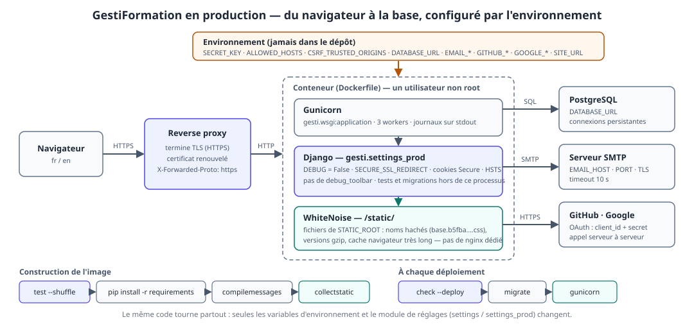
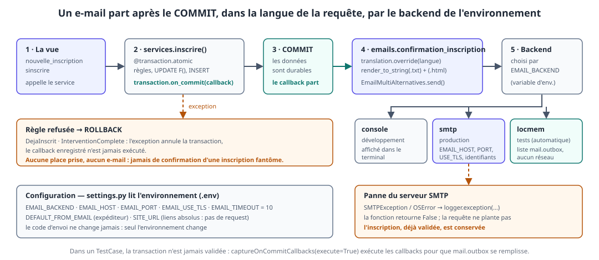
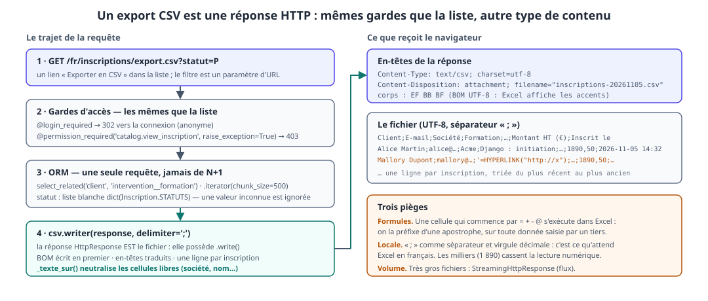
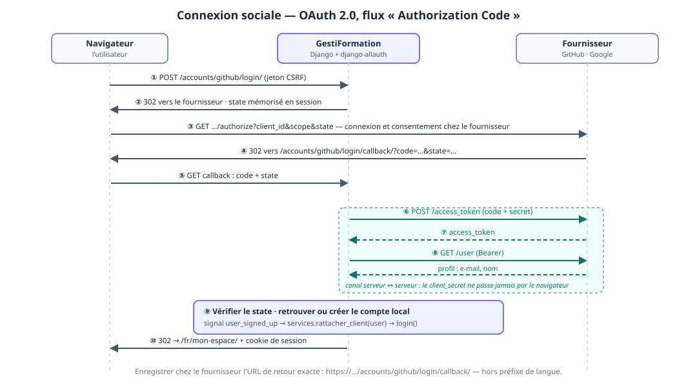
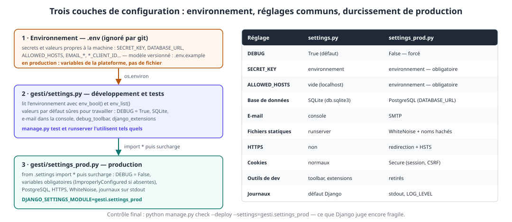

# Jour 5 — Sortir de l'atelier : e-mails, exports, connexion sociale et mise en production

> **Formation** : Django — initiation & approfondissement (5 jours)
> **Programme de référence** : [Dawan — Django : initiation / approfondissement](https://www.dawan.fr/formations/python/django/django-initiation-approfondissement)
> **Projet fil rouge** : GestiFormation — SaaS de gestion d'organisme de formation
> **Blocs couverts** : 12 (fonctionnalités avancées : e-mail, exports, OAuth, déploiement)

**Prérequis** : jour 4 validé (site bilingue `/fr/` `/en/`, suite de tests exécutable, `services.py`, authentification et rôles).
**Durée** : 7 h (9h00 – 17h00, pauses comprises).

> 💡 **Vocabulaire du dépôt** : comme au jour 4, l'entité planifiée s'appelle **`Intervention`** dans le dépôt de référence (`Inscription.intervention`, `Intervention.places_dispo`…). Les extraits du jour 5 suivent le dépôt.

## Objectifs pédagogiques

À la fin de la journée, les participants sont capables de :

- configurer l'envoi d'e-mails par **backend** (console, SMTP, mémoire) et choisir **le bon moment** pour envoyer : après le `COMMIT`, jamais avant ;
- produire un message **texte + HTML**, dans **la langue du destinataire**, avec des liens absolus, depuis des gabarits ;
- tester un envoi avec `mail.outbox` et `captureOnCommitCallbacks`, **sans serveur de messagerie** ;
- exporter des données en **CSV** depuis une vue protégée, lisible dans Excel, **sans injection de formule** ;
- expliquer le flux **OAuth 2.0 « Authorization Code »** et brancher GitHub / Google avec **django-allauth** ;
- relier un compte social au profil `Client`, **sans réseau** dans les tests ;
- séparer **développement** et **production** : variables d'environnement, `settings_prod`, `DEBUG = False`, `ALLOWED_HOSTS`, `check --deploy` ;
- servir les fichiers statiques avec **WhiteNoise**, se connecter à **PostgreSQL**, lancer l'application sous **Gunicorn** dans un **conteneur** ;
- dérouler la chaîne **tests → construction → déploiement** et dire pourquoi la suite de tests en est le premier maillon.

### Livrable de la journée

- un **e-mail de confirmation** (texte + HTML, fr/en) envoyé à chaque inscription validée, jamais pour une inscription refusée ;
- un **export CSV** des inscriptions (`/fr/inscriptions/export.csv`), filtrable par statut, réservé à qui peut déjà voir la liste ;
- des boutons **GitHub / Google** sur la page de connexion, affichés pour chaque fournisseur configuré ;
- `gesti/settings_prod.py`, un `Dockerfile`, un `.env.example` et une configuration validée par `check --deploy` ;
- **29 tests de plus** (e-mails, export, OAuth, configuration de production) : le dépôt de référence en compte **102**, exécutables en une commande.

> 💡 **Fil conducteur** : jusqu'ici, GestiFormation vivait sur la machine du stagiaire. Aujourd'hui il **parle au monde extérieur** (un serveur de messagerie, un tableur, un fournisseur d'identité, une base serveur). Chaque ouverture ajoute une dépendance **qui peut tomber en panne** : la journée apprend à les isoler, à les configurer **par l'environnement**, et à les tester **sans elles**.

## Organisation de la journée

| Heure | Séquence | Blocs programme |
|---|---|---|
| 09h00 – 09h15 | Reprise du J4 : `check`, `test`, `migrate`, dépendances, commit | — |
| 09h15 – 10h30 | **B12·a** — E-mails : backends, `on_commit`, gabarits, tests | Bloc 12 |
| 10h30 – 10h45 | Pause | |
| 10h45 – 11h45 | **B12·b** — Export CSV : vue protégée, Excel, injection de formule | Bloc 12 |
| 11h45 – 12h45 | **B12·c·1** — OAuth : le flux, `django-allauth`, configuration | Bloc 12 |
| 12h45 – 13h45 | Déjeuner | |
| 13h45 – 14h45 | **B12·c·2** — OAuth : liaison au `Client`, tests sans réseau, atelier | Bloc 12 |
| 14h45 – 15h00 | Pause | |
| 15h00 – 16h30 | **B12·d** — Production : `settings_prod`, statiques, base, Gunicorn, Docker | Bloc 12 |
| 16h30 – 17h00 | Démonstrations, bilan des 5 jours, et après ? | — |

### Reprise du jour 4 (15 min)

```bash
python manage.py check
python manage.py test --shuffle
python manage.py migrate
```

Trois points d'attention sur le dépôt de référence, à régler **avant** de commencer :

| Constat | Correction |
|---|---|
| `manage.py test` ne trouve **aucun test** | `catalog/tests/` doit contenir un fichier **`__init__.py`** vide (piège n°41 du J4 : un dossier sans `__init__.py` n'est pas découvert) |
| trois tests de langue / formulaire encore rouges (`test_telephone_invalide`, `test_pluriel`, `test_libelles_du_modele`) | ajouter `code='telephone_invalide'` au `ValidationError` (§10.4), créer le catalogue `fr` de pluriel (§10.6), traduire « intervention » en `training session` : **10 minutes**, et la suite redevient verte |
| `locale/` est absent du dépôt | `.gitignore` contenait `*.po` : le **`.po` est la source** de la traduction, il doit être versionné ; seul le `.mo` (compilé) est un artefact. On retire `*.po` du `.gitignore` (§12.20) |

> ⚠️ **Jamais de déploiement sur une suite rouge.** Aujourd'hui, `manage.py test` est le **premier maillon** de la chaîne de livraison. On ne passe à la suite que lorsqu'il est vert.

Dépendances nouvelles du jour (le `requirements.txt` du dépôt est à jour) :

```bash
pip install "django-allauth[socialaccount]" whitenoise gunicorn dj-database-url "psycopg[binary]" coverage
pip freeze > requirements.txt          # sous PowerShell : écrire en UTF-8, pas en UTF-16
```

> ⚠️ **PowerShell 5 et `>`** : la redirection écrit en **UTF-16**. `pip` sait le relire, mais git affiche un fichier binaire. Écrire le fichier avec `Out-File -Encoding utf8`, ou depuis un terminal `bash`.

---

## B12 — Ouvrir l'application sur l'extérieur (bloc 12)



*(Le détail de cette architecture est revu au §12.25. On l'affiche dès le matin : chaque séquence en colore un coin.)*

| Séquence | Dépendance extérieure | Ce qui peut mal tourner | Parade |
|---|---|---|---|
| **a** — E-mail | serveur SMTP | panne, lenteur, message envoyé pour rien | `on_commit`, `EMAIL_TIMEOUT`, `try/except`, journal |
| **b** — Export | Excel / LibreOffice | accents illisibles, formule exécutée | BOM, `;`, préfixe `'` |
| **c** — OAuth | GitHub, Google | URL de retour fausse, compte dupliqué | URL hors préfixe de langue, signal, adaptateurs |
| **d** — Production | proxy, base, plateforme | secret dans le dépôt, `DEBUG = True` | environnement, `settings_prod`, `check --deploy` |

---

## B12·a — E-mails (75 min)

### 12.1. Trois façons d'envoyer, un seul moteur

Django fournit un module `django.core.mail`. Quel que soit le point d'entrée, le message passe par un **backend** choisi par la configuration.

| Fonction / classe | Usage |
|---|---|
| `send_mail(sujet, corps, expéditeur, [destinataires])` | un message texte, une ligne de code |
| `EmailMessage(...)` | texte + pièces jointes, en-têtes (`reply_to`, `cc`) |
| `EmailMultiAlternatives(...)` | **texte + version HTML** : ce que nous utilisons |
| `mail_admins(...)` | alerte aux `ADMINS` (hors périmètre) |

| Backend | Quand | Effet |
|---|---|---|
| `console.EmailBackend` | **développement** | le message s'affiche dans le terminal du serveur |
| `smtp.EmailBackend` | **production** | envoi réel par un serveur SMTP |
| `locmem.EmailBackend` | **tests** (activé automatiquement par `manage.py test`) | liste `mail.outbox`, aucun réseau |
| `filebased.EmailBackend` | recette | un fichier par message dans un dossier |

> 💡 **Même code partout** : on n'écrit jamais `if DEBUG:` autour d'un envoi. Seul `EMAIL_BACKEND` change, et il vient de l'environnement.

### 12.2. Les réglages

```python
# gesti/settings.py — J5
def env_bool(nom, defaut=False):
    return os.environ.get(nom, str(int(defaut))).strip().lower() in ('1', 'true', 'yes', 'on')


EMAIL_BACKEND = os.environ.get('EMAIL_BACKEND', 'django.core.mail.backends.console.EmailBackend')
EMAIL_HOST = os.environ.get('EMAIL_HOST', 'localhost')
EMAIL_PORT = int(os.environ.get('EMAIL_PORT', '25'))
EMAIL_HOST_USER = os.environ.get('EMAIL_HOST_USER', '')
EMAIL_HOST_PASSWORD = os.environ.get('EMAIL_HOST_PASSWORD', '')
EMAIL_USE_TLS = env_bool('EMAIL_USE_TLS', False)
EMAIL_TIMEOUT = 10                            # sans délai, un SMTP muet bloque la requête indéfiniment
DEFAULT_FROM_EMAIL = os.environ.get('DEFAULT_FROM_EMAIL', 'GestiFormation <formations@example.org>')
SERVER_EMAIL = DEFAULT_FROM_EMAIL             # expéditeur des e-mails d'erreur envoyés aux ADMINS
SITE_URL = os.environ.get('SITE_URL', 'http://127.0.0.1:8000')   # liens absolus dans les e-mails (pas de request)
```

Deux réglages que les stagiaires oublient et qui font mal en production :

- **`EMAIL_TIMEOUT`** : par défaut, il n'y en a pas. Un serveur SMTP qui ne répond pas **gèle le worker** qui traite l'inscription ;
- **`SITE_URL`** : un e-mail est écrit **hors requête**. Il n'existe pas de `request.build_absolute_uri()` ; le domaine doit venir de la configuration.

> ⚠️ **Piège n°46 — le lien relatif dans un e-mail** : `<a href="/fr/mon-espace/">` est **mort** dans une messagerie : elle n'a pas de domaine de référence. Toujours `SITE_URL + reverse(...)`.

### 12.3. Quand envoyer ? Après le COMMIT



`inscrire()` est `@transaction.atomic`. Si l'on envoie l'e-mail **dans** la fonction, deux scénarios dangereux :

| Scénario | Conséquence |
|---|---|
| l'e-mail part, puis l'`INSERT` échoue (contrainte, exception, panne) | le client reçoit une **confirmation pour une inscription qui n'existe pas** |
| l'e-mail part, puis la transaction est annulée par une exception ultérieure | idem, et **impossible à rattraper** : un e-mail ne se « rollback » pas |

La parade s'appelle **`transaction.on_commit(callback)`** : Django mémorise le callback et ne l'exécute **qu'après** le `COMMIT` de la transaction externe. En cas de `ROLLBACK`, il est **jeté**.

> ⚠️ **Piège n°47 — un e-mail dans la transaction** : « ça marche » en développement, où rien n'échoue. Le jour où une règle refuse l'inscription, le client a déjà reçu sa confirmation. L'ordre des opérations **est** la règle métier.

### 12.4. `catalog/emails.py` — la fonction d'envoi

```python
# catalog/emails.py
import logging
from smtplib import SMTPException

from django.conf import settings
from django.core.mail import EmailMultiAlternatives
from django.template.loader import render_to_string
from django.urls import reverse
from django.utils import translation
from django.utils.translation import gettext as _

logger = logging.getLogger(__name__)


def confirmation_inscription(inscription, langue=None) -> bool:
    """
    Envoie la confirmation d'inscription (texte + HTML) au client.
    Retourne False si l'envoi échoue : un e-mail raté n'annule jamais une inscription.
    """
    langue = langue or translation.get_language()
    intervention = inscription.intervention
    formation = intervention.formation

    # hors requête : pas de request.build_absolute_uri → SITE_URL + reverse() dans la langue de l'e-mail
    with translation.override(langue):
        contexte = {
            'client': inscription.client,
            'formation': formation,
            'intervention': intervention,
            'inscription': inscription,
            'url_espace': settings.SITE_URL + reverse('catalog:mon-espace'),
        }
        sujet = _('Inscription enregistrée : %(formation)s') % {'formation': formation.nom}
        texte = render_to_string('catalog/emails/confirmation_inscription.txt', contexte)
        html = render_to_string('catalog/emails/confirmation_inscription.html', contexte)

    message = EmailMultiAlternatives(sujet, texte, to=[inscription.client.email])
    message.attach_alternative(html, 'text/html')
    try:
        message.send()
    except (SMTPException, OSError):
        logger.exception("Envoi impossible de la confirmation de l'inscription %s", inscription.pk)
        return False
    return True
```

Lecture guidée :

| Choix | Pourquoi |
|---|---|
| fonction **dans son module** `emails.py` | la vue et le service ne savent pas *comment* on envoie ; on peut la remplacer ou la tester seule |
| `translation.override(langue)` | le sujet, le texte, le HTML **et** `reverse()` utilisent la même langue |
| `from` omis | `DEFAULT_FROM_EMAIL` s'applique |
| `except (SMTPException, OSError)` | `OSError` couvre `ConnectionRefusedError`, `TimeoutError`, DNS… Pas de `except Exception` : on n'avale pas un bug |
| `logger.exception` | la trace complète est dans les journaux ; la requête de l'utilisateur, elle, aboutit |
| retourne un booléen | le test et l'appelant savent si l'envoi a réussi |

> 💡 **Pas de `BadHeaderError`** : Django refuse un sujet contenant un retour à la ligne (injection d'en-tête). Le nom d'une formation n'en contient pas ; une donnée saisie par un utilisateur pourrait. Ne jamais construire un **destinataire** ou un **sujet** par concaténation d'une saisie non contrôlée.

### 12.5. Les gabarits d'e-mail

Deux fichiers jumeaux dans `catalog/templates/catalog/emails/`.

```django
{# confirmation_inscription.txt —  : un e-mail texte n'est pas du HTML #}
Bonjour {{ prenom }},


Votre inscription à « {{ nom }} » est enregistrée.
Intervention {{ numero }} — {{ ville }}, à partir du {{ debut }}.


Montant : {{ montant }} € HT.


{{ url_espace }}



```

```django
{# confirmation_inscription.html #}
<!DOCTYPE html>
<html lang="{{ LANGUAGE_CODE }}">
<body style="font-family: system-ui, sans-serif; color: #1f2937;">
    <p>Bonjour {{ prenom }},</p>
    <p>
        
            Votre inscription à <strong>« {{ nom }} »</strong> est enregistrée.
        
    </p>
    <table cellpadding="6" style="border-collapse: collapse;">
        <tr><th align="left"></th><td>{{ intervention.numero }} — {{ intervention.ville }}</td></tr>
        <tr><th align="left"></th><td>{{ intervention.date_debut|date:"DATE_FORMAT" }}</td></tr>
        <tr><th align="left"></th><td>{{ inscription.montant_ht|floatformat:"2g" }} €</td></tr>
    </table>
    <p><a href="{{ url_espace }}"></a></p>
    <p></p>
</body>
</html>
```

Trois points de cohérence avec le jour 4 :

- **`render_to_string` n'a pas de `request`** : le context processor `i18n` n'est pas appliqué ; on récupère la langue par `` ;
- les **formats nommés** (`DATE_FORMAT`, `"2g"`) suivent la langue active, donc le `override` de la fonction ;
- le HTML d'e-mail est **minimal** : styles **en ligne**, pas de feuille de style externe (la plupart des messageries l'ignorent).

**Ce que voit le développeur** (backend `console`, extrait) :

```
Content-Type: multipart/alternative; boundary="===============..."
Subject: Inscription enregistrée : Django : initiation
From: GestiFormation <formations@example.org>
To: alice@example.org

Bonjour Alice,

Votre inscription à « Django : initiation » est enregistrée. Intervention T-016-INT — Lyon, à partir du 5 décembre 2026.

Montant : 1 890,00 € HT.

Retrouvez vos inscriptions dans votre espace :
http://127.0.0.1:8000/fr/mon-espace/

L'équipe GestiFormation
```

### 12.6. Brancher l'envoi dans le service

```python
# catalog/services.py — fin de inscrire()
    inscription = Inscription.objects.create(
        client=client,
        intervention=intervention,
        montant_ht=intervention.formation.prix,
    )
    # l'e-mail part APRÈS le commit : jamais pour une inscription finalement annulée par un rollback
    langue = get_language()
    transaction.on_commit(lambda: emails.confirmation_inscription(inscription, langue))
    return inscription
```

```python
from django.utils.translation import get_language

from . import emails
```

> 💡 **Pourquoi capturer `langue` avant le callback ?** Le callback s'exécute au `COMMIT`, plus tard que l'appel. On fige la langue **de la requête** au moment où l'on enregistre l'intention d'envoyer. (Dans une vue, c'est celle de l'URL : `/en/…` donne un e-mail en anglais.)

> 💡 **Pourquoi dans le service et pas dans la vue ?** Toute entrée qui inscrit un client — formulaire, bouton « S'inscrire », une action d'admin demain — obtient l'e-mail **sans y penser**. Le service reste testable sans HTTP.

**Variante pour un volume plus élevé** : un e-mail dans un `on_commit` ralentit encore la requête (c'est la requête qui envoie). Pour des envois en masse ou lents, on délègue à une **file de tâches** (Celery, RQ, Django Tasks) : c'est le sujet de « Et après ? » en fin de support. Le principe reste identique : **on enregistre l'intention après le commit**.

### 12.7. Tester les e-mails

```python
# catalog/tests/test_emails.py
from decimal import Decimal
from smtplib import SMTPException
from unittest.mock import patch

from django.core import mail
from django.test import TestCase, override_settings
from django.utils import translation

from catalog.models import Inscription
from catalog.services import InterventionComplete, inscrire

from .factories import creer_client, creer_formation, creer_intervention


@override_settings(SITE_URL='https://formation.example.org')     # indépendant du .env de chacun
class ConfirmationInscriptionTests(TestCase):
    @classmethod
    def setUpTestData(cls):
        cls.formation = creer_formation(nom='Django : initiation', prix=Decimal('1890.00'))
        cls.alice = creer_client(prenom='Alice', email='alice@example.org')

    def setUp(self):
        # hors requête, la langue active est celle laissée par le test précédent : on la fixe
        self.enterContext(translation.override('fr'))
        self.intervention = creer_intervention(self.formation, capacite=2, ville='Lyon')

    def inscrire_et_envoyer(self, client=None, intervention=None):
        """Dans un TestCase la transaction n'est jamais validée : on exécute les on_commit à la main."""
        with self.captureOnCommitCallbacks(execute=True) as rappels:
            inscription = inscrire(client or self.alice, intervention or self.intervention)
        return inscription, rappels

    def test_aucun_mail_tant_que_la_transaction_n_est_pas_validee(self):
        inscrire(self.alice, self.intervention)
        self.assertEqual(mail.outbox, [])

    def test_un_mail_part_apres_le_commit(self):
        _, rappels = self.inscrire_et_envoyer()
        self.assertEqual(len(rappels), 1)
        self.assertEqual(len(mail.outbox), 1)
        message = mail.outbox[0]
        self.assertEqual(message.to, ['alice@example.org'])
        self.assertEqual(message.subject, 'Inscription enregistrée : Django : initiation')

    def test_le_corps_contient_les_informations_utiles(self):
        self.inscrire_et_envoyer()
        corps = mail.outbox[0].body
        for attendu in ('Alice', 'Django : initiation', 'Lyon', '1\xa0890,00', 'https://formation.example.org/fr/mon-espace/'):
            with self.subTest(attendu=attendu):
                self.assertIn(attendu, corps)

    def test_une_version_html_accompagne_le_texte(self):
        self.inscrire_et_envoyer()
        contenu, type_mime = mail.outbox[0].alternatives[0]
        self.assertEqual(type_mime, 'text/html')
        self.assertIn('<strong>« Django : initiation »</strong>', contenu)

    def test_le_mail_suit_la_langue_active(self):
        with translation.override('en'):
            self.inscrire_et_envoyer()
        message = mail.outbox[0]
        self.assertEqual(message.subject, 'Registration saved: Django : initiation')
        self.assertIn('https://formation.example.org/en/mon-espace/', message.body)

    def test_aucun_mail_quand_l_inscription_est_refusee(self):
        complete = creer_intervention(self.formation, capacite=1, nb_inscrits=1)
        with self.captureOnCommitCallbacks(execute=True) as rappels:
            with self.assertRaises(InterventionComplete):
                inscrire(self.alice, complete)
        self.assertEqual(rappels, [])
        self.assertEqual(mail.outbox, [])

    def test_une_panne_smtp_n_annule_pas_l_inscription(self):
        with patch('django.core.mail.message.EmailMultiAlternatives.send', side_effect=SMTPException('hors service')):
            with self.assertLogs('catalog.emails', level='ERROR'):
                inscription, _ = self.inscrire_et_envoyer()
        self.assertTrue(Inscription.objects.filter(pk=inscription.pk).exists())
        self.assertEqual(mail.outbox, [])
```

Quatre mécanismes à faire repérer :

| Mécanisme | Rôle |
|---|---|
| `mail.outbox` | la liste des messages « envoyés » : Django remplace **automatiquement** le backend par `locmem` pendant les tests |
| `captureOnCommitCallbacks(execute=True)` | un `TestCase` enveloppe chaque test dans une transaction **jamais validée** : sans cet outil, aucun `on_commit` ne s'exécuterait |
| `message.alternatives[0]` | la version HTML jointe à `attach_alternative` |
| `patch(...send, side_effect=SMTPException)` + `assertLogs` | **provoquer** la panne qu'on ne veut pas attendre, et vérifier qu'elle est **journalisée** |

> ⚠️ **Piège n°48 — la langue active hors requête** : `get_language()` renvoie la langue **laissée par le dernier traitement** dans ce fil d'exécution (un test précédent sur `/en/…`, un autre appel). L'e-mail est alors dans la mauvaise langue — et le test n'échoue qu'en ordre aléatoire (`--shuffle`). On **fixe** la langue (`translation.override`) ou on la **passe explicitement** (`confirmation_inscription(inscription, langue)`).

> ⚠️ **Piège n°49 — attendre un e-mail sans exécuter `on_commit`** : « le test ne trouve jamais le message » est le symptôme. Ce n'est pas un bug de l'envoi mais de la **transaction de test** : `captureOnCommitCallbacks(execute=True)`.

> 💡 **Bonus — les e-mails que Django envoie déjà** : l'URL `comptes/password_reset/` (fournie par `django.contrib.auth.urls`) envoie un e-mail de réinitialisation. Avec le backend `console`, le lien apparaît dans le terminal : on peut montrer la fonction « mot de passe oublié » sans configurer de messagerie.

### 🛠️ Atelier 12·a — La confirmation d'inscription (30 min)

1. appliquer les réglages de §12.2 ; dans `.env`, ne rien ajouter (le backend `console` est le défaut) ;
2. créer `catalog/emails.py` et les deux gabarits ; ajouter `on_commit` dans `inscrire` ;
3. dans l'interface, inscrire un client depuis `/fr/inscriptions/nouvelle/` : **lire le message dans le terminal du serveur** ; recommencer depuis `/en/` ;
4. écrire `test_emails.py` ; **lancer** ;
5. **muter** le code :

| # | Mutation | Test qui doit échouer |
|---|---|---|
| 1 | remplacer `transaction.on_commit(lambda: …)` par un appel direct | `test_aucun_mail_tant_que_la_transaction_n_est_pas_validee` **et** `test_un_mail_part_apres_le_commit` |
| 2 | retirer le `try/except` autour de `message.send()` | `test_une_panne_smtp_n_annule_pas_l_inscription` (l'exception remonte) |
| 3 | remplacer `langue = get_language()` par `langue = 'fr'` dans `inscrire` | `test_le_mail_suit_la_langue_active` |
| 4 | remplacer `settings.SITE_URL + reverse(...)` par `reverse(...)` | `test_le_corps_contient_les_informations_utiles` (le lien n'est plus absolu) |

**Checklist** :

- [ ] un message s'affiche dans le terminal à chaque inscription réussie, **aucun** quand l'inscription est refusée ;
- [ ] il est en anglais quand on s'est inscrit depuis `/en/` ;
- [ ] le binôme sait expliquer pourquoi `transaction.on_commit` plutôt qu'un appel direct ;
- [ ] `git add -A && git commit -m "J5 : e-mail de confirmation d'inscription"` fait.

---

## B12·b — Export CSV (60 min)

### 12.8. Une réponse HTTP qui est un fichier



Un export n'a rien de magique : c'est une **vue** qui retourne une `HttpResponse` dont le type de contenu est `text/csv`. Deux idées font tout :

1. l'en-tête **`Content-Disposition: attachment`** dit au navigateur de **télécharger** plutôt que d'afficher ;
2. une `HttpResponse` possède une méthode `.write()` : elle **est** un fichier, que `csv.writer` sait remplir directement.

### 12.9. La vue

```python
# catalog/views.py
import csv

from django.utils import timezone
from django.utils.formats import get_format


def _to_text(valeur) -> str:
    """Neutralise l'injection de formules : Excel exécute une cellule qui commence par = + - @"""
    texte = str(valeur)
    return "'" + texte if texte.startswith(('=', '+', '-', '@', '\t', '\r')) else texte


@login_required
@permission_required('catalog.view_inscription', raise_exception=True)
def export_inscriptions(request):
    """Export CSV des inscriptions, filtrable par ?statut=P|C|X ; mêmes droits que la liste."""
    inscriptions = Inscription.objects.select_related('client', 'intervention__formation')
    statut = request.GET.get('statut', '')
    if statut in dict(Inscription.STATUTS):
        inscriptions = inscriptions.filter(statut=statut)

    reponse = HttpResponse(content_type='text/csv; charset=utf-8')
    reponse['Content-Disposition'] = f'attachment; filename="inscriptions-{timezone.localdate():%Y%m%d}.csv"'
    reponse.write('\ufeff')                      # BOM : Excel reconnaît l'UTF-8
    writer = csv.writer(reponse, delimiter=';')    # Excel en langue française attend « ; »
    writer.writerow([
        _('Client'), _('E-mail'), _('Société'), _('Formation'), _('Intervention'),
        _('Début'), _('Statut'), _('Montant HT (€)'), _('Inscrit le'),
    ])
    for i in inscriptions.iterator(chunk_size=500):
        writer.writerow([
            _to_text(i.client), i.client.email, _to_text(i.client.societe),
            _to_text(i.intervention.formation.nom), i.intervention.numero,
            i.intervention.date_debut.isoformat(), i.get_statut_display(),
            str(i.montant_ht).replace('.', get_format('DECIMAL_SEPARATOR')),     # virgule en français, jamais de milliers
            timezone.localtime(i.date_inscription).strftime('%Y-%m-%d %H:%M'),
        ])
    return reponse
```

```python
# catalog/urls.py — section « Inscription »
path('inscriptions/export.csv', views.export_inscriptions, name='export-inscriptions'),
```

```django
{# liste_inscriptions.html #}
<a class="btn" href=""></a>
```

**Les décisions, une par une**

| Décision | Raison |
|---|---|
| mêmes décorateurs que `liste_inscriptions` | une donnée exportée est une donnée **lue** : exporter ne doit pas ouvrir de droit nouveau |
| `select_related(...)` + `.iterator(chunk_size=500)` | une requête SQL, mémoire bornée : le piège du **N+1** (jour 2) est encore plus coûteux sur 10 000 lignes |
| `statut in dict(Inscription.STATUTS)` | **liste blanche** : une valeur inconnue (`?statut=ZZ`) est ignorée, jamais passée à la requête telle quelle |
| `\ufeff` en premier | le *Byte Order Mark* signale « UTF-8 » à Excel ; sans lui, « Société » devient « Société » |
| `delimiter=';'` | Excel en français lit la virgule comme séparateur **décimal** : la virgule ne sépare pas les colonnes |
| montant avec la **virgule locale**, **sans** séparateur de milliers | `1890,50` : lisible comme un nombre dans Excel français ; `1 890,50` serait un texte |
| `date_debut.isoformat()` | une date **ISO** (`2026-12-05`) se trie et s'importe partout, quelle que soit la langue |
| en-têtes avec `_()` | les titres de colonnes suivent la langue de l'URL (`/en/…`) |

> 💡 **Rappel du jour 4** : un format localisé est pour un **humain** ; une donnée pour une **machine** ne l'est pas. Un CSV est entre les deux : on garde la virgule décimale (Excel) mais on **évite les milliers** et on écrit les dates en ISO.

### 12.10. Les deux pièges de sécurité et de compatibilité

> ⚠️ **Piège n°50 — l'injection de formule (« CSV injection »)** : un client s'inscrit avec la société `=HYPERLINK("http://pirate.example","Cliquez")`. Le gestionnaire ouvre l'export dans Excel : **la cellule s'exécute**. Une donnée **saisie par un tiers** est du texte non fiable. On préfixe d'une apostrophe toute cellule commençant par `=`, `+`, `-`, `@` (ou tabulation / retour chariot). La fonction `_to_text` est appliquée aux champs libres (nom, société, formation) — **pas** aux nombres ni aux dates.

> ⚠️ **Piège n°51 — « les accents sont illisibles dans Excel »** : le fichier est valide, c'est Excel qui devine l'encodage. BOM + `;` + virgule décimale sont ce qui rend le fichier **ouvrable par double-clic** en France. Pour un échange **entre machines** (import dans un autre système), on préférera un CSV standard (`,`, point décimal, sans BOM) — **un format par destinataire**.

**Gros volumes : `StreamingHttpResponse`.** Quand le fichier devient grand, on n'accumule plus tout dans la réponse :

```python
from django.http import StreamingHttpResponse


class Echo:
    """Pseudo-fichier : write() retourne la valeur au lieu de l'écrire."""
    def write(self, valeur):
        return valeur


def lignes(inscriptions):
    writer = csv.writer(Echo(), delimiter=';')
    yield '\ufeff'
    for i in inscriptions.iterator(chunk_size=500):
        yield writer.writerow([...])


return StreamingHttpResponse(lignes(inscriptions), content_type='text/csv; charset=utf-8')
```

Le fichier part au fil de la lecture de la base. Deux contreparties : `translation` et le contexte de requête ne sont plus garantis **pendant** le flux (on précalcule en-têtes et formats avant le `yield`), et une exception **après** le premier octet ne peut plus produire une page d'erreur. À réserver aux cas qui l'exigent.

> 💡 **Et le format Excel (.xlsx) ou le PDF ?** Hors périmètre : `openpyxl` (xlsx), `WeasyPrint` ou `ReportLab` (PDF). La structure d'une vue d'export reste la même : *gardes → requête → écrire dans une réponse avec le bon `Content-Type`*.

### 12.11. Tester l'export

```python
# catalog/tests/test_export.py
import csv
import io
from decimal import Decimal

from django.test import TestCase
from django.urls import reverse
from django.utils import translation

from catalog.services import annuler, inscrire

from .factories import creer_client, creer_formation, creer_intervention, creer_utilisateur


class ExportInscriptionsTests(TestCase):
    @classmethod
    def setUpTestData(cls):
        formation = creer_formation(nom='Django : initiation', prix=Decimal('1890.50'))
        intervention = creer_intervention(formation, capacite=5)
        cls.alice = creer_client(prenom='Alice', nom='Martin', societe='Acme')
        cls.mallory = creer_client(prenom='Mallory', nom='Dupont', societe='=HYPERLINK("http://x")')
        cls.confirmee = inscrire(cls.alice, intervention)
        cls.annulee = inscrire(cls.mallory, intervention)
        annuler(cls.annulee)
        cls.gestionnaire = creer_utilisateur('gestionnaire', ['view_inscription'])

    def setUp(self):
        self.enterContext(translation.override('fr'))     # l'URL porte le préfixe de la langue active
        self.url = reverse('catalog:export-inscriptions')

    def lignes(self, reponse):
        # utf-8-sig : retire le BOM avant de relire le fichier comme le ferait Excel
        texte = reponse.content.decode('utf-8-sig')
        return list(csv.reader(io.StringIO(texte), delimiter=';'))

    def test_anonyme_est_redirige_vers_la_connexion(self):
        self.assertRedirects(self.client.get(self.url), f"{reverse('login')}?next={self.url}")

    def test_sans_permission_recoit_403(self):
        self.client.force_login(creer_utilisateur('stagiaire'))
        self.assertEqual(self.client.get(self.url).status_code, 403)

    def test_entetes_http(self):
        self.client.force_login(self.gestionnaire)
        reponse = self.client.get(self.url)
        self.assertEqual(reponse.status_code, 200)
        self.assertEqual(reponse['Content-Type'], 'text/csv; charset=utf-8')
        self.assertRegex(reponse['Content-Disposition'], r'^attachment; filename="inscriptions-\d{8}\.csv"$')
        self.assertTrue(reponse.content.startswith(b'\xef\xbb\xbf'))

    def test_une_ligne_par_inscription_apres_l_entete(self):
        self.client.force_login(self.gestionnaire)
        lignes = self.lignes(self.client.get(self.url))
        self.assertEqual(len(lignes), 3)
        self.assertEqual(lignes[0][:2], ['Client', 'E-mail'])
        self.assertEqual(len({len(ligne) for ligne in lignes}), 1)

    def test_filtre_par_statut(self):
        self.client.force_login(self.gestionnaire)
        lignes = self.lignes(self.client.get(self.url, {'statut': 'X'}))
        self.assertEqual(len(lignes), 2)
        self.assertEqual(lignes[1][0], 'Mallory Dupont')

    def test_un_statut_inconnu_est_ignore(self):
        self.client.force_login(self.gestionnaire)
        self.assertEqual(len(self.lignes(self.client.get(self.url, {'statut': 'ZZ'}))), 3)

    def test_une_formule_est_neutralisee(self):
        self.client.force_login(self.gestionnaire)
        lignes = self.lignes(self.client.get(self.url, {'statut': 'X'}))
        self.assertEqual(lignes[1][2], '\'=HYPERLINK("http://x")')

    def test_le_montant_suit_la_langue_sans_separateur_de_milliers(self):
        self.client.force_login(self.gestionnaire)
        colonne = self.lignes(self.client.get(self.url, {'statut': 'P'}))[1][7]
        self.assertEqual(colonne, '1890,50')
        with translation.override('en'):
            url_en = reverse('catalog:export-inscriptions')
        self.assertEqual(self.lignes(self.client.get(url_en, {'statut': 'P'}))[1][7], '1890.50')
```

Idée à retenir : **on relit le fichier produit comme le ferait le destinataire** (`csv.reader` avec le même séparateur) et l'on vérifie des **cellules**, pas des sous-chaînes du corps brut.

### 🛠️ Atelier 12·b — Exporter les inscriptions (45 min)

1. écrire `_to_text`, la vue, la route et le lien ; ouvrir `/fr/inscriptions/` et cliquer ;
2. **ouvrir le fichier dans Excel ou LibreOffice** : accents corrects, colonnes séparées, montant lisible comme un nombre ;
3. créer un client dont la **société** vaut `=1+1` ; l'inscrire ; exporter ; constater l'apostrophe ; retirer `_to_text` : **la cellule affiche `2`** ;
4. écrire `test_export.py` ; lancer ;
5. **muter** :

| # | Mutation | Test qui doit échouer |
|---|---|---|
| 1 | retirer `@permission_required` | `test_sans_permission_recoit_403` |
| 2 | retirer `reponse.write('\ufeff')` | `test_entetes_http` |
| 3 | remplacer `';'` par `','` | `test_une_ligne_par_inscription_apres_l_entete` (toutes les colonnes se mélangent aux virgules décimales) |
| 4 | remplacer la liste blanche par `inscriptions.filter(statut=statut)` sans condition | `test_un_statut_inconnu_est_ignore` (la requête filtre sur `ZZ` : 0 ligne) |

**Checklist** :

- [ ] le fichier s'ouvre sans bricolage dans le tableur de la salle ;
- [ ] `?statut=X` ne contient que des inscriptions annulées ;
- [ ] le stagiaire sait dire **pourquoi** l'export a les mêmes droits que la liste ;
- [ ] commit `J5 : export CSV des inscriptions`.

---

## B12·c — Connexion sociale avec OAuth (120 min)

### 12.12. OAuth 2.0 en dix minutes

**Le problème.** On veut qu'un visiteur se connecte avec son compte GitHub ou Google, **sans que GestiFormation ne voie jamais son mot de passe** et sans en stocker un de plus.

| Rôle | Dans notre cas |
|---|---|
| **Propriétaire de la ressource** | l'utilisateur |
| **Client** | GestiFormation |
| **Serveur d'autorisation / de ressources** | GitHub, Google |
| **Scope** | ce que l'on demande : `user:email` (GitHub), `profile` + `email` (Google) |
| **`client_id` / `client_secret`** | l'identité de **notre application** chez le fournisseur ; le secret **ne quitte jamais le serveur** |



Le flux « **Authorization Code** » en trois idées :

1. le **navigateur** est envoyé chez le fournisseur : c'est **là** que l'utilisateur s'authentifie et consent. GestiFormation n'est qu'un spectateur ;
2. le fournisseur renvoie le navigateur vers notre **URL de retour (callback)** avec un **`code`** à usage unique. Le `code` ne vaut **rien** seul ;
3. **côté serveur**, GestiFormation échange le `code` **+ son `client_secret`** contre un **jeton d'accès**, puis interroge le fournisseur pour obtenir le profil. Le secret ne traverse jamais le navigateur.

Le paramètre **`state`** (aléatoire, mémorisé en session) protège contre le *CSRF de connexion* : un attaquant ne peut pas faire se connecter un utilisateur à **son** compte à lui.

> 💡 **OAuth ou OpenID Connect ?** OAuth 2.0 *autorise* l'accès à des données ; **OpenID Connect** (couche au-dessus, utilisée par Google) *authentifie* l'utilisateur. Pour le développeur, `django-allauth` masque la différence : on configure un « fournisseur ».

### 12.13. Déclarer l'application chez le fournisseur

On enregistre GestiFormation **chez** GitHub (ou Google) pour obtenir `client_id` et `client_secret`. Le champ à renseigner avec soin est **l'URL de retour** :

| Fournisseur | Où | URL de retour (développement) |
|---|---|---|
| **GitHub** | *Settings → Developer settings → OAuth Apps → New OAuth App* | `http://127.0.0.1:8000/accounts/github/login/callback/` |
| **Google** | *Google Cloud Console → API et services → Identifiants → ID client OAuth (application Web)* | `http://127.0.0.1:8000/accounts/google/login/callback/` |

> 💡 Les consoles des fournisseurs évoluent souvent : en cas d'écart avec ce tableau, on suit la page du fournisseur dans la documentation d'`allauth` ([docs.allauth.org](https://docs.allauth.org/)). L'**URL de retour** reste le point critique.

> ⚠️ **Piège n°52 — l'URL de retour doit correspondre au **caractère près*** : `127.0.0.1` n'est **pas** `localhost`, `http` n'est pas `https`, le `/` final compte. Le message d'erreur du fournisseur (« redirect_uri mismatch ») est exact : l'URL que l'on ouvre dans le navigateur doit être **la même** que celle enregistrée. En production : l'URL `https://formation.example.org/accounts/…` est une **seconde** déclaration.

Les identifiants vont dans l'**environnement** (`.env`, jamais dans le dépôt) :

```bash
# .env
GITHUB_CLIENT_ID=Iv1.0123456789abcdef
GITHUB_SECRET=…
GOOGLE_CLIENT_ID=…apps.googleusercontent.com
GOOGLE_SECRET=…
```

> ⚠️ **Piège n°53 — un `client_secret` dans git** : un secret commité est un secret **public**, même après suppression (l'historique le conserve). Il se **révoque** chez le fournisseur et on en génère un autre. Le dépôt contient `.env.example` (noms de variables, valeurs factices) ; `.env` est ignoré.

### 12.14. Installer et configurer `django-allauth`

`django-allauth` fournit toute la mécanique OAuth (redirections, `state`, échange du `code`, création du compte) et un catalogue de fournisseurs.

```python
# gesti/settings.py — J5
INSTALLED_APPS = [
    …
    'catalog.apps.CatalogConfig',
    'allauth',
    'allauth.account',
    'allauth.socialaccount',
    'allauth.socialaccount.providers.github',
    'allauth.socialaccount.providers.google',
    …
]

MIDDLEWARE = [
    …
    'django.contrib.messages.middleware.MessageMiddleware',
    'allauth.account.middleware.AccountMiddleware',     # requis par allauth, après les messages
    …
]

AUTHENTICATION_BACKENDS = [
    'django.contrib.auth.backends.ModelBackend',               # nos comptes locaux et l'admin
    'allauth.account.auth_backends.AuthenticationBackend',     # comptes sociaux
]
ACCOUNT_ADAPTER = 'catalog.adapters.CompteAdapter'             # pas d'inscription locale par allauth
SOCIALACCOUNT_ADAPTER = 'catalog.adapters.SocialAdapter'       # mais inscription sociale ouverte
ACCOUNT_EMAIL_VERIFICATION = 'none'                            # l'e-mail vient du fournisseur (vérifié chez lui)
SOCIALACCOUNT_LOGIN_ON_GET = False                             # démarrer le flux = POST + CSRF


def _app_oauth(prefixe):
    """Identifiants OAuth lus dans l'environnement ; None si le fournisseur n'est pas configuré."""
    client_id = os.environ.get(f'{prefixe}_CLIENT_ID')
    if not client_id:
        return None
    return {'client_id': client_id, 'secret': os.environ.get(f'{prefixe}_SECRET', ''), 'key': ''}


SOCIALACCOUNT_PROVIDERS = {}
if _app_oauth('GITHUB'):
    SOCIALACCOUNT_PROVIDERS['github'] = {'SCOPE': ['user:email'], 'APP': _app_oauth('GITHUB')}
if _app_oauth('GOOGLE'):
    SOCIALACCOUNT_PROVIDERS['google'] = {'SCOPE': ['profile', 'email'], 'APP': _app_oauth('GOOGLE')}
```

```bash
python manage.py migrate        # tables allauth : account_*, socialaccount_*
```

**Les choix commentés**

| Réglage | Choix | Raison |
|---|---|---|
| `AUTHENTICATION_BACKENDS` | `ModelBackend` **et** celui d'allauth | l'admin et `creer_compte` continuent de fonctionner |
| `SOCIALACCOUNT_PROVIDERS[…]['APP']` | credentials **dans la configuration** | pas de `SocialApp` à créer dans l'admin ; reproductible d'un environnement à l'autre |
| fournisseur absent de l'environnement | **pas de bouton** | un stagiaire sans identifiants voit un site cohérent, pas une erreur |
| `SOCIALACCOUNT_LOGIN_ON_GET = False` | le flux démarre par un **POST** | un lien GET pourrait être déclenché par une page tierce (CSRF de connexion) |
| `ACCOUNT_EMAIL_VERIFICATION = 'none'` | pas d'e-mail de vérification | l'adresse vient d'un fournisseur qui l'a déjà vérifiée |

Deux **adaptateurs** pour refermer ce qu'on n'utilise pas :

```python
# catalog/adapters.py
from allauth.account.adapter import DefaultAccountAdapter
from allauth.socialaccount.adapter import DefaultSocialAccountAdapter


class CompteAdapter(DefaultAccountAdapter):
    """Les comptes locaux se créent par notre vue `creer_compte`, pas par les pages d'allauth."""

    def is_open_for_signup(self, request):
        return False


class SocialAdapter(DefaultSocialAccountAdapter):
    """L'inscription par un fournisseur (GitHub, Google) reste ouverte."""

    def is_open_for_signup(self, request, sociallogin):
        return True
```

> 💡 **Réduire la surface** : `allauth.account` expose ses propres pages (`/accounts/login/`, `/accounts/signup/`, `/accounts/password/reset/`…). `CompteAdapter` ferme l'inscription locale : **une seule** porte d'entrée pour créer un compte par mot de passe (`creer_compte`), une seule pour créer un compte social.

### 12.15. Les URLs : **hors** `i18n_patterns`

```python
# gesti/urls.py — J5
urlpatterns = [
    path('i18n/', include('django.conf.urls.i18n')),           # set_language (POST)
    # hors i18n_patterns : l'URL de retour (callback) enregistrée chez GitHub/Google ne doit pas changer avec la langue
    path('accounts/', include('allauth.urls')),
]

urlpatterns += i18n_patterns(
    path('admin/', admin.site.urls),
    path('comptes/', include('django.contrib.auth.urls')),
    path('', include('catalog.urls')),
)
```

> ⚠️ **Piège n°54 — le callback sous `i18n_patterns`** : l'URL de retour devient `/fr/accounts/github/login/callback/` ou `/en/…` selon la langue du visiteur. Le fournisseur n'accepte qu'**une** URL enregistrée : le flux échoue pour l'autre langue. Les URLs qui **dialoguent avec un tiers** vivent **hors** préfixe de langue (comme `set_language`).

Le gabarit de mise en page d'`allauth` est surchargé pour hériter de celui du site :

```django
{# catalog/templates/allauth/layouts/base.html #}


{# Les pages d'allauth (liaison de compte, erreurs OAuth…) héritent de la mise en page du site #}
 — GestiFormation


    

```

> 💡 **Pourquoi ça marche** : Django cherche d'abord dans les `templates/` des applications **dans l'ordre de `INSTALLED_APPS`**. `catalog` est listé **avant** `allauth` : notre `allauth/layouts/base.html` masque celui du paquet. C'est la technique générale pour « habiller » une application tierce sans la modifier.

### 12.16. Le bouton sur la page de connexion

```django
{# catalog/templates/registration/login.html #}


…
    {# un bouton par fournisseur configuré (variables d'environnement) ; POST obligatoire : CSRF #}
    
    
    <div class="social">
        <p></p>
        
        <form method="post" action="" class="inline">
            <button type="submit" class="btn">{{ fournisseur.name }}</button>
        </form>
        
    </div>
    
```

`` ne retourne que les fournisseurs **configurés** ; `` fabrique `/accounts/github/login/`. Le formulaire est un **POST avec jeton CSRF** : c'est ce qui démarre le flux (cohérent avec `SOCIALACCOUNT_LOGIN_ON_GET = False`).

### 🛠️ Atelier 12·c·1 — Faire apparaître le bouton (30 min)

1. installer `django-allauth[socialaccount]`, appliquer §12.14 et §12.15, `migrate` ;
2. `python manage.py check` — aucune erreur ;
3. **sans** identifiants : ouvrir `/fr/comptes/login/` → **aucun** bouton ;
4. ajouter à `.env` des identifiants (réels ou **factices**) `GITHUB_CLIENT_ID=test`, `GITHUB_SECRET=test` ; redémarrer `runserver` ;
5. le bouton « GitHub » apparaît ; cliquer : le navigateur est **redirigé vers github.com** avec `client_id=test&state=…` — GitHub répondra par une erreur (identifiants faux), mais **la moitié de notre côté du flux est prouvée** ;
6. avec de **vrais** identifiants (application enregistrée en §12.13), terminer le parcours : retour sur `/fr/mon-espace/`, utilisateur connecté.

**Checklist** :

- [ ] le bouton n'apparaît que si la variable `*_CLIENT_ID` existe ;
- [ ] l'URL de retour enregistrée est strictement celle que le navigateur ouvre ;
- [ ] `/accounts/signup/` répond « inscription fermée » (adaptateur) ;
- [ ] aucune clé n'est dans `git status`.

### 12.17. Relier le compte social au profil `Client`

Après un premier accès par GitHub, l'utilisateur existe (`User`), mais **pas de `Client`** : « Mon espace » dirait « Aucun profil client n'est associé à ce compte ». Le jour 3 avait la même règle pour `creer_compte` : on la **sort de la vue** pour la partager.

```python
# catalog/services.py
def rattacher_client(user) -> Client | None:
    """
    retrouve (ou crée) le Client portant l'e-mail de l'utilisateur et le lui rattache
    sans jamais voler un Client déjà lié à un autre compte ; None si le compte n'a pas d'e-mail
    """
    email = user.email.lower()
    if not email:
        return None
    client, _cree = Client.objects.get_or_create(
        email=email,
        defaults={'prenom': user.first_name, 'nom': user.last_name},
    )
    if client.utilisateur_id is None:
        client.utilisateur = user
        client.save(update_fields=['utilisateur'])
    return client
```

```python
# catalog/views.py — creer_compte, après user.save()
            rattacher_client(user)                   # même règle que la connexion sociale
            login(request, user, backend='django.contrib.auth.backends.ModelBackend')   # 2 backends : à préciser
```

```python
# catalog/signals.py
from allauth.account.signals import user_signed_up
from django.dispatch import receiver

from .services import rattacher_client


@receiver(user_signed_up)
def rattacher_client_au_premier_acces(request, user, **kwargs):
    """Émis par allauth à la création d'un compte (y compris social) : même profil Client que `creer_compte`."""
    rattacher_client(user)
```

```python
# catalog/apps.py
class CatalogConfig(AppConfig):
    default_auto_field = 'django.db.models.BigAutoField'
    name = 'catalog'

    def ready(self):
        # l'import enregistre les récepteurs de signaux
        from . import signals  # noqa: F401
```

**Ce qu'il faut comprendre**

- un **signal** est un point d'extension : allauth *émet* `user_signed_up` après la création d'un compte, nous *branchons* un récepteur — sans modifier le code d'allauth ;
- les signaux se **branchent dans `AppConfig.ready()`** : sans l'import, le récepteur n'existe jamais et rien ne se passe, **sans erreur** ;
- `rattacher_client` ne **vole jamais** un `Client` déjà lié à un autre `User` : si l'e-mail existe côté `Client` avec un autre propriétaire, on ne touche à rien.

> ⚠️ **Piège n°55 — `login()` avec deux backends** : dès qu'`AUTHENTICATION_BACKENDS` en liste plusieurs, `login(request, user)` lève `ValueError: You have multiple authentication backends configured and therefore must provide the backend argument`. Django ne devine pas lequel a authentifié l'utilisateur : on le **précise** (`backend=…`) quand on connecte à la main (`creer_compte`). `client.force_login(user)` des tests, lui, prend le premier de la liste.

> ⚠️ **Piège n°56 — « un compte existe déjà avec cet e-mail »** : un stagiaire créé via `creer_compte` (`alice@example.org`) clique ensuite sur « GitHub » (même e-mail). `allauth` **refuse** par défaut de fusionner : rattacher automatiquement un compte social à un compte existant **par l'e-mail** permet, si le fournisseur est laxiste, une **prise de contrôle de compte**. `SOCIALACCOUNT_EMAIL_AUTHENTICATION = True` (+ `…_AUTO_CONNECT`) active la fusion — réservé aux fournisseurs dont on **sait** qu'ils vérifient l'adresse (Google, GitHub pour l'e-mail principal), et décision **assumée**. Notre choix : refuser, et laisser l'utilisateur se connecter d'abord avec son mot de passe.

### 12.18. Tester OAuth **sans réseau**

On ne teste **ni** GitHub **ni** Google (ce sont leurs systèmes) : on teste **notre** moitié — la configuration, l'amorçage du flux, la liaison au `Client`.

```python
# catalog/tests/test_oauth.py
from allauth.account.signals import user_signed_up
from django.contrib.auth import get_user_model
from django.test import TestCase, override_settings
from django.urls import reverse

from catalog.models import Client

from .factories import creer_client

APP_FACTICE = {'APP': {'client_id': 'id-factice', 'secret': 'secret-factice', 'key': ''}}


class RattachementDuClientTests(TestCase):
    """Un compte créé par un fournisseur (ou par allauth) reçoit son profil Client — sans réseau."""

    def inscrire_par_fournisseur(self, **champs):
        user = get_user_model().objects.create_user(**champs)
        user_signed_up.send(sender=get_user_model(), request=None, user=user)
        return user

    def test_cree_le_client_quand_l_email_est_inconnu(self):
        user = self.inscrire_par_fournisseur(username='octocat', email='Octo@Example.org', first_name='Octo', last_name='Cat')
        client = Client.objects.get(utilisateur=user)
        self.assertEqual((client.email, client.prenom, client.nom), ('octo@example.org', 'Octo', 'Cat'))

    def test_rattache_le_client_existant_de_meme_email(self):
        existant = creer_client(email='octo@example.org')
        user = self.inscrire_par_fournisseur(username='octocat', email='octo@example.org')
        existant.refresh_from_db()
        self.assertEqual(existant.utilisateur, user)
        self.assertEqual(Client.objects.count(), 1)

    def test_ne_prend_pas_un_client_deja_lie_a_un_autre_compte(self):
        proprietaire = get_user_model().objects.create_user('alice', 'alice@example.org')
        client = creer_client(email='alice@example.org', utilisateur=proprietaire)
        self.inscrire_par_fournisseur(username='intrus', email='alice@example.org')
        client.refresh_from_db()
        self.assertEqual(client.utilisateur, proprietaire)

    def test_sans_email_aucun_client_n_est_cree(self):
        self.inscrire_par_fournisseur(username='anonyme', email='')
        self.assertEqual(Client.objects.count(), 0)


class FluxOAuthTests(TestCase):
    @override_settings(SOCIALACCOUNT_PROVIDERS={})
    def test_aucun_bouton_sans_fournisseur_configure(self):
        self.assertNotContains(self.client.get(reverse('login')), 'GitHub')

    @override_settings(SOCIALACCOUNT_PROVIDERS={'github': APP_FACTICE})
    def test_un_bouton_par_fournisseur_configure(self):
        reponse = self.client.get(reverse('login'))
        self.assertContains(reponse, 'GitHub')
        self.assertContains(reponse, 'action="/accounts/github/login/')
        self.assertNotContains(reponse, 'Google')

    @override_settings(SOCIALACCOUNT_PROVIDERS={'github': APP_FACTICE})
    def test_le_post_redirige_vers_le_fournisseur_avec_un_state(self):
        reponse = self.client.post('/accounts/github/login/')
        self.assertEqual(reponse.status_code, 302)
        self.assertTrue(reponse['Location'].startswith('https://github.com/login/oauth/authorize?'))
        self.assertIn('client_id=id-factice', reponse['Location'])
        self.assertIn('state=', reponse['Location'])

    @override_settings(SOCIALACCOUNT_PROVIDERS={'github': APP_FACTICE})
    def test_le_get_ne_demarre_pas_le_flux(self):
        reponse = self.client.get('/accounts/github/login/')
        self.assertEqual(reponse.status_code, 200)

    def test_l_inscription_locale_d_allauth_est_fermee(self):
        self.assertTemplateUsed(self.client.get('/accounts/signup/'), 'account/signup_closed.html')
```

Ce que chaque test **prouve** :

| Test | Prouve |
|---|---|
| `…_sans_fournisseur_configure` | pas d'identifiants → pas de bouton (jamais d'erreur pour un stagiaire sans clé) |
| `…_le_post_redirige_vers_le_fournisseur_avec_un_state` | **l'étape ②** du schéma : redirection vers `github.com/login/oauth/authorize` avec `client_id` et `state` |
| `…_le_get_ne_demarre_pas_le_flux` | un simple lien ne démarre rien (CSRF de connexion) |
| `…_l_inscription_locale_d_allauth_est_fermee` | l'adaptateur ferme bien la porte inutile |
| `RattachementDuClientTests` | la liaison au `Client` : créée, retrouvée, jamais volée, ignorée sans e-mail |

> 💡 **Ce que l'on ne teste pas** : l'échange `code` → jeton. C'est du code **d'`allauth`** (testé chez eux) qui dialogue avec un tiers. Pour un test de bout en bout du retour, on simulerait la réponse HTTP du fournisseur avec `unittest.mock.patch` — utile, mais plus coûteux que son rendement ici.

### 🛠️ Atelier 12·c·2 — Un compte social qui a son profil (45 min)

1. écrire `rattacher_client`, le signal, `ready()` ; refactorer `creer_compte` ;
2. écrire `test_oauth.py` ; lancer ;
3. se connecter **pour de vrai** avec GitHub (ou avec Google) ; ouvrir `/fr/mon-espace/` : « Bonjour <prénom> », **pas** de message « aucun profil client » ;
4. dans l'admin, ouvrir *Clients* : le `Client` existe, lié au compte ;
5. **muter** :

| # | Mutation | Ce qui casse |
|---|---|---|
| 1 | supprimer `def ready(self)` | **rien n'échoue visiblement** en usage normal ; `test_cree_le_client_quand_l_email_est_inconnu` rougit |
| 2 | retirer `backend=…` de `login(…)` dans `creer_compte` | `test_cree_le_compte_connecte_et_rattache_le_client_existant` (J4) : `ValueError` |
| 3 | `is_open_for_signup` du `CompteAdapter` → `True` | `test_l_inscription_locale_d_allauth_est_fermee` |
| 4 | déplacer `path('accounts/', …)` dans `i18n_patterns` | `test_le_post_redirige…` (l'URL n'existe plus sans préfixe) |

**Checklist** :

- [ ] le binôme dessine le flux de mémoire (trois acteurs, dix étapes) ;
- [ ] le profil `Client` est créé automatiquement, jamais en double ;
- [ ] le piège n°52 (URL de retour) est identifié sur un cas concret ;
- [ ] commit `J5 : connexion GitHub / Google (allauth)`.

---

## B12·d — Mise en production (90 min)

### 12.19. Ce qui change entre dev et prod

`DEBUG = True` est un **outil de travail** : pages d'erreur détaillées, rechargement automatique, fichiers statiques servis par `runserver`. Chacun de ces conforts est une **faille** en production.

| Risque avec `DEBUG = True` | Conséquence |
|---|---|
| la page d'erreur affiche variables locales, settings, chemins | fuite de secrets et de structure |
| la mémoire grossit (toutes les requêtes SQL sont conservées) | arrêt du processus au bout de quelques heures |
| `ALLOWED_HOSTS` n'est pas contrôlé | usurpation d'en-tête `Host` |
| `runserver` | un seul processus, pas fait pour la charge, pas audité en sécurité |



La stratégie : **un seul code, plusieurs configurations**.

- **`gesti/settings.py`** : commun + développement. Lit l'environnement avec des valeurs par défaut **confortables** (`DEBUG = True`, SQLite, e-mail console). C'est ce que `runserver` **et `manage.py test`** utilisent ;
- **`gesti/settings_prod.py`** : `from .settings import *` puis **durcit**. Les variables **obligatoires** y sont exigées : si l'une manque, le processus **refuse de démarrer**.

> 💡 **Pourquoi pas un seul fichier avec `if DEBUG:` partout ?** Parce que les valeurs « sécurisées » (HTTPS forcé, cookies `Secure`) **cassent** les tests et le développement en HTTP. Séparer en deux modules garde la suite de tests **verte sans configuration** et rend la production **explicite**.

### 12.20. `settings.py` : lire l'environnement

```python
# gesti/settings.py — J5
from pathlib import Path
import os
from dotenv import load_dotenv

load_dotenv()                                       # charge .env en développement ; sans effet s'il n'existe pas


def env_bool(nom, defaut=False):
    return os.environ.get(nom, str(int(defaut))).strip().lower() in ('1', 'true', 'yes', 'on')


def env_list(nom):
    return [v.strip() for v in os.environ.get(nom, '').split(',') if v.strip()]


SECRET_KEY = os.environ.get("SECRET_KEY")
DEBUG = env_bool('DJANGO_DEBUG', True)               # gesti.settings = développement ; la production utilise settings_prod
ALLOWED_HOSTS = env_list('ALLOWED_HOSTS')

# destination de `collectstatic` : le dossier que WhiteNoise sert en production (cf. settings_prod)
STATIC_ROOT = BASE_DIR / 'staticfiles'
```

Trois règles :

| Règle | Détail |
|---|---|
| **un secret n'a pas de valeur par défaut** | `SECRET_KEY = os.environ.get("SECRET_KEY")` : absent → `ImproperlyConfigured` à l'usage, jamais une clé « de secours » partagée |
| **`.env` en développement, variables de la plateforme en production** | `load_dotenv()` ne remplace **pas** une variable déjà définie : la plateforme a le dernier mot |
| **`.env.example` est versionné, `.env` ne l'est pas** | le modèle documente **les noms** ; les valeurs réelles restent locales |

```bash
# .gitignore — J5
*.pyc
__pycache__/
.venv/
.env*
!.env.example          # exception : le modèle, lui, est versionné
*.mo                   # compilé : artefact ; le .po (source de la traduction) EST versionné
staticfiles/
htmlcov/
.coverage
```

> ⚠️ **Piège n°57 — le `.po` ignoré par git** : avec `*.po` dans `.gitignore`, **les traductions ne sont jamais versionnées** : un `git clone` donne un site sans anglais, et la production ne peut pas compiler ce qui n'existe pas. Le `.po` est du **code source** (écrit à la main, relu en revue) ; le `.mo` est un **artefact** (régénéré par `compilemessages` à la construction).

### 12.21. `settings_prod.py`

```python
# gesti/settings_prod.py
"""
Production : DJANGO_SETTINGS_MODULE=gesti.settings_prod

Tout ce qui est secret ou propre à la machine vient de l'environnement ; une valeur
obligatoire absente arrête le démarrage au lieu de produire un site à moitié configuré.
"""
import os

import dj_database_url
from django.core.exceptions import ImproperlyConfigured

from .settings import *  # noqa: F401,F403 — on part de la configuration commune, puis on durcit


def requis(nom):
    valeur = os.environ.get(nom, '').strip()
    if not valeur:
        raise ImproperlyConfigured(f'Variable d\'environnement obligatoire absente : {nom}')
    return valeur


DEBUG = False
SECRET_KEY = requis('SECRET_KEY')
ALLOWED_HOSTS = env_list('ALLOWED_HOSTS') or requis('ALLOWED_HOSTS')   # noqa: F405
CSRF_TRUSTED_ORIGINS = env_list('CSRF_TRUSTED_ORIGINS')                # noqa: F405 — ex. https://formation.example.org

# les outils de développement n'existent pas en production
INSTALLED_APPS = [a for a in INSTALLED_APPS if a not in ('debug_toolbar', 'django_extensions')]  # noqa: F405
MIDDLEWARE = [m for m in MIDDLEWARE if 'debug_toolbar' not in m]                                  # noqa: F405
# WhiteNoise sert les fichiers de STATIC_ROOT : juste après SecurityMiddleware
MIDDLEWARE.insert(1, 'whitenoise.middleware.WhiteNoiseMiddleware')
STORAGES = {
    'default': {'BACKEND': 'django.core.files.storage.FileSystemStorage'},
    # noms hachés (cache navigateur illimité) + versions gzip/brotli ; exige `collectstatic`
    'staticfiles': {'BACKEND': 'whitenoise.storage.CompressedManifestStaticFilesStorage'},
}

DATABASES = {'default': dj_database_url.parse(requis('DATABASE_URL'), conn_max_age=600, conn_health_checks=True)}

# HTTPS : le reverse proxy termine TLS et transmet X-Forwarded-Proto
SECURE_PROXY_SSL_HEADER = ('HTTP_X_FORWARDED_PROTO', 'https')
SECURE_SSL_REDIRECT = env_bool('SECURE_SSL_REDIRECT', True)     # noqa: F405
SESSION_COOKIE_SECURE = True
CSRF_COOKIE_SECURE = True
SECURE_HSTS_SECONDS = int(os.environ.get('SECURE_HSTS_SECONDS', '3600'))   # à relever (1 an) une fois HTTPS validé
SECURE_HSTS_INCLUDE_SUBDOMAINS = env_bool('SECURE_HSTS_INCLUDE_SUBDOMAINS', False)   # noqa: F405
ACCOUNT_DEFAULT_HTTP_PROTOCOL = 'https'                         # URL de retour OAuth construites en https

EMAIL_BACKEND = os.environ.get('EMAIL_BACKEND', 'django.core.mail.backends.smtp.EmailBackend')

# journaux sur la sortie standard : c'est la plateforme (Docker, systemd…) qui les collecte
LOGGING = {
    'version': 1,
    'disable_existing_loggers': False,
    'formatters': {'simple': {'format': '{asctime} {levelname} {name} {message}', 'style': '{'}},
    'handlers': {'console': {'class': 'logging.StreamHandler', 'formatter': 'simple'}},
    'root': {'handlers': ['console'], 'level': os.environ.get('LOG_LEVEL', 'INFO')},
}
```

**Lecture par couche**

| Bloc | Rôle |
|---|---|
| `requis(...)` | échec **au démarrage**, avec le nom de la variable manquante : on préfère un conteneur qui ne démarre pas à un site qui tourne avec une clé vide |
| `ALLOWED_HOSTS`, `CSRF_TRUSTED_ORIGINS` | la liste des domaines servis ; derrière HTTPS, l'**origine** (`https://…`) doit être déclarée pour les formulaires |
| retrait de `debug_toolbar` / `django_extensions` | pas de dépendance de développement chargée en production |
| `WhiteNoiseMiddleware` en position 1 | **juste après** `SecurityMiddleware`, avant tout le reste : les statiques n'ont pas besoin de session, de langue, de CSRF |
| `CompressedManifestStaticFilesStorage` | `base.css` → `base.b5fba86194a2.css` : l'URL change dès que le contenu change, on peut donc dire au navigateur « garde-le un an » |
| `dj_database_url.parse(DATABASE_URL)` | une seule variable : `postgres://utilisateur:motdepasse@hôte:5432/base` ; `conn_max_age=600` garde les connexions ouvertes 10 min |
| `SECURE_PROXY_SSL_HEADER` | derrière un proxy, Django voit du HTTP ; l'en-tête `X-Forwarded-Proto` lui dit que le visiteur est en HTTPS (sans lui : redirections en boucle) |
| `SECURE_SSL_REDIRECT` + cookies `Secure` + HSTS | HTTPS partout, cookies de session et CSRF **jamais** envoyés en clair |
| `LOGGING` sur stdout | une application en conteneur **n'écrit pas dans des fichiers** : la plateforme collecte la sortie standard |

> ⚠️ **Piège n°58 — HSTS : un engagement difficile à défaire** : `SECURE_HSTS_SECONDS` dit au navigateur « n'accède **jamais** à ce domaine en HTTP pendant N secondes ». Si le certificat expire ou si un sous-domaine n'a pas HTTPS, les visiteurs sont **bloqués** jusqu'à l'échéance. On démarre à **3 600 s**, on valide, puis on monte (1 jour, 1 semaine, 1 an). `INCLUDE_SUBDOMAINS` et `PRELOAD` ne s'activent qu'en connaissance de cause.

> ⚠️ **Piège n°59 — `DEBUG = True` ou `ALLOWED_HOSTS = ['*']` « juste pour voir »** : un `DEBUG = True` temporaire en production expose la configuration **à n'importe quel visiteur** qui provoque une erreur. C'est pourquoi `DEBUG = False` est **écrit en dur** dans `settings_prod.py` — on ne le lit **pas** dans l'environnement.

### 12.22. Contrôler : `check --deploy`

Django sait auditer sa propre configuration :

```bash
export SECRET_KEY="…clé longue et aléatoire…" ALLOWED_HOSTS=formation.example.org DATABASE_URL=sqlite:///check.db
python manage.py check --deploy --settings=gesti.settings_prod
```

Résultat réel sur le dépôt de référence :

```
System check identified some issues:

WARNINGS:
?: (security.W005) You have not set the SECURE_HSTS_INCLUDE_SUBDOMAINS setting to True. Without this, your site is
potentially vulnerable to attack via an insecure connection to a subdomain. Only set this to True if you are certain
that all subdomains of your domain should be served exclusively via SSL.
?: (security.W021) You have not set the SECURE_HSTS_PRELOAD setting to True. Without this, your site cannot be
submitted to the browser preload list.

System check identified 2 issues (0 silenced).
```

Les deux avertissements restants sont **assumés** (piège n°58) : on les lève plus tard, une fois HTTPS validé sur tout le domaine. Un `check --deploy` **qui ne dit plus rien** d'inattendu est le critère d'entrée en production.

> 💡 **Générer une `SECRET_KEY`** : `python -c "from django.core.management.utils import get_random_secret_key as g; print(g())"`. La clé signe les sessions et les jetons : la changer **déconnecte tout le monde** ; la perdre est sans gravité, la **divulguer** exige de la changer.

**Les tests de configuration** (sans serveur, sans environnement réel) :

```python
# catalog/tests/test_production.py
import importlib
import sys
from unittest.mock import patch

from django.core.exceptions import ImproperlyConfigured
from django.test import SimpleTestCase

ENV_VALIDE = {
    'SECRET_KEY': 'cle-factice',
    'ALLOWED_HOSTS': 'formation.example.org, www.example.org',
    'DATABASE_URL': 'postgres://gesti:pw@db:5432/gesti',
}


def charger_settings_prod(env):
    """Réimporte gesti.settings_prod avec un environnement donné (le module lit os.environ à l'import)."""
    sys.modules.pop('gesti.settings_prod', None)
    with patch.dict('os.environ', env, clear=True):
        return importlib.import_module('gesti.settings_prod')


class SettingsProdTests(SimpleTestCase):
    def test_durcissement(self):
        s = charger_settings_prod(ENV_VALIDE)
        self.assertFalse(s.DEBUG)
        self.assertEqual(s.ALLOWED_HOSTS, ['formation.example.org', 'www.example.org'])
        self.assertTrue(s.SECURE_SSL_REDIRECT)
        self.assertTrue(s.SESSION_COOKIE_SECURE)
        self.assertTrue(s.CSRF_COOKIE_SECURE)
        self.assertGreater(s.SECURE_HSTS_SECONDS, 0)

    def test_les_outils_de_developpement_sont_retires(self):
        s = charger_settings_prod(ENV_VALIDE)
        self.assertNotIn('debug_toolbar', s.INSTALLED_APPS)
        self.assertNotIn('django_extensions', s.INSTALLED_APPS)
        self.assertFalse([m for m in s.MIDDLEWARE if 'debug_toolbar' in m])

    def test_whitenoise_suit_le_middleware_de_securite(self):
        s = charger_settings_prod(ENV_VALIDE)
        self.assertEqual(s.MIDDLEWARE[:2], ['django.middleware.security.SecurityMiddleware', 'whitenoise.middleware.WhiteNoiseMiddleware'])

    def test_la_base_vient_de_l_environnement(self):
        base = charger_settings_prod(ENV_VALIDE).DATABASES['default']
        self.assertEqual((base['HOST'], base['NAME'], base['USER']), ('db', 'gesti', 'gesti'))

    def test_chaque_variable_obligatoire_est_exigee(self):
        for manquante in ENV_VALIDE:
            with self.subTest(variable=manquante):
                env = {k: v for k, v in ENV_VALIDE.items() if k != manquante}
                with self.assertRaisesMessage(ImproperlyConfigured, manquante):
                    charger_settings_prod(env)

    def tearDown(self):
        sys.modules.pop('gesti.settings_prod', None)
```

Le module de réglages lit `os.environ` **à l'import** : on le **réimporte** sous un environnement contrôlé (`patch.dict(..., clear=True)`), plutôt que de lancer un sous-processus. `SimpleTestCase` suffit : aucune base.

### 12.23. Fichiers statiques : `collectstatic` et WhiteNoise

En développement, `runserver` sert `catalog/static/`. En production, **aucun** serveur Django ne doit le faire : on **collecte** tous les fichiers statiques (ceux des applications **et** de l'admin) dans **un** dossier, que `WhiteNoise` expose.

```bash
python manage.py collectstatic --noinput --settings=gesti.settings_prod
# 130 static files copied to '…/staticfiles', 390 post-processed.
```

```
staticfiles/css/
├── base.css                 ← l'original
├── base.css.gz              ← version compressée (servie si le navigateur l'accepte)
├── base.b5fba86194a2.css    ← nom haché : empreinte du contenu
└── base.b5fba86194a2.css.gz
```

`` produit **automatiquement** l'URL hachée (`/static/css/base.b5fba86194a2.css`) : le gabarit n'a pas changé.

> ⚠️ **Piège n°60 — le stockage « manifest » exige `collectstatic`** : avec `CompressedManifestStaticFilesStorage`, `` consulte le manifeste produit par `collectstatic`. Si on l'active dans `settings.py` **commun**, la suite de tests échoue (`ValueError: Missing staticfiles manifest entry for 'css/base.css'`) tant qu'on n'a pas collecté. Raison pour laquelle le stockage **et** le middleware WhiteNoise sont dans `settings_prod.py` : le développement et les tests n'en dépendent pas.

> 💡 **Et les fichiers téléversés (`MEDIA`) ?** GestiFormation n'en a pas. Si un jour il en reçoit : stockage objet (S3, Azure Blob) via `django-storages`, **pas** le disque du conteneur (il disparaît à chaque redéploiement).

### 12.24. Base de données et migrations

SQLite convient à l'atelier, **pas** à une application multi-processus : verrous d'écriture globaux, pas d'accès réseau, un fichier dans un conteneur éphémère. On passe à **PostgreSQL** :

```bash
# une variable, tout est dedans
DATABASE_URL=postgres://gesti:motdepasse@db:5432/gesti
```

| Élément | Rôle |
|---|---|
| `psycopg[binary]` | pilote PostgreSQL (dans `requirements.txt`) |
| `dj-database-url` | convertit l'URL en dictionnaire `DATABASES` |
| `conn_max_age=600` | réutilise les connexions plutôt que d'en ouvrir une par requête |
| `conn_health_checks=True` | vérifie qu'une connexion persistante est encore vivante avant de s'en servir |

Les migrations s'appliquent **au déploiement**, **avant** de démarrer la nouvelle version, jamais au démarrage de chaque worker :

```bash
python manage.py migrate --noinput --settings=gesti.settings_prod
```

> ⚠️ **Piège n°61 — oublier `makemigrations --check`** : le dépôt de référence a une migration en attente (le `choices` « Clôturée » corrigé au jour 4 sans `makemigrations`). Une migration manquante ne se voit **pas** en développement ; en production, `migrate` n'applique rien et le code attend un état de schéma qui n'existe pas. En CI : `python manage.py makemigrations --check --dry-run` **doit** retourner 0.

> 💡 **Vos données de développement ne partent pas en production** : `db.sqlite3` n'est pas déployé (`.dockerignore`). Pour peupler une base neuve : `migrate`, puis `seed` ou `loaddata` **explicitement**, une fois.

### 12.25. Gunicorn, Docker et l'image

`runserver` n'est pas un serveur de production. On utilise **Gunicorn**, un serveur d'application WSGI, derrière un **reverse proxy** qui termine TLS (nginx, Caddy, ou la plateforme elle-même).

```bash
gunicorn gesti.wsgi:application --bind 0.0.0.0:8000 --workers 3 --access-logfile -
```

> 💡 **Combien de workers ?** Règle de départ : `2 × cœurs + 1`. Chaque worker est un processus Python complet (mémoire), traitant **une** requête à la fois.
> ⚠️ **Gunicorn ne tourne pas sous Windows** : il s'exécute dans un **conteneur Linux** (ou WSL). `waitress` est l'équivalent Windows.

```dockerfile
# Dockerfile
FROM python:3.13-slim

ENV PYTHONDONTWRITEBYTECODE=1 \
    PYTHONUNBUFFERED=1 \
    DJANGO_SETTINGS_MODULE=gesti.settings_prod

# gettext : compilemessages (.mo) ; non versionnés, ils sont produits à la construction
RUN apt-get update \
    && apt-get install -y --no-install-recommends gettext \
    && rm -rf /var/lib/apt/lists/*

WORKDIR /app
COPY requirements.txt .
RUN pip install --no-cache-dir -r requirements.txt

COPY . .

# valeurs factices : seules les commandes de construction en ont besoin, jamais l'image finale
RUN SECRET_KEY=construction ALLOWED_HOSTS=construction DATABASE_URL=sqlite:////tmp/build.db \
    python manage.py compilemessages \
    && SECRET_KEY=construction ALLOWED_HOSTS=construction DATABASE_URL=sqlite:////tmp/build.db \
    python manage.py collectstatic --noinput

RUN useradd --create-home appuser
USER appuser

EXPOSE 8000
CMD ["gunicorn", "gesti.wsgi:application", "--bind", "0.0.0.0:8000", "--workers", "3", "--access-logfile", "-"]
```

```
# .dockerignore
.venv/
.git/
.env*
!.env.example
__pycache__/
*.pyc
db.sqlite3
staticfiles/
htmlcov/
docs/
```

| Ligne | Pourquoi |
|---|---|
| `COPY requirements.txt` **avant** `COPY . .` | la couche des dépendances est **mise en cache** : modifier une vue ne réinstalle pas tout |
| `gettext` + `compilemessages` | le `.mo` n'est pas versionné ; l'image le fabrique à partir du `.po` |
| variables factices à la construction | `settings_prod` exige `SECRET_KEY`… : on lui en donne **uniquement** pour ces deux commandes ; l'image finale n'en contient aucune |
| `useradd` + `USER appuser` | le processus ne tourne **pas** en `root` |
| `.dockerignore` : `.env*`, `db.sqlite3`, `.git/` | un secret ou une base locale ne finit jamais **dans l'image** |
| `CMD` Gunicorn | l'image est autonome : aucune commande de démarrage à retenir |

**Construire et lancer** (sur une machine disposant de Docker et d'une base PostgreSQL) :

```bash
docker build -t gestiformation:j5 .
docker run --rm -p 8000:8000 --env-file .env.prod gestiformation:j5
```

> 💡 **Formateur** : la construction de l'image **n'a pas été exécutée** lors de la rédaction (démon Docker arrêté sur la machine de préparation). Valider `docker build` **la veille** sur le poste de la salle ; en cas d'impossibilité, l'atelier se limite aux étapes 1 à 5 ci-dessous, qui n'ont pas besoin de Docker.

> ⚠️ **Piège n°62 — les secrets ne se copient pas dans l'image** : `ENV SECRET_KEY=…` dans un `Dockerfile` **grave** la valeur dans chaque couche (`docker history` la montre). Les secrets sont injectés à **l'exécution** (`--env-file`, secrets de la plateforme).

### 12.26. La chaîne de livraison

Le schéma du matin se lit maintenant de gauche à droite :

| Étape | Commande | Échec = |
|---|---|---|
| **1. Tests** | `SECRET_KEY=cle-factice python manage.py test --shuffle` | on s'arrête, **rien n'est construit** |
| 2. Migrations à jour | `python manage.py makemigrations --check --dry-run` | un `models.py` modifié sans migration |
| 3. Dépendances | `pip install -r requirements.txt` | un paquet manquant se voit **ici**, pas en production |
| 4. Traductions | `python manage.py compilemessages` | `.po` invalide |
| 5. Statiques | `python manage.py collectstatic --noinput --settings=gesti.settings_prod` | un `` vers un fichier inexistant |
| 6. Audit | `python manage.py check --deploy --settings=gesti.settings_prod` | un réglage fragile |
| 7. Base | `python manage.py migrate --noinput --settings=gesti.settings_prod` | schéma et code désynchronisés |
| 8. Démarrage | `gunicorn gesti.wsgi:application …` | — |

> 💡 Le test d'**entrée** de la chaîne est celui qui a été écrit hier : *« Quand un collègue touchera `services.py`, il n'aura pas besoin de vous : les tests lui diront ce qui casse. »* Aujourd'hui, la même phrase vaut pour **le déploiement**.

### 🛠️ Atelier 12·d — Du poste à la production (60 min)

1. appliquer les modifications de `settings.py` (§12.20) ; vérifier que **rien ne change** : `python manage.py test` toujours vert ;
2. créer `settings_prod.py` ; **lancer sans variable** :

```bash
python manage.py check --settings=gesti.settings_prod
# django.core.exceptions.ImproperlyConfigured: Variable d'environnement obligatoire absente : SECRET_KEY
```

3. fournir les trois variables (clé générée, hôte, `DATABASE_URL=sqlite:///check.db`) : `check --deploy` → **deux avertissements** HSTS seulement ;
4. `collectstatic --settings=gesti.settings_prod` : repérer `base.<hash>.css` ; modifier une ligne de `base.css`, relancer : **le hash change** ;
5. écrire `test_production.py` ; lancer ;
6. *(si Docker disponible)* construire l'image, la lancer avec un `--env-file`, ouvrir `http://127.0.0.1:8000/` : redirection HTTPS attendue (`SECURE_SSL_REDIRECT`) — définir `SECURE_SSL_REDIRECT=0` pour un essai local ;
7. **muter** :

| # | Mutation | Détection |
|---|---|---|
| 1 | `DEBUG = True` dans `settings_prod.py` | `test_durcissement` ; `check --deploy` (W018) |
| 2 | retirer `SESSION_COOKIE_SECURE = True` | `test_durcissement` ; `check --deploy` (W012) |
| 3 | `MIDDLEWARE.insert(0, …)` au lieu de `insert(1, …)` | `test_whitenoise_suit_le_middleware_de_securite` |
| 4 | mettre `STORAGES` dans `settings.py` (commun) | `manage.py test` : `ValueError … Missing staticfiles manifest entry` (piège n°60) |

**Checklist** :

- [ ] `manage.py test` est **vert sans variable** (settings de développement), `check --deploy` est **quasi muet** (settings de production) ;
- [ ] aucun secret n'est dans le dépôt (`git grep -n "SECRET\|CLIENT_ID"` ne renvoie que des **noms** de variables) ;
- [ ] les stagiaires savent dire ce que ferait `DEBUG = True` en production ;
- [ ] commit `J5 : configuration de production, Dockerfile`.

> 💡 **Critère de réussite de la journée** (à énoncer devant le binôme) : « Je sais dire, pour l'inscription d'un client, **quand part l'e-mail** et pourquoi **pas avant** ; **ce qui se passe** quand le serveur SMTP est en panne ; **comment un compte GitHub devient un `Client`** ; et **ce qui empêche** `DEBUG = True` de se retrouver en production. »

---

## Synthèse de fin de journée

### Ce qui est en place

```
gestiformation/
├── manage.py
├── requirements.txt                  # + django-allauth, whitenoise, gunicorn, dj-database-url, psycopg
├── Dockerfile                        # ← NOUVEAU
├── .dockerignore                     # ← NOUVEAU
├── .env.example                      # ← NOUVEAU (modèle versionné ; .env reste local)
├── .gitignore                        # *.po n'est plus ignoré ; .env.example excepté
├── gesti/
│   ├── settings.py                   # + env_bool/env_list, EMAIL_*, allauth, STATIC_ROOT
│   ├── settings_prod.py              # ← NOUVEAU : DEBUG=False, HTTPS, WhiteNoise, PostgreSQL
│   └── urls.py                       # + accounts/ (allauth) hors i18n_patterns, toolbar conditionnelle
└── catalog/
    ├── emails.py                     # ← NOUVEAU : confirmation_inscription()
    ├── adapters.py                   # ← NOUVEAU : inscription locale fermée, sociale ouverte
    ├── signals.py                    # ← NOUVEAU : user_signed_up → rattacher_client
    ├── apps.py                       # ready() branche les signaux
    ├── services.py                   # + rattacher_client(), on_commit dans inscrire()
    ├── views.py                      # + export_inscriptions(), _to_text()
    ├── urls.py                       # + inscriptions/export.csv
    ├── templates/
    │   ├── allauth/layouts/base.html # ← NOUVEAU : habille les pages d'allauth
    │   ├── catalog/emails/…          # ← NOUVEAU : confirmation_inscription.txt / .html
    │   └── registration/login.html   # + boutons GitHub / Google
    └── tests/
        ├── test_emails.py            #  7 tests
        ├── test_export.py            #  8 tests
        ├── test_oauth.py             #  9 tests
        └── test_production.py        #  5 tests
```

### Les réflexes installés

| Réflexe | Pourquoi |
|---|---|
| un effet de bord irréversible (e-mail, webhook) part **après le COMMIT**, par `transaction.on_commit` | jamais de confirmation pour une inscription qui n'existe pas |
| un service extérieur **peut tomber** : `timeout`, `try/except`, journal, et la requête **aboutit** | l'inscription est plus importante que sa notification |
| la langue d'un e-mail se **fixe** (`translation.override`) | hors requête, la langue « active » n'est pas fiable |
| un lien d'e-mail est **absolu** (`SITE_URL`) | une messagerie n'a pas de domaine de référence |
| un export = mêmes **gardes** que la liste ; une donnée saisie par un tiers est **non fiable** | exporter ne doit ni ouvrir de droit, ni exécuter de formule |
| un CSV a **un destinataire** : Excel français (`;`, BOM, virgule) ou un autre système (standard) | « le fichier est valide » ≠ « le fichier s'ouvre bien » |
| OAuth : le **secret reste côté serveur**, `state` anti-CSRF, flux démarré en **POST** | le mot de passe ne passe jamais chez nous |
| l'**URL de retour** est identique **au caractère près**, **hors** préfixe de langue | une seule URL enregistrée chez le fournisseur |
| on teste **notre** moitié d'OAuth, jamais celle du fournisseur | tests rapides, déterministes, sans réseau |
| un signal se branche dans `AppConfig.ready()` | sinon : **aucune erreur, aucun effet** |
| la configuration vient de l'**environnement** ; un secret n'a **pas** de valeur par défaut | le même code tourne partout ; rien de sensible dans git |
| un module `settings_prod` **explicite**, `DEBUG = False` **écrit en dur** | la production est lisible et ne dépend d'aucun `if` |
| `check --deploy` avant chaque mise en ligne | Django audite sa propre configuration |
| les tests sont le **premier maillon** de la livraison | on ne construit pas une image sur une suite rouge |

### Pièges vus aujourd'hui (à récapituler oralement)

46. lien relatif dans un e-mail : mort hors du site ;
47. e-mail envoyé **dans** la transaction : confirmation d'une inscription annulée ;
48. langue active hors requête : e-mail dans la mauvaise langue (visible en `--shuffle`) ;
49. attendre un e-mail sans `captureOnCommitCallbacks` : `mail.outbox` vide ;
50. injection de formule dans un CSV ;
51. accents illisibles dans Excel : BOM, séparateur, virgule décimale ;
52. URL de retour OAuth différente de celle enregistrée (`127.0.0.1` ≠ `localhost`, `http` ≠ `https`) ;
53. `client_secret` ou `SECRET_KEY` dans git ;
54. callback OAuth sous `i18n_patterns` : une URL par langue ;
55. `login()` avec plusieurs backends : `ValueError` ;
56. fusion automatique des comptes par e-mail : risque de prise de contrôle ;
57. `*.po` dans `.gitignore` : traductions jamais versionnées ;
58. HSTS activé trop vite ou trop longtemps ;
59. `DEBUG = True` ou `ALLOWED_HOSTS = ['*']` en production ;
60. stockage « manifest » dans la configuration commune : tests et développement cassés ;
61. migration oubliée : `makemigrations --check` en CI ;
62. secret copié dans l'image Docker.

### Bilan des cinq jours

| Jour | Question traitée | Ce que GestiFormation sait faire |
|---|---|---|
| **J1** | Comment une requête devient une page ? | projet, application `catalog`, URLs, vues, gabarits, 404 |
| **J2** | Où vivent les données ? | modèles, migrations, relations, ORM (`F`, `select_related`), formulaires de saisie |
| **J3** | Qui a le droit de faire quoi ? | `ModelForm`, inscriptions, admin sur mesure, authentification, permissions, « Mon espace » |
| **J4** | Est-ce lisible par d'autres, et est-ce correct ? | français / anglais, formats localisés, **suite de tests** |
| **J5** | Comment ça sort de l'atelier ? | e-mails, export CSV, connexion sociale, **production** |

Le fil conducteur de la semaine : **une règle métier s'écrit une fois** (`services.inscrire`), puis chaque jour lui donne une nouvelle porte d'entrée (formulaire, bouton, admin), une nouvelle langue, un nouveau garde-fou (permission, test), un nouveau canal (e-mail, CSV) — **sans jamais la réécrire**.

### Et après ? (pistes hors périmètre)

| Besoin | Piste |
|---|---|
| tâches longues ou en masse (e-mailing de 5 000 destinataires, exports volumineux) | **Celery**, **RQ**, ou Django Tasks : même principe `on_commit` → file → worker |
| API pour une application mobile ou une SPA | **Django REST Framework** (ou Ninja) : sérialiseurs, permissions, authentification par jeton |
| performances | cache (`django.core.cache`, Redis), `select_related`/`prefetch_related`, index, pagination |
| suivi en production | **Sentry** (erreurs), métriques, `health check` HTTP, alertes |
| factures PDF | **WeasyPrint** ou **ReportLab**, `Contrat` (hérité d'un `Document`) comme point de départ |
| séparer les données par organisme (multi-tenant) | filtre systématique par propriétaire (§9.7 du jour 3) ou schéma par client |
| sauvegardes | `pg_dump` planifié, restauration **testée** |

> 💡 **Message de clôture** : « En cinq jours, le site est passé d'une page blanche à une application **multilingue, testée, ouverte sur l'extérieur et déployable**. Le plus important n'est pas ce qu'elle fait aujourd'hui : c'est que n'importe qui peut la modifier demain **sans la casser** — parce que les règles sont à un seul endroit et que les tests le diront. »

---

## Annexe — Commandes du jour (cheat-sheet)

```bash
# Dépendances
pip install "django-allauth[socialaccount]" whitenoise gunicorn dj-database-url "psycopg[binary]" coverage
python manage.py migrate                         # tables allauth

# E-mail (développement : affichage dans le terminal)
python manage.py runserver                       # EMAIL_BACKEND = console par défaut
python manage.py test catalog.tests.test_emails

# Export
python manage.py test catalog.tests.test_export

# OAuth
python manage.py test catalog.tests.test_oauth
#   .env : GITHUB_CLIENT_ID, GITHUB_SECRET, GOOGLE_CLIENT_ID, GOOGLE_SECRET
#   URL de retour : http://127.0.0.1:8000/accounts/<fournisseur>/login/callback/

# Traductions (le .po est versionné ; le .mo non)
python manage.py makemessages -l en -i .venv -i staticfiles
python manage.py compilemessages

# Production
python -c "from django.core.management.utils import get_random_secret_key as g; print(g())"
export SECRET_KEY=… ALLOWED_HOSTS=formation.example.org DATABASE_URL=postgres://…
python manage.py check --deploy --settings=gesti.settings_prod
python manage.py collectstatic --noinput --settings=gesti.settings_prod
python manage.py migrate --noinput --settings=gesti.settings_prod
gunicorn gesti.wsgi:application --bind 0.0.0.0:8000 --workers 3 --access-logfile -

# Conteneur
docker build -t gestiformation:j5 .
docker run --rm -p 8000:8000 --env-file .env.prod gestiformation:j5

# Chaîne complète en CI
SECRET_KEY=cle-factice python manage.py test --shuffle
python manage.py makemigrations --check --dry-run
SECRET_KEY=cle-factice coverage run --source=catalog manage.py test --shuffle && coverage report --fail-under=85

# Git
git add -A && git commit -m "J5 : e-mail de confirmation d'inscription"
git add -A && git commit -m "J5 : export CSV des inscriptions"
git add -A && git commit -m "J5 : connexion GitHub / Google (allauth)"
git add -A && git commit -m "J5 : configuration de production, Dockerfile"
```
